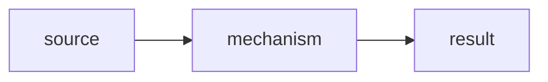

# <NN> · <Topic Name>

> **Level:** Foundation | Intermediate | Advanced | Senior
> **Prerequisites:** [link](../NN-slug/slug.md), …
> **Related:** [link](../NN-slug/slug.md), …
> **Go version:** <output of `go version` when written> · behaviour notes apply from Go <1.N> on
> **Targets stuck patterns:** <open patterns from `../00-diagnostic/diagnostic.md` this topic addresses, or "none yet">
> **Started:** YYYY-MM-DD · **Status:** 📖 In progress

---

## 1. TL;DR
3–6 bullets a senior Go engineer would say: what it is, how it behaves at runtime, the idiomatic way to use it, the trap to remember.

## 2. Why It Exists
- The problem Go's design solves here, and the trade-off the Go team chose (simplicity, explicitness, performance, compile speed).
- What **Python** and **Java** do instead, and why Go chose differently.

## 3. Mental Model
The one picture to keep in mind (a diagram or analogy).
**Where it breaks:** the cases where this picture gives the wrong answer.

## 4. Core Concepts & Terminology
| Term | Precise meaning (spec wording where possible) | Common confusion |
|---|---|---|

## 5. How It Works Inside
The real mechanism: data structures, memory layout, runtime behaviour, compiler decisions. State the Go version for internals that have changed.

```
ASCII memory layout, e.g. a slice header → backing array
```



### 5.x <Sub-mechanism>
- How it works, step by step.
- **Predict the output** ([`internal/examples/<concept>.go`](internal/examples/) · `make example N=<name>`):
  ```go
  // the example's code, 5–25 lines
  ```
  <details><summary>Output</summary>

  ```
  exact output, the same as the ExampleName test's // Output: block
  ```
  Why: …
  </details>

## 6. Worked Examples
One example **per concept**, living in `internal/examples/` and verified by an Example test (AGENTS.md §5). For each: the code, the exact output, a one-line takeaway and `make example N=<name>`. Use the "Predict the output" format for the important ones. `make examples` lists them all.

## 7. Gotchas
For each trap: **minimal reproduction** → observed output → why it happens → the fix.

| Gotcha | Symptom | Fix |
|---|---|---|

### 7.x <Gotcha name>
```go
// reproduction
```

## 8. Idiomatic vs Non-Idiomatic
| ❌ Non-idiomatic | ✅ Idiomatic | Why (source) |
|---|---|---|

Side-by-side code for the important cases, citing Effective Go / Go Code Review Comments / Go blog / the spec / official docs. Only real sources.

## 9. Coming from Python / Java
| Concept | Python (FastAPI) | Java (Spring Boot) | Go | What doesn't translate |
|---|---|---|---|---|

**Habits to unlearn here:** the AGENTS.md §1.1 habits that matter for this topic, each with a before/after.

## 10. Production Lens
- **Performance & allocations:** what it costs, with benchmark or `-gcflags=-m` evidence.
- **Testing:** how to test code that uses this.
- **Observability:** what to log, measure or profile.
- **API design:** how this shows up in package and function signatures.
- **Concurrency safety:** what is and isn't safe to share.
- **Senior review:** a realistic snippet with the review comments a senior Go engineer would leave.

## 11. Interview Lens
| Question | What a strong answer shows | Red flags |
|---|---|---|

## 12. Exercises
[`exercises/`](exercises/README.md) · run from this topic folder (`make` lists every command). Don't open `solutions/` until you've tried.

| # | Exercise | Trains | Command | Status | Score |
|---|---|---|---|---|---|
| E1 | [Predict: …](exercises/01-predict-…/) | | `make ex E=01-predict-…` | ⬜ | – |
| E2 | [Fix the bug: …](exercises/02-fix-…/) | | `make ex E=02-fix-…` | ⬜ | – |
| E3 | [Implement: …](exercises/03-implement-…/) | | `make ex E=03-implement-…` | ⬜ | – |
| E4 | [Refactor: …](exercises/04-refactor-…/) | | `make ex E=04-refactor-…` | ⬜ | – |
| E5 | [Mini-project: …](exercises/05-project-…/) | | `make ex E=05-project-…` | ⬜ | – |

Before asking the tutor to `check En`: `make check E=<folder>` (gofmt + vet + race tests).

Exercise status: ⬜ not started · 🛠️ attempted · ✅ passed + reviewed · 🔁 redo (solved after seeing the full solution)

## 13. Cheat Sheet
The 10 lines to reread.

## 14. References & Further Reading
Effective Go, Go Code Review Comments, the spec, Go blog posts, package docs, books. Only real sources.

---

## 🗣️ Q&A Discussion

<!-- Sessions, exercise reviews and stuck entries are appended below by the AI tutor, per AGENTS.md §9.4. Never delete past entries. -->
