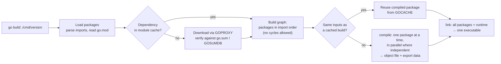

# 01 · Go Fundamentals & Toolchain

> **Level:** Foundation
> **Prerequisites:** none. This is the starting point.
> **Related:** 02 Variables & constants · 05 Functions, closures & defer (`defer`) · 16 Packages, modules & encapsulation (visibility, `internal/`, dependencies in depth) · 19 Testing · 22 Goroutines (why `main` doesn't wait) · 46 Shipping Go (containers, CI, releases)
> **Go version:** go1.27.1 (darwin/arm64) · everything here applies from Go 1.22 on, and version-specific behaviour is marked
> **Targets stuck patterns:** none recorded yet (no diagnostic). Likely targets: confusion about packages and `main`, and learning syntax without a build/test loop
> **Started:** 2026-10-25 · **Status:** 📖 In progress
>
> **Syllabus items covered:** 1 (Go philosophy, installation, the `go` command, project structure, `main`, packages, imports, comments) and 42 (gofmt, `go vet`, `go test`, `go build`, `go run`, `go install`, `go doc`), plus a first table-driven test (§6.10) so the exercises have a feedback loop from day one.
> **Run the code:** `cd topics/01-go-fundamentals-and-toolchain && make examples` · exercises in [`exercises/`](exercises/README.md)

---

## 1. TL;DR

- **Go was designed for large codebases and large teams:** fast builds, one formatting style, explicit code over clever code, dependencies you can see. Most "why does Go force me to…" questions (unused imports are errors, no formatter options, no cyclic imports) come from that goal.
- **A directory is a package, a `go.mod` makes a tree of packages a module, and `package main` + `func main()` makes a package a command.** Every file in a directory belongs to the same package. The import path finds a package, and the package clause names it.
- **The `go` command is the whole toolchain:** build, run, test, vet, format, document, install and fetch dependencies. There's no Maven/Gradle/pip/poetry layer, no build file to write and no plugins.
- **The output is one statically linked native binary** with the runtime (scheduler, garbage collector) inside it. Cross-compiling is two environment variables: `GOOS=linux GOARCH=amd64 go build`.
- **Startup order is defined by the spec:** imported packages initialize first, then this package's variables (in dependency order), then its `init()` functions, then `main()`. When `main` returns, the program ends, even if other goroutines are still running.
- **Habits to drop:** reaching for a build tool, a `utils` package, `init()` for configuration, and "I'll format it my way".

## 2. Why It Exists

### The problem Go was built for
Go was started at Google in 2007 by Robert Griesemer, Rob Pike and Ken Thompson, announced in 2009, and reached Go 1.0 in 2012. Its stated motivation (Rob Pike, *Go at Google: Language Design in the Service of Software Engineering*, 2012) was software engineering at scale, not language research:

- **Slow builds.** Large C++ builds took tens of minutes, partly because headers get re-read and re-parsed thousands of times. Go's answer: a package's compiled export data contains everything an importer needs. The compiler reads each dependency once, unused imports are compile errors so the dependency graph stays honest, and import cycles are forbidden so packages can be compiled in a clean order.
- **Every team writing a different dialect.** Go's answer: a small language (the spec is short enough to read in an evening), one canonical format (`gofmt`), and a culture of "clear is better than clever" (a Go proverb).
- **Hard-to-follow dependencies and magic.** Go's answer: imports are explicit full paths, there's no class hierarchy, no annotations driving behaviour, no implicit conversions, and visibility is visible in the name itself (capitalized = exported).
- **Concurrency that's too hard to get right with threads and callbacks.** Go's answer: goroutines and channels in the language (Phase 5).
- **Deploying interpreted code with its runtime, or a JVM.** Go's answer: a single native binary with the runtime linked in.

The **Go 1 compatibility promise** (go.dev/doc/go1compat) says programs written for Go 1.0 keep compiling and running with later Go 1.x releases. That's why decade-old Go code still builds, and why language changes arrive slowly and deliberately.

### What Python and Java do instead

| Concern | Python (FastAPI) | Java (Spring Boot) | Go |
|---|---|---|---|
| Execution | Interpreted bytecode on CPython | Bytecode on the JVM, JIT-compiled | Ahead-of-time compiled to native code |
| Deployment unit | Source + virtualenv/container with the interpreter | Fat JAR + a JVM | One static binary (runtime included) |
| Build tool | pip/poetry/uv + `pyproject.toml` | Maven/Gradle + `pom.xml`/`build.gradle` | The `go` command + `go.mod`. Nothing else |
| Formatting | black/ruff, configurable | google-java-format/IDE, configurable | `gofmt`, **not configurable** |
| Entry point | `if __name__ == "__main__":` / `uvicorn app:app` | `public static void main`, often hidden by Spring Boot | `package main` + `func main()` |
| Startup wiring | Framework discovers routes/dependencies | Spring scans the classpath, autowires beans, reads annotations | You write it in `main`, in plain code |
| Import cycles | Often work, until a partially-initialized module fails | Allowed between packages | **Compile error** |

The trade-off Go chose: more explicit code to write (wiring in `main`, `if err != nil`), in exchange for code that any Go developer can read without knowing a framework, and builds that stay fast as the codebase grows.

## 3. Mental Model

**The go command is a factory that turns a tree of directories into one binary.**

```
 module (go.mod: "module github.com/acme/shop")    ← the versioned unit you publish
 ├── cmd/api/        package main   ─┐             ← a command: becomes a binary
 ├── internal/order/ package order   ├─ packages   ← one directory = one package
 └── internal/store/ package store  ─┘             ← all .go files in a dir share it
                │
     go build ./cmd/api
                │  1. resolve imports (go.mod → module cache)
                │  2. compile each package once (cached)
                │  3. link everything + the Go runtime
                ▼
         ./api   (one native, static executable)
```

Three ideas to hold on to:
1. **Directory = package.** Not file = class (Java), not file = module (Python). Splitting code into files is only for readability: everything in the directory can see everything else.
2. **Import path = where it is; package name = what you call it.** `import "math/rand/v2"` is used as `rand.IntN`.
3. **The tool does it all, with conventions instead of configuration.** `_test.go` files are tests, `testdata/` is ignored, `internal/` restricts imports, `//go:build` lines pick files. No build file declares any of this.

**Where the picture breaks:**
- **cgo:** a program that uses C code (`import "C"`, or some standard-library features on some platforms) links against system C libraries, so the binary may not be fully static. Cross-compiling disables cgo by default.
- **`go run` still builds a binary.** It compiles into a temporary directory and runs that. It isn't an interpreter.
- **The package name doesn't have to match the directory name** (only convention says it should), and major versions add `/v2` to the path but not to the name.
- **A module is not a package.** One module usually contains many packages, and you can't import a module, only packages inside it.

## 4. Core Concepts & Terminology

| Term | Precise meaning | Common confusion |
|---|---|---|
| **Package** | The Go source files in one directory that share a `package <name>` clause. The unit of compilation, encapsulation and import | "One file = one class/module." In Go, all files in a directory are one package |
| **Package name** | The identifier in the package clause (`package rand`). What importing files use as a qualifier by default | It's not the directory name or the last import-path element, although by convention they usually match |
| **Import path** | The string in an `import` declaration (`"math/rand/v2"`, `"github.com/acme/shop/internal/order"`). Locates the package | Relative imports (`"./order"`) aren't allowed in module mode. Always use the full path |
| **Module** | A tree of packages released and versioned together, defined by a `go.mod` at its root. Its module path is the prefix of all its import paths | You import packages, never modules |
| **Command** / **main package** | A package named `main` with a `func main()`. `go build` produces an executable from it | A `func main` in any other package is just an ordinary unexported function that is never called |
| **Library package** | Any non-main package. Built for importing, and `go build` on it only checks that it compiles | — |
| **Exported identifier** | Starts with an upper-case letter (`order.Service`) and is visible to importers. Lower-case is package-private | There are no `public`/`private` keywords. *(Full treatment in 16.)* |
| **`internal/` directory** | Packages under `.../internal/...` can only be imported by code rooted at the parent of `internal` | It's not a naming convention: the go command enforces it. *(Full treatment in 16.)* |
| **`init()` function** | `func init()` with no arguments or results. Runs automatically after the package's variables are initialized, before `main`. A file may have several | It can't be called or referenced, and it's not a constructor |
| **Toolchain** | The `go` command + compiler + linker + standard library of one Go release (e.g. go1.27.1) | Since Go 1.21 the `go` command can download and switch toolchains automatically (`GOTOOLCHAIN`) |
| **GOROOT** | Where the toolchain and standard library are installed | You almost never set it yourself |
| **GOPATH** | Default `~/go`. Holds the module cache (`GOMODCACHE`, `~/go/pkg/mod`) and installed binaries (`~/go/bin`) | Since modules (on by default from Go 1.16), your code does **not** need to live in GOPATH |
| **GOCACHE** | The build cache: compiled packages and test results, keyed by a hash of their inputs | Why the second `go build`/`go test` is near-instant (`(cached)`) |
| **Doc comment** | A comment directly before a top-level declaration (or `package` clause), no blank line between. Shown by `go doc` and pkg.go.dev | A comment separated by a blank line isn't attached to anything |
| **Directive** | A `//go:xxx` comment the toolchain reads: `//go:build`, `//go:embed`, `//go:generate` | No space after `//`. `// go:embed` is just a comment (§7.8) |
| **Build constraint** | A `//go:build <expr>` line at the top of a file that decides whether the file is compiled for this OS/arch/tag set | The old `// +build` form was replaced in Go 1.17 |

## 5. How It Works Inside

### 5.0 Installing Go (and checking the install)
- **Install:** `brew install go` on macOS, or the official installer/archive from go.dev/dl (all platforms). Linux distro packages are often several releases behind.
- **Check:** `go version` should print the release, and `go env` shows every setting the `go` command uses. Real output on the machine these notes were written on (home directory shortened to `~`):

  ```
  $ go env GOVERSION GOROOT GOPATH GOBIN GOMODCACHE GOCACHE GOPROXY GOSUMDB GOOS GOARCH CGO_ENABLED GOTOOLCHAIN
  go1.27.1
  /opt/homebrew/Cellar/go/1.27.1/libexec
  ~/go
  ~/go/bin
  ~/go/pkg/mod
  ~/Library/Caches/go-build
  https://proxy.golang.org,direct
  sum.golang.org
  darwin
  arm64
  1
  auto
  ```
- **PATH:** add `$(go env GOPATH)/bin` (usually `~/go/bin`) to your `PATH`, so that tools installed with `go install` can be run by name.
- **Editor:** the VS Code Go extension installs `gopls`, the official language server. It runs `gofmt`/`goimports` on save and shows `go vet` findings as you type.
- **Persistent settings:** `go env -w GOFLAGS=-mod=mod` writes to the go env file (`go env GOENV`), not your shell profile. `go env -u NAME` undoes it.

### 5.1 One tool, many jobs: the `go` command

| Command | What it does | Python / Java equivalent |
|---|---|---|
| `go build [pkgs]` | Compiles packages. For a `main` package, writes an executable (named after the directory) into the current directory. For libraries, compiles and discards the result | `mvn package`, `python -m build` |
| `go run <pkg or files>` | Builds into a temp dir and runs the binary. `go run .` / `go run ./cmd/api` | `python app.py`, `mvn spring-boot:run` |
| `go test [pkgs]` | Builds a test binary per package from `_test.go` files, runs a subset of `go vet` first, then runs the tests; caches passing results | `pytest`, `mvn test` |
| `go vet [pkgs]` | Static analysis for likely bugs (Printf mismatches, unreachable code, copied locks, bad struct tags, …) | pylint/mypy-ish, SpotBugs/ErrorProne |
| `gofmt -l -w .` / `go fmt ./...` | Rewrites code into the one canonical format | black / google-java-format |
| `go doc <pkg>[.Symbol]` | Prints documentation from doc comments, on the command line | `pydoc`, javadoc |
| `go install <pkg>[@version]` | Builds a command and puts it in `GOBIN` (`~/go/bin`). With `@version`, installs any published tool without touching your module | `pipx install`, no Maven equivalent |
| `go get <module>@<version>` | Adds or changes a dependency in `go.mod`. `go get -tool` (Go 1.24+) records a dev tool. *(Full treatment in 16.)* | `pip install` + lockfile, adding a `<dependency>` |
| `go mod tidy` | Makes `go.mod`/`go.sum` match the imports actually used. *(Full treatment in 16.)* | `poetry lock`, `mvn dependency:analyze` |
| `go list` | Prints package metadata (a scriptable view of the build graph) | `mvn dependency:tree` |
| `go env` | Prints/sets toolchain settings | — |
| `go version -m <binary>` | Shows the build info recorded inside a binary | — |

`go help <command>` documents each one. `go help test`, for example, lists the vet checks `go test` runs automatically: *atomic, bools, buildtag, directive, errorsas, ifaceassert, nilfunc, printf, stdversion, stringintconv, and tests* (from `go help test`, go1.27.1).

### 5.2 What `go build` actually does



Step by step, for the 15-line `cmd/version` program in this topic:
1. **Load.** The go command reads `go.mod`, parses the import clauses of every file and follows them. `go list -deps ./cmd/version` lists **58 packages**, because `fmt` pulls in `os`, `io`, `reflect`, `sync`, `unicode/utf8`, … and the runtime itself.
2. **Compile.** Each package is compiled once into an archive with *export data*: the type information an importer needs. Importers read that summary instead of re-parsing the dependency's source. That's a big part of why Go compiles fast. With the cache bypassed, `go build -a -x ./cmd/version` printed **57 `compile` steps** on this machine.
3. **Cache.** Results are stored in `GOCACHE`, keyed by a hash of the inputs (source, flags, Go version, dependencies). Tests are cached the same way. Real output, running the same tests twice:
   ```
   $ go test ./internal/...
   ok   .../internal/examples     0.137s
   ?    .../internal/greet        [no test files]
   ok   .../internal/temperature  0.136s
   $ go test ./internal/...
   ok   .../internal/examples     (cached)
   ?    .../internal/greet        [no test files]
   ok   .../internal/temperature  (cached)
   ```
   Change one file and only that package and its importers are rebuilt and retested. To force a rerun, use `go test -count=1`.
4. **Link.** The linker combines every package plus the runtime (scheduler, garbage collector, stack management) into one executable, and records build info in it (§5.6).

### 5.3 Program startup and initialization order

Initialization is fully specified ("Program initialization and execution" in the spec). The order is:

```
 runtime starts (allocator, GC, scheduler, main goroutine)
   │
   ▼
 for each package, dependencies first (each package exactly once, however many importers):
   │   1. package-level variables, in dependency order:
   │        repeatedly pick the EARLIEST variable in declaration order
   │        whose initializer doesn't depend on an uninitialized variable
   │        ("declaration order" across files = file order given to the compiler,
   │         and the go command sorts files by name)
   │   2. every init() function, in the order they appear (files in that same order)
   ▼
 main.main() runs
   │
   ▼
 main returns → the program exits immediately
   (other goroutines are NOT waited for, deferred calls in them don't run)
```

Since **Go 1.21** the order *between* packages is fully specified too: the packages, sorted by import path, are initialized by repeatedly picking the first one whose imports are all initialized. Before 1.21 the order between unrelated packages was left to the implementation.

**Worked example** ([`cmd/init-order/main.go`](cmd/init-order/main.go), which imports [`internal/greet`](internal/greet/greet.go)):

```go
var (
	a = trace("a", b+1) // depends on b, so b is initialized first
	b = trace("b", 1)
	c = trace("c", 3)
)

func init() { fmt.Println("main: init #1") }

func init() { fmt.Println("main: init #2") }

func main() {
	fmt.Println("main: main() starts, greet.Message =", greet.Message)
}
```

Predict the output first. `greet` has a variable `Message = build()` (prints `greet: var Message`) and an `init` that prints `greet: init`.

<details><summary>Output (<code>go run ./cmd/init-order</code>)</summary>

```
greet: var Message
greet: init
main: var b = 1
main: var a = 2
main: var c = 3
main: init #1
main: init #2
main: main() starts, greet.Message = hello
```
Why: the imported package `greet` is completely initialized (variables, then `init`) before anything in `main`. Inside `main`, `a` comes first in declaration order but isn't ready (it needs `b`), so `b` is initialized first, then `a`, then `c`. Then both `init` functions run, in source order, and finally `main`.
</details>

**Consequences that matter in real code:**
- `init()` runs at **import time**, in every program and test binary that imports the package, so a slow or failing `init` (reading files, connecting to a database) taxes and breaks everything downstream. That's why the idiom is to keep `init` trivial (§8).
- A variable whose initializer uses values that `init` sets later sees their **zero values** (§7.6, exercise E2).
- Because `main` returning ends the process, a server's `main` must block (e.g. on `http.ListenAndServe` or a shutdown signal) and wait for background work to finish. *(Goroutines in depth: 22. Graceful shutdown: 38.)*

### 5.4 Packages, import paths and package names

**How an import is resolved** (module mode):

```
import "github.com/google/uuid"
        │
        ├─ standard library? (no dot in the first element, e.g. "fmt", "net/http") → GOROOT/src
        ├─ inside the main module? (path starts with the module path in go.mod)    → that directory
        └─ otherwise: the module in go.mod's require list with the LONGEST matching path prefix
                      → its directory in the module cache (~/go/pkg/mod/github.com/google/uuid@v1.6.0)
```

**The name used in code comes from the package clause, not the path.** By convention the last path element *is* the name, with one standard exception: major-version suffixes. `math/rand/v2` is `package rand`, and `github.com/jackc/pgx/v5` is `package pgx`. You can rename an import with an alias, but idiomatic code does that only to resolve a name clash (two packages called `rand`, for instance).

**Rules the compiler and go command enforce:**
- All non-test files in a directory must declare the same package name (tests may also use `<name>_test`, the "external test package").
- An unused import is a compile error.
- Import cycles are compile errors (§7.5). Two packages that need each other usually mean the shared part belongs in a third package.
- Packages under an `internal/` directory can only be imported from inside the tree rooted at `internal`'s parent (§7.12). *(Full treatment in 16.)*
- Directories named `testdata`, and directories or files starting with `.` or `_`, are ignored by the go command (exercise E5 implements this rule).

**Visibility is per package, not per file:** every identifier, exported or not, is visible in all files of the package. Exported (capitalized) identifiers are also visible to importers. *(Full treatment in 16.)*

### 5.5 `go.mod` and `go.sum`, just enough for now
*(Dependencies, versions, `go get` and `go mod tidy` in depth: 16.)*

```
module github.com/Shreyash019/Golang/topics/01-go-fundamentals-and-toolchain   ← module path: prefix of every import path in this module

go 1.27.1                       ← minimum Go version (a hard requirement since Go 1.21)

toolchain go1.27.1              ← optional: preferred toolchain when switching (Go 1.21+)

require github.com/google/uuid v1.6.0             ← direct dependency
require golang.org/x/sync v0.8.0 // indirect       ← needed only by a dependency
```

- **`go.sum`** records cryptographic hashes of every module version used. The go command checks downloads against it, and against the public checksum database `sum.golang.org` (`GOSUMDB`) for new ones, so a changed or tampered dependency fails the build. Commit both files.
- **The `go` line is a minimum.** If it asks for a newer Go than you have, the go command (with the default `GOTOOLCHAIN=auto`) downloads that toolchain and re-runs itself with it. With `GOTOOLCHAIN=local`, it refuses. Real output with `go 1.99` in a scratch `go.mod`:
  ```
  $ GOTOOLCHAIN=local go build .
  go: go.mod requires go >= 1.99 (running go 1.27.1; GOTOOLCHAIN=local)
  ```
- **Workspaces (`go.work`, Go 1.18+)** let you develop several modules together locally. This repo doesn't use one: each topic is its own module and builds alone.

Exercise **E3** has you parse exactly this format.

### 5.6 The output: one static binary
- **Size.** `go build -o version-demo ./cmd/version` produced a **2.3 MB** binary for a 15-line program. Most of that is the runtime and `fmt`'s dependencies. With `-trimpath -ldflags "-s -w"` (strip the symbol table and DWARF debug info, and remove local file paths) it was **1.5 MB**.
- **Build info is embedded.** Real `go version -m` output for that binary:
  ```
  version-demo: go1.27.1
  	path	github.com/Shreyash019/Golang/topics/01-go-fundamentals-and-toolchain/cmd/version
  	mod	github.com/Shreyash019/Golang/topics/01-go-fundamentals-and-toolchain	(devel)
  	build	-buildmode=exe
  	build	-compiler=gc
  	build	CGO_ENABLED=1
  	...
  	build	GOARCH=arm64
  	build	GOOS=darwin
  	build	vcs=git
  	build	vcs.revision=622c13e9808ac89977f2c4674b9e388fe476afe7
  	build	vcs.time=2026-10-25T16:00:18Z
  	build	vcs.modified=true
  ```
  The `vcs.*` lines (Go 1.18+) record the git commit, and `vcs.modified=true` means there were uncommitted changes. When a production incident asks "which code is this?", `go version -m` answers from the binary itself. A program can read the same data with `runtime/debug.ReadBuildInfo` (§6.7).
- **Cross-compiling** needs no extra toolchain. Real output:
  ```
  $ GOOS=linux GOARCH=amd64 CGO_ENABLED=0 go build -o version-linux ./cmd/version
  $ file version-linux
  version-linux: ELF 64-bit LSB executable, x86-64, version 1 (SYSV), statically linked, Go BuildID=…, with debug_info, not stripped
  $ GOOS=windows GOARCH=amd64 go build -o version.exe ./cmd/version
  $ file version.exe
  version.exe: PE32+ executable (console) x86-64, for MS Windows
  ```
  `go tool dist list` prints every supported `GOOS/GOARCH` pair. With `CGO_ENABLED=0` the Linux binary is fully static, so it can run in a `scratch` or distroless container image.
- **Stamping values at link time:** `-ldflags "-X main.version=1.4.2"` sets a package-level **string variable** (not a constant) when linking (§6.2).

## 6. Worked Examples

Every example below is real code in this module. `make examples` lists the registered ones, `make example N=<name>` runs one, and the Example tests in [`internal/examples/examples_output_test.go`](internal/examples/examples_output_test.go) fail if the output shown here ever stops being true.

### 6.1 The smallest real program: `main` + `run`
[`cmd/version/main.go`](cmd/version/main.go)

```go
package main

import (
	"fmt"
	"io"
	"os"
)

var version = "dev"

func main() { run(os.Stdout) }

func run(w io.Writer) { fmt.Fprintln(w, "version", version) }
```
```
$ go run ./cmd/version
version dev
```
**Takeaway:** keep `main` to a line or two that hands the real work to a function taking its inputs (`args`, `io.Writer`s, later a `context.Context`) and returning an `error` or an exit code. `main` itself can't be tested; `run` can, as [`cmd/version/main_test.go`](cmd/version/main_test.go) shows with an Example test. This is the pattern for every command in this repo (exercises E4 and E5).

### 6.2 Stamping a version at build time
Same program, different linker flag:
```
$ go run -ldflags "-X main.version=1.4.2" ./cmd/version
version 1.4.2
```
**Takeaway:** `-X importpath.name=value` overwrites a package-level `string` variable at link time. CI pipelines use it to bake the git tag into the binary. It **fails silently**: with a misspelled name, or with `version` declared as a `const`, the build succeeds and the old value is printed (both checked with real runs). Verify the stamp in CI by running `./app -version`. `debug.ReadBuildInfo` (§6.7) gives the commit without any flags.

### 6.3 Import path vs package name
[`internal/examples/importpath.go`](internal/examples/importpath.go) · `make example N=import-path-vs-package-name`

```go
import (
	"math/rand/v2"  // import path ends in "v2", but the package clause says "package rand"
	pathpkg "path"  // an alias: the file now refers to package path as pathpkg
)

func ImportPathVsPackageName(w io.Writer) {
	r := rand.New(rand.NewPCG(1, 2)) // seeded: reproducible "random" numbers
	fmt.Fprintln(w, "rand.IntN:", r.IntN(100), r.IntN(100), r.IntN(100))
	fmt.Fprintln(w, "pathpkg.Join:", pathpkg.Join("cmd", "api", "main.go"))
}
```
**Predict the output:** what's the qualifier for `math/rand/v2`? Will the alias still work as `path.Join`?
<details><summary>Output</summary>

```
rand.IntN: 76 61 78
pathpkg.Join: cmd/api/main.go
```
Why: the code uses `rand.`, the package clause name, even though the path ends in `v2`. After aliasing, the file can only refer to the package as `pathpkg`: `path.Join` would be "undefined: path". The three numbers are fixed because the PCG source has a fixed seed. `math/rand/v2` itself arrived in Go 1.22.
</details>

### 6.4 A blank import that does real work
[`internal/examples/blankimport.go`](internal/examples/blankimport.go) · `make example N=blank-import-registers`

```go
import (
	"image"
	_ "image/png" // imported only for its init(), which registers the PNG decoder
)

//go:embed assets/pixel.png
var pixelPNG []byte

func BlankImportRegisters(w io.Writer) {
	cfg, format, err := image.DecodeConfig(bytes.NewReader(pixelPNG))
	if err != nil {
		fmt.Fprintln(w, "error:", err)
		return
	}
	fmt.Fprintf(w, "format=%s width=%d height=%d (%d bytes embedded)\n", format, cfg.Width, cfg.Height, len(pixelPNG))
}
```
**Predict the output:** the code never mentions `png` except in the import. Does decoding work?
<details><summary>Output</summary>

```
format=png width=3 height=2 (78 bytes embedded)
```
Why: `image/png` has an `init()` that calls `image.RegisterFormat("png", …)`. The blank import `_` runs that `init` without giving the file a name to use. A real run of the same code **without** the blank import:
```
format:  err: image: unknown format
```
This is how `database/sql` drivers register themselves too (`import _ "github.com/jackc/pgx/v5/stdlib"`). Go Code Review Comments ("Import Blank") says such imports belong in the `main` package or in tests, so the program's entry point decides what gets registered.
</details>

### 6.5 Build constraints: different files for different builds
[`cmd/buildtags/`](cmd/buildtags/): [`debug_on.go`](cmd/buildtags/debug_on.go) starts with `//go:build debug` and [`debug_off.go`](cmd/buildtags/debug_off.go) with `//go:build !debug`. Each defines `const debug` and `func mode()`.

```
$ go run ./cmd/buildtags
debug=false mode=production
$ go run -tags debug ./cmd/buildtags
debug=true mode=verbose logging, pprof enabled
```
**Takeaway:** the toolchain picks files, not `if` statements. The same mechanism selects OS-specific code by file name alone: `file_linux.go`, `file_windows_amd64.go`, and `_test.go`. The `//go:build` line must come before the `package` clause, followed by a blank line. The `buildtag` vet check catches a misplaced one.

### 6.6 Embedding files with a directive
[`internal/examples/blankimport.go`](internal/examples/blankimport.go) · `make example N=embed-directive`

```go
import _ "embed" // needed for //go:embed into a string or []byte

//go:embed assets/greeting.txt
var greeting string
```
```
$ make example N=embed-directive
"Hello from an embedded file."
```
**Takeaway:** `//go:embed` (Go 1.16+) bakes files into the binary at build time: templates, SQL migrations, static web assets, test fixtures. Use `embed.FS` for whole directories. Paths are relative to the source file's directory and can't use `..`. The directive must be written exactly `//go:embed` with no space (§7.8).

### 6.7 What the binary knows about itself
[`internal/examples/buildinfo.go`](internal/examples/buildinfo.go) · `make example N=build-info`

```go
fmt.Fprintln(w, "go version:", runtime.Version())
fmt.Fprintln(w, "platform:  ", runtime.GOOS+"/"+runtime.GOARCH)
info, ok := debug.ReadBuildInfo()
// ... print info.Main.Path, info.Main.Version and a few info.Settings
```
One real run (machine-dependent, so this example has no `// Output:` check):
```
go version: go1.27.1
platform:   darwin/arm64
main module: github.com/Shreyash019/Golang/topics/01-go-fundamentals-and-toolchain (devel)
  CGO_ENABLED=1
  GOARCH=arm64
  GOOS=darwin
```
**Takeaway:** `go run` doesn't stamp version-control info, but `go build` does (§5.6). A `/version` endpoint or a startup log line built from `debug.ReadBuildInfo` makes every deployed binary identify itself. `(devel)` is the version reported for the main module when it isn't built from a published module version (e.g. installed with `go install module@v1.2.3`).

### 6.8 Doc comments and `go doc`
[`internal/temperature/temperature.go`](internal/temperature/temperature.go) is written as a model package doc:

```go
// Package temperature converts between temperature scales.
//
// # Scales
//
// Two scales are supported:
//   - [Celsius], the SI scale used in most of the world
//   - [Fahrenheit], used mainly in the United States
//
// Convert a value with its method, for example:
//
//	f := temperature.Celsius(100).Fahrenheit() // 212
package temperature

// CToF converts c to degrees Fahrenheit.
//
// Deprecated: Use [Celsius.Fahrenheit] instead.
func CToF(c float64) float64 { ... }
```
Real `go doc` output (trimmed to the parts above):
```
$ go doc ./internal/temperature
package temperature // import "github.com/Shreyash019/Golang/topics/01-go-fundamentals-and-toolchain/internal/temperature"

Package temperature converts between temperature scales.
...
# Scales

Two scales are supported:
  - Celsius, the SI scale used in most of the world
  - Fahrenheit, used mainly in the United States

Convert a value with its method, for example:

    f := temperature.Celsius(100).Fahrenheit() // 212
...
func CToF(c float64) float64
type Celsius float64
    const AbsoluteZero Celsius = -273.15
type Fahrenheit float64

$ go doc ./internal/temperature CToF
func CToF(c float64) float64
    CToF converts c to degrees Fahrenheit.

    Deprecated: Use Celsius.Fahrenheit instead.
```
**Comment syntax first:** Go has `//` line comments and `/* */` block comments. Line comments are the norm, including for doc comments. Block comments mostly appear in long package docs or to disable code temporarily (Effective Go, "Commentary").

**Takeaway:** doc comment syntax (Go 1.19+, go.dev/doc/comment) is deliberately tiny: paragraphs, `# Headings`, lists, tab-indented code blocks, and `[Name]` doc links. A `Deprecated:` paragraph is recognized by gopls and linters, which flag callers. An `Example…` function in a `_test.go` file ([`example_test.go`](internal/temperature/example_test.go)) is runnable documentation: `go test` checks its `// Output:`, and pkg.go.dev shows it next to the function. `go doc fmt.Println` works the same way for the standard library.

### 6.9 `gofmt` and `go vet` on real mistakes
`gofmt -d` shows the diff it would apply (real output):
```
$ gofmt -d fmtme/main.go
-func main(){
-x:=[]int{1,2,3}
-for i:=0;i<len(x);i++{ fmt.Println( x[i] ) }
+func main() {
+	x := []int{1, 2, 3}
+	for i := 0; i < len(x); i++ {
+		fmt.Println(x[i])
+	}
 }
```
`go vet` catches bugs that compile fine. This file **builds without errors**:
```go
name := "Gopher"
age := 4
fmt.Printf("%s is %d years old\n", age, name)
fmt.Println("done %d", age)
```
```
$ go vet ./vetme
vetme/main.go:8:14: fmt.Printf format %s has arg age of wrong type int
vetme/main.go:9:2: fmt.Println call has possible Printf formatting directive %d
```
**Takeaway:** formatting isn't up for discussion (gofmt), and `go vet` is a free reviewer. Run both before every commit. `make check` and `make verify` in this repo do.

### 6.10 Your first test: table-driven, with subtests
*(Added 2026-11-03: every exercise in this guide is a test from topic 01 on, so the basics of writing and reading one come first. Testing in depth: 19.)*

A test is a function `TestXxx(t *testing.T)` in a `_test.go` file next to the code. Go has no assertion library: you compare `got` with `want` and call `t.Errorf` (marks the test failed, keeps going) or `t.Fatalf` (marks it failed and stops this test). [`internal/temperature/temperature_test.go`](internal/temperature/temperature_test.go):

```go
func TestCelsiusFahrenheit(t *testing.T) {
	tests := []struct {
		name string
		in   Celsius
		want Fahrenheit
	}{
		{name: "freezing", in: 0, want: 32},
		{name: "boiling", in: 100, want: 212},
		{name: "same on both scales", in: -40, want: -40},
	}
	for _, tt := range tests {
		t.Run(tt.name, func(t *testing.T) {
			got := tt.in.Fahrenheit()
			if got != tt.want {
				t.Errorf("Celsius(%v).Fahrenheit() = %v, want %v", tt.in, got, tt.want)
			}
		})
	}
}
```
Passing, real output (`-v` lists each subtest; spaces in subtest names become `_`):
```
$ go test -v -run TestCelsiusFahrenheit ./internal/temperature
=== RUN   TestCelsiusFahrenheit
=== RUN   TestCelsiusFahrenheit/freezing
=== RUN   TestCelsiusFahrenheit/boiling
=== RUN   TestCelsiusFahrenheit/same_on_both_scales
--- PASS: TestCelsiusFahrenheit (0.00s)
    --- PASS: TestCelsiusFahrenheit/freezing (0.00s)
    --- PASS: TestCelsiusFahrenheit/boiling (0.00s)
    --- PASS: TestCelsiusFahrenheit/same_on_both_scales (0.00s)
PASS
```
**Predict:** if `Fahrenheit` had a bug, `c*9/5 - 32` instead of `+ 32`, what would `go test` print?
<details><summary>Output</summary>

Real output from a copy of the package with that bug:
```
$ go test -run TestCelsiusFahrenheit ./internal/temperature
--- FAIL: TestCelsiusFahrenheit (0.00s)
    --- FAIL: TestCelsiusFahrenheit/freezing (0.00s)
        temperature_test.go:21: Celsius(0).Fahrenheit() = -32, want 32
    --- FAIL: TestCelsiusFahrenheit/boiling (0.00s)
        temperature_test.go:21: Celsius(100).Fahrenheit() = 148, want 212
    --- FAIL: TestCelsiusFahrenheit/same_on_both_scales (0.00s)
        temperature_test.go:21: Celsius(-40).Fahrenheit() = -104, want -40
FAIL
```
</details>

**How to read a failure**, in this order: (1) *which* test and subtest (`TestCelsiusFahrenheit/boiling`); (2) *where* the check is (`temperature_test.go:21`); (3) the message, which by convention reads `Func(input) = got, want want` (Go Code Review Comments, "Useful Test Failures"). All three cases failed, so the bug is in the shared formula, not an edge case. Rerun one subtest alone with `-run 'TestCelsiusFahrenheit/boiling'` while you fix it.

**Takeaway:** the table is the specification and the loop is the test. `t.Run` gives each case a name you can run on its own, and `t.Errorf` lets every case report in a single run. This is the loop for every exercise in this guide: read the failing message, change the code, rerun.

## 7. Gotchas

Every reproduction below was run with go1.27.1 in a scratch module (`example.com/gotchas`), and the output is copied from the terminal.

| # | Gotcha | Symptom | Fix |
|---|---|---|---|
| 7.1 | `func main` in a non-main package | `go run`: "is not a main package"; `go build` succeeds silently | `package main` for commands; libraries have no `main` |
| 7.2 | `go run main.go` in a multi-file package | `undefined: helper` | `go run .` |
| 7.3 | Unused import or variable | Compile error | Delete it (gopls/goimports do it on save); `_ = x` only temporarily |
| 7.4 | A variable shadows a package name | `strings.Join undefined (type []string …)` | Rename the variable (`words`) |
| 7.5 | Import cycle | `import cycle not allowed` | Move the shared part into a third package, or invert with an interface |
| 7.6 | Package variable computed from values `init()` sets | Zero values in the result | Use initializers, not `init`, or compute lazily |
| 7.7 | `os.Exit` / `log.Fatal` skip deferred calls | Cleanup never runs | Return errors to `main`, exit in one place |
| 7.8 | `// go:embed` (with a space) | Silently empty variable; vet is quiet | `//go:embed`, no space |
| 7.9 | `go.mod` needs a newer Go | Toolchain download, or an error with `GOTOOLCHAIN=local` | Upgrade Go, or lower the `go` line deliberately |
| 7.10 | `main` returns while goroutines run | Their output and work disappear | Wait for them explicitly (22, 24) |
| 7.11 | `go build ./x` for a command | Binary written into the current directory (or an error if a directory has that name) | `go build -o bin/x ./cmd/x` |
| 7.12 | Importing someone else's `internal/` | `use of internal package … not allowed` | It's private by design: use the public API or move the code |

### 7.1 `func main` in a package that isn't `main`
```go
// ifelse/ifelse.go
package ifelse

func main() { fmt.Println("If Else") }
```
```
$ go run ./ifelse
package example.com/gotchas/ifelse is not a main package
$ go build ./ifelse && go vet ./ifelse && echo OK
OK
```
**Why:** only `package main` produces a program. In any other package, `main` is an ordinary unexported function that nothing calls, which is legal and even passes vet. So the mistake goes unnoticed until someone tries to run it. **Fix:** commands live in `package main` (by convention under `cmd/<name>/`). Libraries expose functions for commands to call.

### 7.2 `go run main.go` ignores the package's other files
```
two/main.go:      func main() { fmt.Println(greeting()) }
two/greeting.go:  func greeting() string { return "hello from another file" }

$ go run main.go
# command-line-arguments
./main.go:5:27: undefined: greeting
$ go run .
hello from another file
```
**Why:** given file names, the go command builds a synthetic package (`command-line-arguments`) from **only those files**. **Fix:** run packages, not files: `go run .` or `go run ./cmd/api`.

### 7.3 Unused imports and variables don't compile
```
$ go build -o /dev/null ./unused
# example.com/gotchas/unused
unused/main.go:5:2: "os" imported and not used
unused/main.go:9:2: declared and not used: count
```
**Why:** the Go FAQ ("Can I stop these complaints about my unused variable/import?") says an unused import slows the build and adds a dependency for nothing, and an unused variable often means a bug. Both are errors so they don't pile up. **Fix:** let gopls/goimports manage imports on save. While debugging, `_ = count` or a blank import keeps the build going, but don't commit those. Note that unused *package-level* variables, functions and parameters are allowed. Linters such as `unused` flag those.

### 7.4 Shadowing a package name
```go
import "strings"

func main() {
	strings := []string{"go", "is", "fun"}
	fmt.Println(strings.Join(strings, " "))
}
```
```
shadow/main.go:5:2: "strings" imported and not used
shadow/main.go:10:22: strings.Join undefined (type []string has no field or method Join)
```
**Why:** inside `main`, the local variable `strings` hides the package `strings` (block scoping, topic 02). The classic victims are `url`, `path`, `errors`, `len`, `string`. **Fix:** name variables for their meaning (`words`, `u`, `p`).

### 7.5 Import cycles
```
a/a.go:  import "example.com/gotchas/b"
b/b.go:  import "example.com/gotchas/a"

$ go build ./a
package example.com/gotchas/a
	imports example.com/gotchas/b from a.go
	imports example.com/gotchas/a from b.go: import cycle not allowed
```
**Why:** the dependency graph must be acyclic so packages can be compiled and initialized in order (§5.2, §5.3). Java allows cycles between packages and Python sometimes tolerates them, so code ported from either often hits this. **Fix:** move what both need into a lower-level package, or have the lower package define a small interface that the higher one implements. *(Interfaces: 12. Package design: 16, 17.)*

### 7.6 Package variables are initialized before `init()` runs
*(Exercise E2 is this bug.)*
```go
var defaultName string

var greeting = "Hello, " + defaultName + "!"

func init() {
	defaultName = "Gopher"
}

func main() {
	fmt.Println(greeting)
	fmt.Println("defaultName is now", defaultName)
}
```
```
Hello, !
defaultName is now Gopher
```
**Why:** §5.3: all package-level variables are initialized first, then `init` runs. `greeting` was computed while `defaultName` was still `""`. **Fix:** give `defaultName` an initializer (`var defaultName = "Gopher"`), so dependency ordering applies. Even better, avoid package state and compute values where they're used.

### 7.7 `os.Exit` and `log.Fatal` skip deferred calls
```go
func main() {
	defer fmt.Println("cleanup: flush logs, close DB")
	if err := run(); err != nil {
		fmt.Fprintln(os.Stderr, "error:", err)
		os.Exit(1)
	}
}
```
```
error: config file not found
exit status 1
```
The cleanup line never prints. **Why:** `os.Exit` ends the process immediately, and `log.Fatal` calls `os.Exit(1)`. Deferred calls only run when a function returns or panics. *(`defer` in depth: 05.)* **Fix:** do the cleanup inside `run` (its defers run when `run` returns), and call `os.Exit` in exactly one place: the last line of `main`.

### 7.8 `// go:embed` with a space is just a comment
```go
import _ "embed"

// go:embed hello.txt
var hello string

func main() { fmt.Printf("%q\n", hello) }
```
```
$ go run ./embedspace
""
$ go vet ./embedspace && echo "vet: no complaints"
vet: no complaints
```
**Why:** directives are recognized only in the exact form `//go:` with no space. With a space, it's an ordinary comment, so `hello` is just an empty string. **Fix:** `//go:embed hello.txt`. A test that checks the embedded content is non-empty catches this.

### 7.9 The `go` line asks for a newer Go
Shown in §5.5: with `GOTOOLCHAIN=local` the build stops with `go.mod requires go >= 1.99 (running go 1.27.1; GOTOOLCHAIN=local)`. With the default `auto`, the go command downloads the newer toolchain, which surprises people in locked-down CI. **Fix:** treat the `go` line as a real minimum requirement. Raise it deliberately (it's a breaking change for the people who use your module), and pin `GOTOOLCHAIN` in CI if downloads aren't allowed.

### 7.10 `main` returning doesn't wait for goroutines
```go
func main() {
	go fmt.Println("hello from a goroutine")
	fmt.Println("main returns")
}
```
Three real runs, all identical:
```
main returns
main returns
main returns
```
**Why:** §5.3: when `main` returns, the process exits. The goroutine *may* print on some runs, but nothing guarantees it, which makes this worse than never printing. **Fix:** wait explicitly (`sync.WaitGroup`, channels, `errgroup`). *(Full treatment in 22, 24, 27.)*

### 7.11 Where `go build` puts the binary
`go build ./cmd/api` writes `./api` into the **current directory**. In the scratch module, `go build ./unused` failed with `go: build output "unused" already exists and is a directory`, because the binary's name clashed with the package's own directory. **Fix:** be explicit (`go build -o bin/api ./cmd/api`), use `go run` while developing, and keep `bin/` in `.gitignore`. Library packages produce no output file.

### 7.12 `internal/` is enforced
```
$ go build ./shipping
package example.com/gotchas/shipping
	shipping/ship.go:3:8: use of internal package example.com/gotchas/billing/internal/tax not allowed
```
**Why:** `billing/internal/tax` can only be imported by code under `billing/`. That lets a team change it without breaking anyone else. **Fix:** respect it: use `billing`'s public API, or move `tax` up a level if it really is shared. *(Full treatment in 16.)*

## 8. Idiomatic vs Non-Idiomatic

| ❌ Non-idiomatic | ✅ Idiomatic | Why (source) |
|---|---|---|
| Logic, flag parsing and `log.Fatal` spread through `main` | `main` calls `run(args, stdout, stderr) error` and exits in one place | Testable, and deferred cleanup runs (§6.1, §7.7). A community convention rather than an official rule, popularized for example by Mat Ryer, *How I write HTTP services in Go after 13 years* (Grafana Labs blog, 2024) |
| `init()` that reads env vars, opens files or connects to a DB | Explicit setup called from `main`; `init` only for trivial registration | Effective Go ("The init function"): init is for what declarations can't express. A failing `init` breaks every importer and test |
| Package `utils`, `common`, `helpers`, `base`, `models` | Name a package after what it provides: `order`, `config`, `httpapi` | Go Code Review Comments ("Package Names"); Go blog *Package names* (2015) |
| `order.OrderService`, `config.ConfigLoader` (stutter) | `order.Service`, `config.Load` | The package name already qualifies the identifier (Effective Go, "Package names") |
| `import . "fmt"` | `import "fmt"` | Dot imports hide where names come from. Go Code Review Comments ("Import Dot") allows them only in rare tests |
| Aliases everywhere (`str "strings"`) | Aliases only to resolve clashes (`crand "crypto/rand"`) | Go Code Review Comments ("Imports") |
| Blank driver import in a library | Blank imports in `main` or tests | Go Code Review Comments ("Import Blank") |
| `// this function gets the user` / no comment on exported names | `// User returns the user with the given ID. It returns ErrNotFound if…` | Go Code Review Comments ("Doc Comments", "Comment Sentences"); go.dev/doc/comment |
| Arguing about brace placement and tabs | `gofmt` on save | "Gofmt's style is no one's favorite, yet gofmt is everyone's favorite." (Go Proverbs); Go blog *go fmt your code* (2013) |
| `src/`, `pkg/` everywhere, one directory per class | `go.mod` at the root, `cmd/<app>/` for commands, `internal/` for private packages, flat until it hurts | go.dev/doc/modules/layout (*Organizing a Go module*) |

### 8.1 `main` that can't be tested vs `main` + `run`

```go
// ❌ Everything in main: untestable, and log.Fatal skips deferred cleanup.
func main() {
	port := os.Getenv("PORT")
	if port == "" {
		log.Fatal("PORT not set")
	}
	db, err := sql.Open("pgx", os.Getenv("DSN"))
	if err != nil {
		log.Fatal(err)
	}
	defer db.Close() // never runs if a later log.Fatal fires
	// ... 80 more lines
}
```

```go
// ✅ main only translates run's result into an exit code.
func main() {
	if err := run(os.Args[1:], os.Getenv, os.Stdout); err != nil {
		fmt.Fprintln(os.Stderr, "error:", err)
		os.Exit(1)
	}
}

// run receives its dependencies (args, environment lookup, output) explicitly,
// so tests can call it with fakes, and its defers always run.
func run(args []string, getenv func(string) string, stdout io.Writer) error {
	// ...
	return nil
}
```
Exercise **E4** is this refactor, and exercise **E5**'s `cmd/pkgscan` is a complete example.

### 8.2 Package and file layout

```
❌ Java/Python habits                      ✅ Go module layout (go.dev/doc/modules/layout)
shop/                                      shop/
├── src/main/go/com/acme/shop/             ├── go.mod
│   ├── controllers/OrderController.go     ├── cmd/
│   ├── services/OrderServiceImpl.go       │   └── shop-api/main.go       ← wiring only
│   ├── interfaces/IOrderService.go        └── internal/
│   └── utils/StringUtils.go                   ├── order/                 ← domain + service, many files OK
└── build.gradle-like Makefile magic           │   ├── order.go
                                               │   ├── service.go
                                               │   └── service_test.go
                                               └── httpapi/               ← handlers for all resources
```
- **Start flat.** A small program can be a single `main` package in the module root. Add `cmd/` once there's more than one binary, and `internal/` once there's code you don't want others to import.
- **Many files per package is normal.** Split files by topic (`order.go`, `service.go`, `store.go`), not one type per file.
- **No `pkg/` unless you mean it.** The official layout guide doesn't use it. Put public, importable packages at the module root (or under it by name).

### 8.3 Doc comments that work with `go doc`

```go
// ❌
// this is the Config struct
type Config struct{...}

// gets the port
func (c Config) GetPort() int

// ✅
// Config holds the server settings loaded at startup.
// The zero value is not valid; use Load.
type Config struct{...}

// Port returns the TCP port the server listens on.
func (c Config) Port() int
```
Start with the identifier's name, write full sentences, say what the caller needs to know (errors returned, zero-value behaviour, concurrency safety), and skip what the signature already says. Getters are named after the field, without `Get` (Effective Go, "Getters").

## 9. Coming from Python / Java

| Concept | Python (FastAPI) | Java (Spring Boot) | Go | What doesn't translate |
|---|---|---|---|---|
| Unit of code | Module = file, package = dir with `__init__.py` | Class per file, package = dir | **Package = directory**, any number of files | Don't create a package per type |
| Visibility | Convention (`_private`) | `public`/`private`/`protected` keywords | Capitalization: `Exported` vs `unexported`, at package level | There's no class-private or protected. *(16)* |
| Entry point | `if __name__ == "__main__":`, `uvicorn main:app` | `public static void main`, `SpringApplication.run` | `package main` + `func main()` | The framework doesn't own `main`. You do |
| Startup wiring | FastAPI `Depends`, decorators | Component scan, `@Autowired`, `@Configuration` | Plain code in `main`/`run`: construct, pass in | No container, no reflection-driven wiring |
| Static init | Module top-level code runs on import | `static { }` blocks, bean init | Package variables, then `init()` | Same risks: side effects at import time. Keep `init` trivial |
| Imports | `import x`, `from x import *`, relative imports | `import com.acme.*`, same-package needs no import | Full path strings, explicit per file, no wildcards, no relative paths | Unused import = compile error. Cycles = compile error |
| Build/deps | pip/poetry/uv, `pyproject.toml`, lockfile | Maven/Gradle, `pom.xml`, repositories | `go` command, `go.mod` + `go.sum`, module proxy | No plugins, no build scripts, no profiles; `//go:build` tags instead |
| Package registry | PyPI | Maven Central | Decentralized: the import path *is* the location (`github.com/…`), served through `proxy.golang.org` | No central account or publishing step: tag a git release |
| Artifact | Wheel/source + interpreter | JAR + JVM | Native static binary | No runtime to install on the server |
| Formatting | black/ruff (configurable) | IDE/google-java-format | `gofmt` (not configurable) | No style debates in review |
| Docs | Docstrings, Sphinx | Javadoc `/** @param */` | `//` doc comments, `go doc`, pkg.go.dev | No tags like `@param`/`@return`: write sentences |
| Tests | pytest (separate tool) | JUnit + Maven Surefire | `go test`, built in; `_test.go` files next to the code | No test runner to configure. *(19)* |
| Linting | ruff/pylint/mypy | ErrorProne/SpotBugs/Checkstyle | `go vet` (built in) + staticcheck/golangci-lint | — |

**Habits to unlearn in this topic** (AGENTS.md §1.1):
- **"I need a build tool."** → The `go` command is the build tool. A `Makefile` (like this repo's) is only a shortcut for `go` commands, never a place for build logic Go can't see.
- **`utils/`, `common/`, one class per file, deep package trees** → small packages named for what they provide, several files each, a flat layout until it hurts (§8.2).
- **Framework-owned startup (`@SpringBootApplication`, decorators, auto-wiring)** → `main` builds the dependencies and passes them in (§8.1). It's more lines, and you can read every one of them.
- **Static/module-level initialization doing real work** → explicit setup in `main` (§7.6, E2).
- **Exceptions to the top-level handler (`log.Fatal` everywhere)** → return errors up to `run`, exit once (§7.7). *(Errors in depth: 18.)*
- **Getters/setters and `IThing`/`ThingImpl`** → exported fields or `Thing()` methods, concrete types (E4).

## 10. Production Lens

- **Reproducible builds.** Commit `go.mod` and `go.sum`. Since Go 1.16 builds don't modify `go.mod` by default (`-mod=readonly`), so CI fails if someone forgot `go mod tidy`; run `go mod tidy && git diff --exit-code` in CI to catch it. Build release binaries with `-trimpath` so local paths aren't embedded.
- **Identify every binary.** Stamp the release with `-ldflags "-X main.version=$(git describe --tags)"` (§6.2), and log `debug.ReadBuildInfo` data (commit, `vcs.modified`) at startup or expose it on a `/version` endpoint (§6.7). `go version -m` answers "what's running?" from the binary itself.
- **Containers.** `CGO_ENABLED=0 go build` gives a static binary that runs on `scratch` or distroless images (a few MB instead of hundreds). Use a multi-stage Dockerfile: build with the `golang` image, copy only the binary. Cross-compiling (§5.6) means a Mac laptop can build the Linux image's binary directly.
- **Startup cost and safety.** Import-time work (`init`, heavy package variables) runs in every binary *and every test binary* that imports the package. Keep startup explicit in `main`, so tests and tools that import a package don't connect to a database.
- **CI quality gate.** `gofmt -l .` is empty → `go vet ./...` → `go test -race ./...` → a linter (`staticcheck` or `golangci-lint`) → `govulncheck ./...` (the Go team's vulnerability scanner, `golang.org/x/vuln/cmd/govulncheck`, which reports only vulnerabilities your code actually reaches). Pin tool versions with `go get -tool` (Go 1.24+) and run them with `go tool <name>`, so everyone uses the same versions. *(Containers, CI and releases in depth: 46.)*
- **Build cache in CI.** Cache `GOCACHE` and `GOMODCACHE` between runs: incremental builds and `(cached)` tests turn minutes into seconds (§5.2).
- **Testing `main`.** Keep `main` trivial and test `run`. *(Testing in depth: 19.)*

### Senior review: a realistic first service

```go
package main

import (
	"database/sql"
	"log"
	"net/http"
	"os"

	"github.com/acme/shop/utils"
	_ "github.com/jackc/pgx/v5/stdlib"
)

var db *sql.DB

func init() {
	var err error
	db, err = sql.Open("pgx", os.Getenv("DATABASE_URL"))
	if err != nil {
		log.Fatal(err)
	}
}

func main() {
	http.HandleFunc("/orders", utils.OrdersHandler(db))
	log.Println("listening on :8080")
	log.Fatal(http.ListenAndServe(":8080", nil))
}
```

Review comments a senior Go engineer would leave:
1. **`init` opens the database.** Every test and tool importing this package now needs a database at import time, and a failure kills the process before `main` can log context. Move it into `run`, and return the error.
2. **Global `db`.** Hidden dependency, impossible to swap in tests. Construct it in `run` and pass it to the handlers' constructor.
3. **`utils.OrdersHandler`.** `utils` says nothing. Orders handlers belong in a package named for what it does (`internal/httpapi`, or `internal/order` + `internal/httpapi`).
4. **`log.Fatal(http.ListenAndServe(...))`.** No timeouts (`http.Server{ReadHeaderTimeout: …}`), no graceful shutdown, and deferred cleanup can't run. *(HTTP in depth: 34. Graceful shutdown: 38.)*
5. **Hard-coded `:8080`.** Make it configurable, with a default.
6. **No version info at startup.** Log the build info so on-call engineers know which commit is running.
7. **The blank driver import is in `main`.** ✅ That's the right place (Go Code Review Comments, "Import Blank").

## 11. Interview Lens

| Question | What a strong answer shows | Red flags |
|---|---|---|
| What's the difference between a package and a module? | Package = directory and compilation unit; module = versioned tree of packages with a `go.mod`; you import packages | "Same thing", or "a file is a package" |
| What happens, in order, when a Go program starts? | Runtime init → dependencies' variables and `init`s, each package once → this package's variables in dependency order → `init`s in file order → `main`; exit when `main` returns | Thinks `init` runs lazily or can be called; thinks the program waits for goroutines |
| `go run` vs `go build` vs `go install`? | Temp binary + run / binary in the current dir / binary into `GOBIN` (and `go install pkg@version` for tools) | Thinks `go run` interprets code |
| Why are unused imports compile errors? | Build speed and an honest dependency graph (Go FAQ); tooling removes them automatically | "Go is just strict" |
| Why can't Go packages import each other in a cycle? | Initialization and compilation order need a DAG; cycles indicate a missing abstraction; how to break one | Doesn't know how to restructure |
| How do you know which version of a service is running? | `-ldflags -X`, `debug.ReadBuildInfo`, `go version -m`, vcs stamping | "Check the deploy logs" |
| What does `internal/` do? | Compiler/tool-enforced import restriction to the parent tree; lets teams change code freely | "It's just a convention" |
| How do you build a Linux binary on a Mac? | `GOOS=linux GOARCH=amd64 CGO_ENABLED=0 go build`, and why cgo matters | Thinks you need Docker or a Linux machine |
| What does `go vet` catch that the compiler doesn't? | Printf mismatches, copied locks, unreachable code, struct tag mistakes…; `go test` runs a subset automatically | Has never run it |

**What separates a senior answer:** connecting the mechanics to consequences, e.g. "`init` runs at import time, so I keep it trivial because it runs in every test binary too", or "a cycle tells me the shared type belongs in its own package".

## 12. Exercises

[`exercises/`](exercises/README.md) · run from this topic folder (`make` lists every command). Don't open `solutions/` until you've tried.

| # | Exercise | Trains | Command | Status | Score |
|---|---|---|---|---|---|
| E1 | [Predict: init order](exercises/01-predict-init-order/) | Variables in dependency order across two files, then `init`s, then `main` (§5.3) | `make ex E=01-predict-init-order` | ⬜ | – |
| E2 | [Fix the bug: the init trap](exercises/02-fix-init-trap/) | Variables are initialized before `init()` runs (§7.6) | `make ex E=02-fix-init-trap` | ⬜ | – |
| E3 | [Implement: a go.mod parser](exercises/03-implement-gomod/) | `go.mod` structure (§5.5), table-driven tests, line-numbered errors | `make ex E=03-implement-gomod` | ⬜ | – |
| E4 | [Refactor: Java-style config](exercises/04-refactor-config/) | `main` + `run`, no getters/`IThing`/`Impl`/`utils`/panics (§8) | `make ex E=04-refactor-config` | ⬜ | – |
| E5 | [Mini-project: `pkgscan`](exercises/05-project-pkgscan/) | Packages, `main`, imports, doc comments and the go command's directory rules, in a CLI with `cmd/` + `internal/` | `make ex E=05-project-pkgscan` | ⬜ | – |

Before asking the tutor to `check En`: `make check E=<folder>` (gofmt + vet + race tests).

## 13. Cheat Sheet

1. **Directory = package, `go.mod` = module, `package main` + `func main()` = a command.** You import packages by full path.
2. **Import path finds it, package clause names it:** `math/rand/v2` → `rand`. Alias only to resolve clashes.
3. **Startup:** dependencies first → variables in dependency order → `init`s in file order → `main`. When `main` returns, everything stops.
4. **`init` is for trivial registration only.** Real setup goes in `main`/`run`, explicitly.
5. **`main` calls `run(...) error` and exits in one place.** `os.Exit` and `log.Fatal` skip defers.
6. **`go run .`, not `go run main.go`.** Run packages, not files.
7. **Unused imports/variables and import cycles are compile errors.** Fix the design, don't fight the tool.
8. **`gofmt` + `go vet` before every commit.** `go test` already runs part of vet.
9. **One static binary:** `GOOS/GOARCH` to cross-compile, `CGO_ENABLED=0` for scratch images, `-ldflags "-X main.version=…"` to stamp it, `go version -m` to inspect it.
10. **Directives are comments with no space:** `//go:build`, `//go:embed`, `//go:generate`. Doc comments start with the name.

## 14. References & Further Reading

- **The Go Programming Language Specification**, sections *Packages*, *Import declarations*, *Program initialization and execution*: go.dev/ref/spec
- **Effective Go**: *Formatting*, *Commentary*, *Names*, *The init function*: go.dev/doc/effective_go
- **Go Code Review Comments**: *Package Names*, *Imports*, *Import Blank*, *Import Dot*, *Doc Comments*, *Comment Sentences*: go.dev/wiki/CodeReviewComments
- **How to Write Go Code**: go.dev/doc/code
- **Organizing a Go module** (official layout guide): go.dev/doc/modules/layout
- **Go Doc Comments**: go.dev/doc/comment
- **Go Modules Reference**: go.dev/ref/mod
- **Go Toolchains** (`GOTOOLCHAIN`, the `toolchain` line): go.dev/doc/toolchain
- **Go 1 and the Future of Go Programs** (compatibility promise): go.dev/doc/go1compat
- **Go FAQ**, incl. unused imports/variables: go.dev/doc/faq
- `go help build`, `go help test`, `go help get`, `go doc cmd/vet`, `go doc cmd/go`: the authoritative docs for your installed version
- Rob Pike, *Go at Google: Language Design in the Service of Software Engineering* (2012): go.dev/talks/2012/splash.article
- Go blog: *go fmt your code* (2013), *Package names* (2015), *Using Go Modules* (2019): go.dev/blog
- Go Proverbs: go-proverbs.github.io
- Mat Ryer, *How I write HTTP services in Go after 13 years* (Grafana Labs blog, 2024): the `run` function pattern

---

## 🗣️ Q&A Discussion

<!-- Sessions, exercise reviews and stuck entries are appended below by the AI tutor, per AGENTS.md §9.4. Never delete past entries. -->
