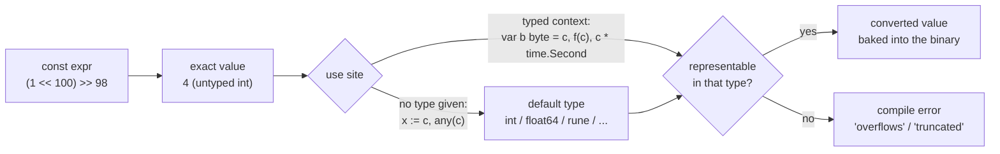
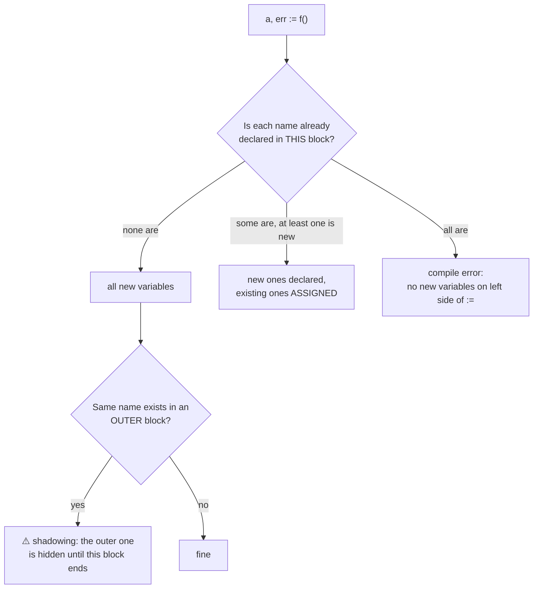

# 02 · Variables & Constants

> **Level:** Foundation
> **Prerequisites:** [01 Go fundamentals & toolchain](../01-go-fundamentals-and-toolchain/go-fundamentals-and-toolchain.md) (packages, `go run`, reading a test failure, §6.10)
> **Related:** 03 Basic types & operators (the numeric types constants convert to) · 04 Control flow (scopes of `if`/`for`/`switch`, per-iteration loop variables) · 05 Functions, closures & defer (closures capture variables) · 09 Pointers & value semantics (where variables live) · 13 The type system (defined types, assignability, untyped constants revisited) · 18 Errors (the `err` shadowing trap in error handling)
> **Go version:** go1.27.1 (darwin/arm64) · everything here applies from Go 1.22 on, and version-specific behaviour is marked
> **Targets stuck patterns:** none recorded yet (no diagnostic). Likely targets: bugs that "feel random" because of shadowing (hypothesis 3, missing mental models), and Java/Python habits around constants and globals (hypothesis 4)
> **Started:** 2026-11-03 · **Status:** 📖 In progress
>
> **Syllabus items covered:** 2 (`var`, `:=`, `const`, `iota`, untyped constants, zero values, type inference, scope, shadowing). This topic is the **home** of scope & shadowing and of untyped constants (topic 13 revisits them through the type system).
> **Run the code:** `cd topics/02-variables-and-constants && make examples` · exercises in [`exercises/`](exercises/README.md)

---

## 1. TL;DR

- **Every variable starts at its type's zero value.** `0`, `false`, `""`, `nil`, or a struct/array of zero values. Go has no "uninitialized" state, so good Go types are designed to be **useful at their zero value** (`strings.Builder`, `sync.Mutex`, a nil slice you can `append` to).
- **Declare with `var` when the zero value is what you want, and with `:=` when you have a real value.** `:=` works only inside functions. It declares at least one new variable in the **current block**, and may reuse others already declared in that same block.
- **Constants are exact compile-time values, usually untyped.** `const huge = 1 << 100` is legal; it gets a type only where it is used, and it must fit that type then. That is why `retries * time.Second` compiles while `n * time.Second` (with `n int`) doesn't.
- **`iota` is the line number inside a `const (...)` block**, and an omitted expression repeats the previous one. Use it for enums and bit flags, make the **zero value mean "unknown/unset"**, and never persist raw iota numbers that a reorder could change.
- **Names resolve to the innermost enclosing declaration.** A `:=` in an inner block (an `if`, a `for`, a `{}`) creates a **new** variable that hides the outer one. That's shadowing, and it's the #1 bug of this topic: it compiles, passes `go vet`, and silently drops values.
- **Habits to drop:** `MAX_RETRIES`-style names, mutable globals as "constants", `var x int = 0`, durations as `int`s with a `Ms` suffix, and constant "classes" with getters.

## 2. Why It Exists

### The problems Go's design solves here

**Uninitialized memory.** In C, a local variable holds whatever bytes were in that memory before, a classic source of bugs and security holes. Java solves it for fields (defaults to `0`/`null`/`false`) but makes *local* variables a compile error until definitely assigned. Python has no declarations at all: a name exists once assigned, and using it earlier is a runtime `NameError`. Go picks one rule for everything: **declaring a variable allocates it and zeroes it**. Locals, globals, struct fields, array elements and heap allocations all follow it. The cost is tiny (zeroing memory is cheap and often free), and in exchange no Go program can ever read garbage.

**Readable declarations without ceremony.** Go wanted the safety of static types with the feel of a dynamic language, hence type inference (`b := 42`) and the short declaration `:=`. The trade-off: two ways to declare a variable, and `:=`'s "declare *or* reuse" rule, which is where shadowing bugs come from (§7.1).

**Numeric constants that just work.** In C and Java, `1 << 40` overflows an `int` silently, and mixing `int` and `long` constants needs suffixes and casts. Go's designers made constants **mathematical values computed exactly by the compiler**, with no type until they're used ("untyped constants"). You can write `const KiB = 1 << 10` and use it as an `int64`, a `float64` or a `time.Duration` without casts, while Go still has **no implicit conversions between typed values** at runtime. Rob Pike's Go blog post *Constants* (2014) explains the reasoning: keep the strictness of "no implicit conversions" for variables, but make constants pleasant.

**Enums without a type-system feature.** Go has no `enum` keyword. A defined type + a `const` block + `iota` covers most uses (named, ordered values, bit flags), with less machinery than Java's enum classes. The cost: no exhaustiveness checking and no built-in string names (you add a `String` method, topic 10, or use `go generate` + `stringer`, topic 45).

**Scope you can read.** Go is lexically scoped with block scope (like Java, unlike Python's function scope). Every `{}` and every `if`/`for`/`switch` statement opens a block, so a variable's life is exactly as long as the code that needs it. The price is that the same name can be declared again in an inner block, which shadows the outer one.

### What Python and Java do instead

| Concern | Python | Java | Go |
|---|---|---|---|
| Declaring | No declaration; assignment creates the name | `int x;` / `var x = 5;` (Java 10+) | `var x int`, `var x = 5`, `x := 5` |
| Unassigned variable | `NameError` at runtime | Locals: compile error until assigned; fields: default value | Impossible: always the zero value |
| Constants | Convention only (`MAX_SIZE = 10`, still reassignable; `typing.Final` is advisory) | `static final` fields, typed, can be any object | `const`, compile-time only, numbers/strings/booleans/runes, untyped by default |
| Numeric literals | Arbitrary-precision ints at runtime | Typed (`int` vs `long` with `L`), silent overflow | Exact untyped constants; overflow is a **compile** error when converted |
| Enums | `enum.Enum` classes | `enum` classes with fields and methods | Defined type + `const` + `iota` |
| Scope | Function scope (`if`/`for` don't create a scope), `global`/`nonlocal` | Block scope; redeclaring a name in an inner block is a compile error for locals | Block scope; redeclaring in an inner block **shadows** (legal) |

That last row matters: Java *forbids* a local variable from hiding another local in an enclosing block, so a Java engineer's instinct is "if it compiled, it's the same variable". In Go it may not be.

## 3. Mental Model

**A variable is a labelled box of a fixed size and type, created already zeroed. A constant is not a box at all: it's a value the compiler pastes in wherever you use it.**

```
var n int              const limit = 64 * 1024
┌──────────────┐       (no memory, no address)
│ n: int       │       every use of `limit` is replaced by 65536,
│ 0            │       converted to whatever type that use needs
└──────────────┘
x := 5   → a new box, type inferred from 5 (int)
x = 6    → same box, new contents
x := 7   → in the SAME block: compile error (no new variables)
           in an INNER block: a NEW box that hides the outer one
```

And for names: **scopes are nested boxes; a lookup starts in the innermost box and walks outwards until it finds the name.**

```
universe   (int, len, true, nil, iota, error, ...)
└─ package (package-level const/var/type/func, all files)
   └─ file (imports)
      └─ function (parameters, results, body)
         └─ if / for / switch / { } blocks, nested as deep as the code
```

**Where it breaks:**
- **"A constant is just a variable that can't change."** No: a constant has no address (`&limit` doesn't compile), can only be a boolean, rune, number or string (no constant slices, maps or structs), and is untyped until used. Read-only *data* tables (a slice of allowed values) have to be variables, or functions that return a fresh copy.
- **"`:=` always creates a new variable."** In the *same* block it may just assign to an existing one, as long as at least one name on the left is new (§5.7).
- **"The scope of `x` starts at the start of its block."** It starts *after* its declaration ends, which is why `x := x + 1` in an inner block reads the outer `x` (§5.6).
- **"Zero value = invalid / not set."** For many types the zero value is a perfectly valid value (`0` for a counter, `""` for an optional name). Whether "zero" can mean "unset" is a design decision you make per type (§7.9).

## 4. Core Concepts & Terminology

| Term | Precise meaning (spec wording where possible) | Common confusion |
|---|---|---|
| **Variable** | "A storage location for holding a value." Its static type is fixed at declaration | It's not a "reference" to an object as in Python: assigning copies the value (09) |
| **Zero value** | The value a variable gets when storage is allocated without explicit initialization: `false`, `0`, `""`, `nil` for pointers, functions, interfaces, slices, channels and maps; recursively for arrays and structs | A nil map can be *read* (returns zeros) but not *written* (panic, topic 07) |
| **Variable declaration** | `var name T`, `var name = expr`, `var name T = expr`, grouped in `var ( ... )` | Allowed at package level and in functions |
| **Short variable declaration** | `name := expr`. Only inside functions. Shorthand for `var name = expr` | Not allowed at package level (§7.3) |
| **Redeclaration** | In `a, b := ...`, a name already declared **in the same block** with the same type is assigned, not redeclared. At least one non-blank name must be new | It's not "reuse whatever exists anywhere": in an inner block every name on the left is new |
| **Constant** | A compile-time value: boolean, rune, integer, floating-point, complex or string | No constant arrays, slices, maps, structs or pointers |
| **Untyped constant** | A constant without a type yet, of a *kind* (integer, rune, float, complex, string, boolean). Literals and most `const` declarations are untyped | It still has a kind: `1 / 2` is integer division (§7.7) |
| **Typed constant** | A constant declared with a type (`const t time.Duration = 5`) or derived from typed operands (`2 * time.Second`) | Must be representable in its type: `int8(100) * 2` is a compile error (§7.6) |
| **Default type** | The type an untyped constant takes when the context doesn't give one (`:=`, `any`): `bool`, `rune` (`int32`), `int`, `float64`, `complex128`, `string` | `x := 'a'` is an `int32`, not a `byte` |
| **Representable** | A constant value fits type `T`: integers within range, floats roundable to `T`'s precision | Checked at compile time, so constant overflow never happens silently |
| **`iota`** | Inside a `const` declaration, the untyped integer index of the current ConstSpec (line), starting at 0 | It counts **lines**, not constants, and restarts in every `const` block |
| **Implicit repetition** | In a parenthesized `const` list, an omitted expression repeats the previous ConstSpec's expression (and type) textually | That's why `KiB = 1 << (10 * iota)` followed by bare `MiB` works |
| **Blank identifier `_`** | A write-only placeholder: discards a value, skips an iota value, satisfies "use this import/variable" | `_ := x` doesn't compile: there's no new variable (§7.4) |
| **Scope** | The region of source text where a declared name refers to that declaration | Go scope is **lexical** (by text), not dynamic |
| **Block** | A sequence of declarations and statements within braces, plus the implicit blocks: universe, package, file, each `if`/`for`/`switch`, each `case` clause | `if x := f(); x > 0 {} else {}`: `x` is visible in both branches |
| **Shadowing** | Declaring a name in an inner block that is already declared in an enclosing one; inside the inner block the outer declaration is unreachable | Not an error, not a `go vet` warning by default (§7.1) |
| **Package-level variable** | Declared outside any function; lives for the whole program; initialized before `main` (01 §5.3) | Unused package-level variables and constants compile fine; unused *locals* don't |
| **Addressable** | An operand you can take `&` of: variables, pointer indirections, slice indexing, fields of addressable structs | Constants and map elements are not addressable |

**Version notes:** since **Go 1.22**, each iteration of a `for` loop has its *own* copy of the loop variable (before, one variable was shared by all iterations, which broke closures and goroutines). Full treatment in 04 and 05. Since **Go 1.21**, `min`, `max` and `clear` are predeclared (universe) functions, so they too can be shadowed by mistake (§7.11).

## 5. How It Works Inside

### 5.1 A variable is a typed storage location, born zeroed

When the compiler sees `var n int`, it reserves 8 bytes (on 64-bit platforms) for `n`, either in the function's **stack frame** or, if the variable must outlive the call, on the **heap** (escape analysis decides; intro in 09, full treatment in 28). Either way the bytes are **zero**: the compiler emits zeroing for stack slots, and the runtime hands out heap memory that is already zeroed. Package-level variables live in the binary's data/BSS segments, which the OS maps in zeroed.

So a zero value is literally **all-zero bytes** interpreted as that type:

```
var i int        ┌────────────────────────┐
                 │ 00 00 00 00 00 00 00 00│  = 0
                 └────────────────────────┘
var s string     ┌──────────┬──────────┐
                 │ ptr: nil │ len: 0   │      = ""   (a string is a 2-word header)
                 └──────────┴──────────┘
var sl []int     ┌──────────┬──────────┬──────────┐
                 │ ptr: nil │ len: 0   │ cap: 0   │ = nil slice (3-word header, topic 06)
                 └──────────┴──────────┴──────────┘
var m map[K]V    ┌──────────┐
                 │ nil      │  a nil pointer to a map: reads OK, writes panic (topic 07)
                 └──────────┘
var err error    ┌──────────┬──────────┐
                 │ type: nil│ data: nil│      = nil interface (2 words, topic 12)
                 └──────────┴──────────┘
var p struct{Name string; Age int}
                 ┌─────────────────────┬──────────┐
                 │ Name: {nil, 0} = "" │ Age: 0   │  every field zeroed, recursively
                 └─────────────────────┴──────────┘
```

That's why "the zero value" is one rule and not a table to memorize: **all bits zero** happens to mean `0`, `false`, `""`, `nil` and "empty header" for every built-in type.

**Predict the output** ([`internal/examples/zerovalues.go`](internal/examples/zerovalues.go) · `make example N=zero-values`):
```go
var (
	i   int
	f   float64
	b   bool
	s   string
	r   rune
	p   *int
	sl  []int
	m   map[string]int
	ch  chan int
	fn  func()
	err error
	arr [3]int
	st  struct {
		Name string
		Age  int
	}
)
fmt.Fprintf(w, "int=%d float64=%g bool=%t string=%q rune=%d\n", i, f, b, s, r)
fmt.Fprintf(w, "pointer=%v slice=%v (nil? %t) map=%v (nil? %t)\n", p, sl, sl == nil, m, m == nil)
fmt.Fprintf(w, "chan nil? %t func nil? %t error=%v\n", ch == nil, fn == nil, err)
fmt.Fprintf(w, "array=%v struct=%+v\n", arr, st)
fmt.Fprintf(w, "len(slice)=%d len(map)=%d len(string)=%d\n", len(sl), len(m), len(s))
fmt.Fprintln(w, "read from nil map:", m["missing"])
```
<details><summary>Output</summary>

```
int=0 float64=0 bool=false string="" rune=0
pointer=<nil> slice=[] (nil? true) map=map[] (nil? true)
chan nil? true func nil? true error=<nil>
array=[0 0 0] struct={Name: Age:0}
len(slice)=0 len(map)=0 len(string)=0
read from nil map: 0
```
Why: every variable is zeroed. `fmt` prints a nil slice as `[]` and a nil map as `map[]`, so **printing can't tell you whether a slice is nil**; compare with `nil` instead. `len` of a nil slice, nil map or empty string is 0, and reading a missing key from a nil map returns the element type's zero value.
</details>

### 5.2 Declaration forms, and what the compiler infers

```mermaid
flowchart TD
  A{Inside a function?} -->|no: package level| V[var name T / var name = expr<br/>var ( ... ) groups]
  A -->|yes| B{Starting from the zero value?}
  B -->|yes| VZ["var name T<br/>e.g. var total time.Duration"]
  B -->|no, I have a value| C{Need a type other than<br/>the value's default type?}
  C -->|no| SV["name := expr<br/>e.g. count := len(items)"]
  C -->|yes| VT["var name T = expr<br/>e.g. var ratio float64 = 1"]
```

The **type inference** rule is simple: with no type written, the variable gets the type of the initializer. If the initializer is a typed expression (`len(x)`, `time.Second`, a function result), that's the type. If it's an **untyped constant**, the variable gets the constant's **default type**.

**Predict the output** ([`internal/examples/declarations.go`](internal/examples/declarations.go) · `make example N=declaration-forms`):
```go
var a int           // explicit type, zero value
var b = 42          // type inferred from the initializer
var c, d = "x", 3.5 // several at once, each inferred separately
e := true           // short variable declaration: inside functions only
var (
	host = "localhost"
	port = 8080
)
fmt.Fprintf(w, "a=%v b=%v c=%v d=%v e=%v\n", a, b, c, d, e)
fmt.Fprintf(w, "%T %T %T %T %T\n", a, b, c, d, e)
fmt.Fprintf(w, "%s:%d\n", host, port)
```
<details><summary>Output</summary>

```
a=0 b=42 c=x d=3.5 e=true
int int string float64 bool
localhost:8080
```
Why: `42` → `int`, `"x"` → `string`, `3.5` → `float64`, `true` → `bool`: the default types of untyped constants.
</details>

**Predict the output** (`make example N=default-types`):
```go
i := 7
f := 7.0
r := 'x'
c := 2i
s := "go"
b := 1 < 2
fmt.Fprintf(w, "%T %T %T %T %T %T\n", i, f, r, c, s, b)

const mixed = 1 + 2.0 // untyped int + untyped float = untyped float
fmt.Fprintf(w, "mixed=%v %T\n", mixed, mixed)
fmt.Fprintf(w, "any(1<<10) is %T\n", any(1<<10))
```
<details><summary>Output</summary>

```
int float64 int32 complex128 string bool
mixed=3 float64
any(1<<10) is int
```
Why: a rune literal defaults to `rune`, which is an alias for `int32`, so `%T` prints `int32`. When untyped constants of different numeric kinds meet, the result takes the kind that comes later in *integer → rune → floating-point → complex* (spec, "Constant expressions"), so `1 + 2.0` is an untyped float whose value is 3. Storing an untyped constant in an interface (`any`, `fmt`'s arguments) also uses the default type.
</details>

### 5.3 Constants: exact values that exist only at compile time

The compiler represents untyped constants with **arbitrary precision** (the spec requires at least 256 bits for integer constants and for float mantissas; the gc compiler's type checker computes them with the `go/constant` package). Constant expressions are **evaluated exactly at compile time**. Only when a constant is used in a context that needs a type is it **converted**, and the conversion must be exact (integers) or roundable (floats), or the build fails.



**Predict the output** ([`internal/examples/constants.go`](internal/examples/constants.go) · `make example N=untyped-constants`):
```go
const huge = 1 << 100    // far bigger than any integer type, and legal
const small = huge >> 98 // 4: computed exactly at compile time
fmt.Fprintln(w, "small:", small)

var f float64 = huge // converted when used: representable as a float64
fmt.Fprintln(w, "huge as float64:", f)

var d time.Duration = 3 // the same untyped 3 becomes a Duration (3ns)
var b byte = 'A'        // a rune constant becomes a byte
fmt.Fprintln(w, "duration:", d, "byte:", b)
```
<details><summary>Output</summary>

```
small: 4
huge as float64: 1.2676506002282294e+30
duration: 3ns byte: 65
```
Why: `huge` never exists at runtime; only `small` (4) and the float conversion do. `huge` is representable as a `float64` (rounded), but `x := huge` would fail, because its default type `int` can't hold it (§7.5). The untyped `3` takes whatever type its use requires: `time.Duration` here, which counts nanoseconds.
</details>

Because constant arithmetic is exact, constant expressions don't suffer floating-point rounding until the very end.

**Predict the output** (`make example N=constant-float-exactness`):
```go
const a, b = 0.1, 0.2
fmt.Fprintln(w, "constants:", a+b == 0.3)

x, y := 0.1, 0.2
fmt.Fprintln(w, "variables:", x+y == 0.3)
fmt.Fprintln(w, "x+y =", x+y)
```
<details><summary>Output</summary>

```
constants: true
variables: false
x+y = 0.30000000000000004
```
Why: `a+b` is computed on exact values (1/10 + 2/10 = 3/10), then compared with the exact 3/10. `x` and `y` are `float64` variables, each already rounded to the nearest binary fraction, and their runtime sum rounds differently from the `float64` nearest to 0.3. Same digits on the page, different arithmetic.
</details>

### 5.4 Typed vs untyped constants at the point of use

A constant becomes **typed** if you declare it with a type, or if its expression involves a typed operand: `2 * time.Second` has type `time.Duration` because `time.Second` does. Untyped constants combine freely with typed values; **typed values never convert implicitly**, whether they are constants or variables.

**Predict the output** (`make example N=typed-vs-untyped`):
```go
const timeout = 2 * time.Second // typed: its type is time.Duration
const retries = 3               // untyped: adapts to the other operand
fmt.Fprintf(w, "timeout: %v (%T)\n", timeout, timeout)
fmt.Fprintln(w, "retries*timeout:", retries*timeout)

n := 3 // an int variable has a fixed type
// n*timeout would not compile: mismatched types int and time.Duration
fmt.Fprintln(w, "time.Duration(n)*timeout:", time.Duration(n)*timeout)
```
<details><summary>Output</summary>

```
timeout: 2s (time.Duration)
retries*timeout: 6s
time.Duration(n)*timeout: 6s
```
Why: `retries` is untyped, so in `retries*timeout` it converts to `time.Duration`. `n` is a typed `int` variable, so `n*timeout` mixes `int` and `time.Duration`: a compile error (§7.8). Convert explicitly.
</details>

**Rule of thumb:** leave numeric constants **untyped** unless the type carries meaning. `time.Duration` constants should be typed (the unit is the point). Enum constants should be typed (topic 13's defined types keep `Weekday` and `Month` apart). Plain counts and sizes (`maxAttempts = 5`, `KiB = 1 << 10`) are more useful untyped.

### 5.5 `iota`: the line index of a const block

The spec defines it exactly: within a `const` declaration, `iota` is the **index of the ConstSpec** (each line of the block, starting at 0). Combined with **implicit repetition**, where an omitted expression list repeats the previous one textually, a block like this:

```go
const (
	KiB = 1 << (10 * (iota + 1))   // iota = 0 → 1 << 10
	MiB                            // repeated with iota = 1 → 1 << 20
	GiB                            // repeated with iota = 2 → 1 << 30
)
```
is rewritten by the compiler into three independent constant expressions. There's no runtime counter and no enum object: the result is three plain constants.

**Predict the output** ([`internal/examples/iota.go`](internal/examples/iota.go) · `make example N=iota-basics`):
```go
type Weekday int
const (
	Sunday Weekday = iota
	Monday
	Tuesday
)
// ... inside the function:
fmt.Fprintf(w, "Sunday=%d Monday=%d Tuesday=%d (%T)\n", Sunday, Monday, Tuesday, Tuesday)

const (
	a = iota * 10 // 0
	b             // the expression repeats: iota is now 1, so 10
	_             // 20, discarded
	c             // 30
)
fmt.Fprintln(w, "a b c:", a, b, c)

const (
	x, y = iota, iota + 10 // both on line 0: iota is 0 for both
	z, v                   // line 1: 1, 11
)
fmt.Fprintln(w, "x y z v:", x, y, z, v)

const restart = iota // a new const block starts again at 0
fmt.Fprintln(w, "restart:", restart)
```
<details><summary>Output</summary>

```
Sunday=0 Monday=1 Tuesday=2 (examples.Weekday)
a b c: 0 10 30
x y z v: 0 10 1 11
restart: 0
```
Why: `Monday` repeats `Weekday = iota`, so it has the type `Weekday` too (the type repeats with the expression). `_` consumes a line, so `c` is on line 3. Two names on one line share that line's `iota`. Every `const` keyword starts a new declaration, so `iota` restarts at 0.
</details>

### 5.6 Scope: nested blocks resolved inside-out

The spec lists the blocks: the **universe** block (predeclared identifiers such as `int`, `len`, `nil`, `true`), the **package** block (all package-level declarations, across all files), the **file** block (imports), each **function** (parameters and results live in the function body's scope), and then every **explicit `{}`** and every **implicit** block of `if`, `for`, `switch` and `select`, plus each `case`/`default` clause.

```
universe:  int  len  true  nil  iota  min  max ...
└── package examples:  scopeLevel = "package"   currentEnv   ScopeLevels ...
    └── file scope.go:  fmt  io  strconv          (imports belong to the file)
        └── func ScopeLevels(w io.Writer):  w,  scopeLevel = "function"
            ├── { }                     scopeLevel = "explicit block"
            ├── if scopeLevel := ...;   scopeLevel = "if statement"   (if + else)
            └── for i := ...;           i
                └── loop body { }       scopeLevel = "loop body"
```

Two precise rules:
1. **Lookup** starts at the innermost block containing the use and moves outwards. The first declaration found wins.
2. **A local constant or variable's scope begins at the end of its declaration** (the ConstSpec, VarSpec or ShortVarDecl), not at the start of the block. So in `x := x + 10`, the `x` on the right is still the outer one.

**Predict the output** ([`internal/examples/scope.go`](internal/examples/scope.go) · `make example N=scope-levels`):
```go
var scopeLevel = "package" // package level

func ScopeLevels(w io.Writer) {
	fmt.Fprintln(w, "1:", scopeLevel) // the package variable
	scopeLevel := "function"          // shadows it for the rest of the function
	fmt.Fprintln(w, "2:", scopeLevel)
	{
		scopeLevel := "explicit block"
		fmt.Fprintln(w, "3:", scopeLevel)
	}
	if scopeLevel := "if statement"; scopeLevel != "" {
		fmt.Fprintln(w, "4:", scopeLevel) // the if's init scope covers if and else
	}
	for i := 0; i < 1; i++ {
		scopeLevel := "loop body"
		fmt.Fprintln(w, "5:", scopeLevel, "i =", i)
	}
	fmt.Fprintln(w, "6:", scopeLevel) // back to the function's variable
}
```
<details><summary>Output</summary>

```
1: package
2: function
3: explicit block
4: if statement
5: loop body i = 0
6: function
```
Why: line 1 runs before the local `scopeLevel` is declared, so it finds the package variable. Each inner block declares its own variable, which disappears at the closing brace. Note that the `for` statement has *two* blocks: the `for` clause's (holding `i`) and the body's, nested inside it.
</details>

**Predict the output** (`make example N=scope-starts-after-declaration`):
```go
x := 1
{
	x := x + 10 // the right side reads the OUTER x
	fmt.Fprintln(w, "inner:", x)
}
fmt.Fprintln(w, "outer:", x)
```
<details><summary>Output</summary>

```
inner: 11
outer: 1
```
Why: the inner `x` isn't in scope until its declaration ends, so `x + 10` reads the outer `x` (1). The outer `x` is never modified. (Package-level declarations are different: their scope is the whole package block, which is how package variables can refer to each other in any order, 01 §5.3.)
</details>

### 5.7 `:=` redeclaration vs shadowing

The spec rule for short variable declarations: `a, b := ...` **may redeclare** variables *originally declared earlier in the same block* (or in the parameter list, if the block is the function body), with the same type, **as long as at least one non-blank variable is new**. Redeclaration doesn't create a variable; it **assigns** the existing one. In any *other* block, every name on the left is a brand-new variable.



**Predict the output** (`make example N=short-redeclaration`):
```go
a, err := strconv.Atoi("1")
first := &err
b, err := strconv.Atoi("x") // b is new, err is only assigned
fmt.Fprintln(w, "a b err:", a, b, err)
fmt.Fprintln(w, "same err variable:", first == &err)
{
	c, err := strconv.Atoi("2") // inner block: a NEW err
	fmt.Fprintln(w, "inner c err:", c, err, "same err variable:", first == &err)
}
fmt.Fprintln(w, "outer err after the block:", err)
```
<details><summary>Output</summary>

```
a b err: 1 0 strconv.Atoi: parsing "x": invalid syntax
same err variable: true
inner c err: 2 <nil> same err variable: false
outer err after the block: strconv.Atoi: parsing "x": invalid syntax
```
Why: comparing addresses proves it (`&` gives a variable's address; pointers are topic 09). The second `:=` in the same block reuses the same `err` variable. The `:=` inside `{}` creates a different `err`, so its `nil` never reaches the outer one. This is the mechanism behind the most common bug of this topic (§7.1).
</details>

## 6. Worked Examples

§5 has the core mechanism examples. These four cover the remaining concepts. `make examples` lists all 19 examples, and `make example N=all` runs them.

### 6.1 Useful zero values: no constructor needed
[`internal/examples/zerovalues.go`](internal/examples/zerovalues.go) · `make example N=useful-zero-values`
```go
var sb strings.Builder // ready to use
sb.WriteString("built ")
sb.WriteString("without a constructor")
fmt.Fprintln(w, sb.String())

var buf bytes.Buffer // an empty buffer, ready to write to
fmt.Fprintf(&buf, "%d bytes buffered", 16)
fmt.Fprintln(w, buf.String())

var mu sync.Mutex // an unlocked mutex
mu.Lock()
fmt.Fprintln(w, "locked a zero-value mutex")
mu.Unlock()

var nums []int // nil slice: append allocates on first use
nums = append(nums, 1, 2, 3)
fmt.Fprintln(w, nums, len(nums))
```
```
built without a constructor
16 bytes buffered
locked a zero-value mutex
[1 2 3] 3
```
**Takeaway:** "Make the zero value useful" (Go Proverbs; Effective Go, "Allocation with new") is a design principle, not luck. The standard library's types are built so that `var x T` is ready to use. Design your own types the same way (topic 10): then callers never forget a constructor, and a type embedded in a struct works without extra setup. Exceptions are types that need resources or required fields, such as a `*sql.DB` or an HTTP client with a base URL. Those get a `NewX` constructor.

### 6.2 Assignment: swap, evaluation order, the blank identifier
[`internal/examples/declarations.go`](internal/examples/declarations.go) · `make example N=multiple-assignment`

**Predict the output:**
```go
x, y := 1, 2
x, y = y, x // the right side is evaluated before anything is assigned
fmt.Fprintln(w, "swapped:", x, y)

i := 0
nums := []int{10, 20, 30}
i, nums[i] = 2, 99 // the index i is evaluated (0) before i becomes 2
fmt.Fprintln(w, "i:", i, "nums:", nums)

_, frac := math.Modf(3.75) // _ discards a value you must receive
fmt.Fprintln(w, "fraction:", frac)
```
<details><summary>Output</summary>

```
swapped: 2 1
i: 2 nums: [99 20 30]
fraction: 0.75
```
Why: the spec defines tuple assignment in two phases. First, index expressions and pointer indirections on the left and all expressions on the right are evaluated. Then the assignments happen left to right. So `nums[i]` was already `nums[0]` when `i` became 2. No temporary variable is needed for a swap.
</details>

**Takeaway:** `x, y = y, x` is the idiomatic swap. `_` is how you ignore a value Go makes you receive, but **never use it to silence an `error`** in real code (topic 18).

### 6.3 Bit flags with `1 << iota`
[`internal/examples/iota.go`](internal/examples/iota.go) · `make example N=iota-bit-flags`
```go
type Perm uint8

const (
	Read  Perm = 1 << iota // 1
	Write                  // 2
	Exec                   // 4
)

p := Read | Write
fmt.Fprintf(w, "%03b write? %t exec? %t\n", p, p&Write != 0, p&Exec != 0)
p &^= Write // clear the Write bit
p |= Exec   // set the Exec bit
fmt.Fprintf(w, "%03b write? %t exec? %t\n", p, p&Write != 0, p&Exec != 0)
```
```
011 write? true exec? false
101 write? false exec? true
```
**Takeaway:** `1 << iota` gives one bit per constant. Combine with `|`, test with `&`, clear with `&^` (AND NOT, a Go operator; operators in depth in 03). This is how `os.FileMode` and the flags of `log` and `regexp/syntax` are built in the standard library. Use a typed constant (`Perm`) so flags from different sets can't be mixed by accident.

### 6.4 Size units with `iota` (the Effective Go pattern)
`make example N=iota-sizes`
```go
const (
	_   = iota // skip 0: 1 << (10*0) would be 1 byte
	KiB = 1 << (10 * iota)
	MiB
	GiB
	TiB
)

fmt.Fprintln(w, KiB, MiB, GiB, TiB)
var fileSize int64 = 3 * MiB // an untyped constant fits any numeric type
fmt.Fprintf(w, "%d bytes = %.1f MiB = %.4f GiB\n", fileSize, float64(fileSize)/MiB, float64(fileSize)/GiB)
```
```
1024 1048576 1073741824 1099511627776
3145728 bytes = 3.0 MiB = 0.0029 GiB
```
**Takeaway:** because `KiB`…`TiB` are **untyped**, the same constant works as an `int64` (`3 * MiB`) and as a `float64` divisor, with no conversions. `TiB` (2⁴⁰) doesn't fit in a 32-bit `int`, but that only matters if you use it as one: the check happens at the use site. Effective Go's "Constants" section uses the same pattern with a typed `ByteSize float64`. E3 builds on this.

## 7. Gotchas

Every compile error below was produced with go1.27.1 in a scratch module (`example.com/gotchas`) and copied from the terminal. Runtime gotchas are examples in this module (`make example N=<name>`).

| # | Gotcha | Symptom | Fix |
|---|---|---|---|
| 7.1 | `:=` in an inner block shadows an outer variable | Value silently lost; compiles, `go vet` quiet | `=` to assign, or declare in the outer scope; enable a shadow linter |
| 7.2 | `:=` in a function "sets" a package variable | Package variable unchanged | `=`; better, no mutable package variables |
| 7.3 | `:=` at package level | `syntax error: non-declaration statement outside function body` | `var x = ...` |
| 7.4 | `:=` with no new variable on the left | `no new variables on left side of :=` | `=` |
| 7.5 | A huge untyped constant given its default type | `cannot use huge (untyped int constant …) as int value … (overflows)` | Use it only where it fits, or a bigger/float type |
| 7.6 | Typed constant arithmetic overflows | `limit * 2 (constant 200 of type int8) overflows int8` | Fix the type or the value |
| 7.7 | `1 / 2` with constants is 0, even in a `float64` | `0` instead of `0.5` | Make one operand a float: `1.0 / 2` |
| 7.8 | `int` variable × `time.Duration` | `mismatched types int and time.Duration` | `time.Duration(n) * time.Second` |
| 7.9 | iota enum whose 0 is a real state | Unset values look valid | Make 0 mean unknown/unset |
| 7.10 | Inserting a constant in an iota block | Stored numbers change meaning | Append only, or explicit values, or store names |
| 7.11 | Shadowing a predeclared name (`len`, `max`, `new`, `string`) | `cannot call len (variable of type int)` | Rename the variable |
| 7.12 | Constant slices/maps/structs, `&constant` | `is not constant` / `cannot take address of` | A variable, or a function returning a fresh value |

### 7.1 `:=` in an inner block shadows the outer variable
The most common bug of this topic, and #1 in *100 Go Mistakes* ("Unintended variable shadowing"). [`internal/examples/scope.go`](internal/examples/scope.go) · `make example N=shadowed-err`
```go
func portFrom(s string) (int, error) {
	port := 8080
	if s != "" {
		port, err := strconv.Atoi(s) // NEW port and err, scoped to the if block
		if err != nil {
			return 0, err
		}
		if port < 1 || port > 65535 {
			return 0, fmt.Errorf("port %d out of range", port)
		}
	}
	return port, nil // the OUTER port: still 8080
}
```
**Predict:** what do `portFrom("9090")` and `portFrom("abc")` return?
<details><summary>Output</summary>

```
buggy: port=8080 err=<nil>
fixed: port=9090 err=<nil>
buggy, bad input: port=0 err=strconv.Atoi: parsing "abc": invalid syntax
```
</details>

**Why:** `port, err :=` is in the `if` block, where neither name is declared yet, so **both** are new variables (§5.7). The parsed 9090 lives in the inner `port`, which dies at the `}`. The error path still "works" (it returns from inside the block), so only a test with a *valid* value catches the bug. It compiles because the inner variables are used; if they weren't, you'd get `declared and not used: port`, which is how the compiler catches the simpler cases.

**Fix:** assign instead of declaring:
```go
if s != "" {
	var err error
	port, err = strconv.Atoi(s) // = assigns the outer port
	...
}
```
or parse into a differently named variable and copy it (`p, err := ...; port = p`).

**Tooling:** `go vet` does **not** report shadowing by default. The `shadow` analyzer does, but it's opt-in because it also flags harmless shadowing (real output):
```
$ go vet ./shadowbug && echo "go vet: clean"
go vet: clean
$ go run golang.org/x/tools/go/analysis/passes/shadow/cmd/shadow@latest ./shadowbug
shadowbug/main.go:11:3: declaration of "port" shadows declaration at line 9
```
With golangci-lint, enable it under `linters.settings.govet.enable: [shadow]`:
```
shadowbug/main.go:11:3: shadow: declaration of "port" shadows declaration at line 9 (govet)
```
E2 is this bug in a timeout parser.

### 7.2 `:=` in a function doesn't set the package variable
`make example N=shadowed-package-var`
```go
var currentEnv string // package level

func setupEnv(w io.Writer) error {
	currentEnv, err := detectEnv() // declares a LOCAL currentEnv
	if err != nil {
		return err
	}
	fmt.Fprintf(w, "inside setupEnv: %q\n", currentEnv)
	return nil
}
// then: setupEnv(w); fmt.Fprintf(w, "package currentEnv: %q\n", currentEnv)
```
```
inside setupEnv: "production"
package currentEnv: ""
```
**Why:** the function body is a different block from the package block, so `:=` declares a new local `currentEnv`. This is the classic `db, err := sql.Open(...)` inside `init()` that leaves the global `db` nil (01 §10, senior review). **Fix:** `var err error; currentEnv, err = detectEnv()`. The better fix is not having a mutable package variable at all: return the value and pass it explicitly (§8).

### 7.3 `:=` outside a function
```go
package main

import "fmt"

count := 0

func main() { fmt.Println(count) }
```
```
outside/main.go:5:1: syntax error: non-declaration statement outside function body
```
**Why:** at package level, every statement must start with a keyword (`var`, `const`, `type`, `func`, `import`). Requiring the keyword makes top-level declarations fast to parse and easy to scan for. **Fix:** `var count = 0`, or just `var count int`.

### 7.4 `:=` with no new variables
```go
n, err := strconv.Atoi("1")
n, err := strconv.Atoi("2")
```
```
nonew/main.go:10:9: no new variables on left side of :=
```
And the blank identifier doesn't count as new: `_ := 5` gives the same error (`blankonly/main.go:6:4: no new variables on left side of :=`). **Fix:** use `=` for the second assignment.

### 7.5 A huge untyped constant meets its default type
```go
const huge = 1 << 100
x := huge
```
```
overflow/main.go:7:7: cannot use huge (untyped int constant 1267650600228229401496703205376) as int value in assignment (overflows)
```
**Why:** `huge` is legal as a constant. `x := huge` needs a type, the default type `int` can't represent it, and representability is checked at compile time. **Fix:** use the constant only in expressions whose result fits (`huge >> 98`), or give it a type that can hold it (`var f float64 = huge`).

### 7.6 Typed constant arithmetic overflows at compile time
```go
const limit int8 = 100
fmt.Println(limit * 2)
```
```
typedoverflow/main.go:7:14: limit * 2 (constant 200 of type int8) overflows int8
```
**Why:** `limit` is typed, so `limit * 2` is a typed constant expression of type `int8`, and 200 doesn't fit. The same arithmetic on an `int8` *variable* compiles and wraps around silently at runtime (overflow in depth: 03). That's an argument for leaving constants untyped unless the type matters.

### 7.7 Integer division of constants, even when stored in a float
`make example N=constant-int-division`
```go
const half = 1 / 2      // untyped int / untyped int: 0
const halfF = 1 / 2.0   // one float operand: 0.5
var ratio float64 = 1 / 2 // evaluated as integers first, then converted
fmt.Fprintln(w, half, halfF, ratio)
```
```
0 0.5 0
```
**Why:** `1 / 2` is an expression of two untyped *integer* constants, so it's integer division (= 0), and only then converted to `float64`. The declared type of `ratio` doesn't reach inside the expression. A real-world version: `const sampleRate = 1 / 10` silently samples nothing. **Fix:** `1.0 / 2`. **Tooling:** `go vet` misses it, but staticcheck reports it (real output from `make lint`, golangci-lint 2.14):
```
internal/examples/constants.go:51:15: SA4025: the integer division '1 / 2' results in zero (staticcheck)
```

### 7.8 Mixing a typed variable with a typed constant
```go
retries := 3
fmt.Println(retries * time.Second)
```
```
duration/main.go:10:14: invalid operation: retries * time.Second (mismatched types int and time.Duration)
```
**Why:** `retries` is an `int` variable and `time.Second` is a `time.Duration` constant. Go has **no implicit conversion between typed values**, so you must say which unit you mean. `3 * time.Second` compiles because `3` is untyped (§5.4). **Fix:** `time.Duration(retries) * time.Second`.

### 7.9 An iota enum whose zero value is a real state
`make example N=iota-zero-value-trap`
```go
type Status int
const (
	Active Status = iota // 0: also the zero value!
	Suspended
)
var s Status // never set: missing JSON field, forgotten struct field…
fmt.Fprintln(w, "unset status == Active:", s == Active)

type SafeStatus int
const (
	StatusUnknown SafeStatus = iota // 0 means "not set"
	StatusActive
	StatusSuspended
)
var safe SafeStatus
fmt.Fprintln(w, "unset safe status == StatusUnknown:", safe == StatusUnknown)
```
```
unset status == Active: true
unset safe status == StatusUnknown: true
```
**Why:** every forgotten field, missing JSON key or new row starts at 0. If 0 is `Active`, an account nobody activated is active. **Fix:** reserve 0 for "unknown/unset/invalid" (or start at 1 with `iota + 1`; the Uber Go Style Guide's "Start Enums at One"), unless the zero state really is the right default. Then validation can reject `StatusUnknown`.

### 7.10 Inserting a constant renumbers everything after it
`make example N=iota-reorder`
```go
const ( // version 1 of the code
	v1Pending = iota
	v1Paid
	v1Shipped
)
const ( // version 2: someone inserts Cancelled in the middle
	v2Pending = iota
	v2Cancelled
	v2Paid
	v2Shipped
)
stored := v1Paid // version 1 wrote 1 to the database
fmt.Fprintln(w, "stored value:", stored)
fmt.Fprintln(w, "v2 reads it as Paid?", stored == v2Paid, "as Cancelled?", stored == v2Cancelled)
```
```
stored value: 1
v2 reads it as Paid? false as Cancelled? true
```
**Why:** iota values are positions, and positions change when someone edits the list. That's harmless inside one process, and corrupting once the number leaves the process: a database column, a message on a queue, a file, another service. **Fix:** for anything persisted or sent over the wire, either (a) only ever append to the end of the block and say so in a comment, (b) write the numbers explicitly (`StatusPaid Status = 2`), or (c) store the **name** (`"paid"`), which also makes the data readable. Serialization in depth: 33.

### 7.11 Shadowing a predeclared identifier
```go
names := []string{"a", "b"}
len := len(names)
fmt.Println(len, len(names))
```
```
builtin/main.go:8:19: invalid operation: cannot call len (variable of type int): int is not a function
```
**Why:** `len`, `cap`, `new`, `make`, `append`, `copy`, `min`, `max`, `clear`, `string`, `error`, `true`, `nil`… live in the **universe block**, the outermost scope, so any declaration shadows them. Note that `len := len(names)` itself is legal: the right side is evaluated before the new `len` is in scope (§5.6). The error appears on the *next* use. Shadowing `min`/`max` became a trap in Go 1.21, when they became builtins: older code with a `max` variable still compiles, but can no longer call `max()` in that scope. **Fix:** name variables for their meaning (`n`, `count`, `highest`). Package names can be shadowed the same way (01 §7.4).

### 7.12 What constants can't be
```go
const ports = []int{80, 443}
```
```
constslice/main.go:5:15: []int{…} (value of type []int) is not constant
```
```go
const maxConns = 100
p := &maxConns
```
```
constaddr/main.go:8:8: invalid operation: cannot take address of maxConns (untyped int constant 100)
```
**Why:** constants exist only at compile time: only booleans, runes, numbers and strings, and no memory location to point at. **Fix:** for a read-only table, use an unexported package variable and never write it, or a function that returns a fresh slice each call (`func defaultPorts() []int { return []int{80, 443} }`), so no caller can modify a shared one. For a pointer to a constant value, copy it into a variable first: `n := maxConns; p := &n`.

**Also remember** (recap of 01 §7.3): an unused **local** variable is a compile error (`declared and not used: x`), but unused **package-level** variables and **constants** compile fine. The rule exists because unused locals are usually bugs, like a value computed and then shadowed.

## 8. Idiomatic vs Non-Idiomatic

| ❌ Non-idiomatic | ✅ Idiomatic | Why (source) |
|---|---|---|
| `const MAX_RETRIES = 5`, `var kMaxSize` | `const maxRetries = 5` (unexported), `MaxRetries` (exported) | Go Code Review Comments, "Mixed Caps": constants too, "`maxLength` not `MaxLength` or `MAX_LENGTH`"; Effective Go, "MixedCaps" |
| `var count int = 0`, `var name string = ""` | `var count int` | The declaration already zeroes it. Google Go Style Guide, Best Practices, "Variable declarations"; Uber Go Style Guide, "Local Variable Declarations" |
| `var total = computeTotal(items)` inside a function | `total := computeTotal(items)` | Same sources: `:=` when initializing with a non-zero value |
| `items := []string{}` to start empty | `var items []string` (nil slice) | Go Code Review Comments, "Declaring Empty Slices" (except where an empty, non-nil slice is required, e.g. JSON `[]` vs `null`, topic 33) |
| `var Timeout = 30 // seconds` | `const defaultTimeout = 30 * time.Second` | Typed `time.Duration` carries the unit; Uber Go Style Guide, "Use `time` to handle time" |
| Mutable exported globals for settings | Constants for fixed values; config values passed explicitly | Uber Go Style Guide, "Avoid Mutable Globals"; AGENTS.md §6.3 (no global mutable state) |
| `const ( StatusActive = iota ...)` with 0 = a real state | `StatusUnknown` (or `iota + 1`) at 0 | Uber Go Style Guide, "Start Enums at One" (§7.9) |
| Declaring everything at the top of the function | Declare right before first use, in the narrowest block | Uber Go Style Guide, "Reduce Scope of Variables"; Code Review Comments, "Variable Names" (short names for short scopes) |
| `len := len(x)`, `max := 0`, `new := ...` | `n`, `highest`, `created` | Uber Go Style Guide, "Avoid Using Built-In Names" (§7.11) |
| `userAccountDataStruct`, `idx_counter` | `u`, `i` in a 5-line loop; `account` across a function | Code Review Comments, "Variable Names": "the further from its declaration that a name is used, the more descriptive the name must be" |

### 8.1 Settings: a "constants class" vs a const block

```go
// ❌ Java "constants class" / Python settings module in Go clothing
var MAX_RETRIES int = 5        // mutable, exported, SCREAMING_SNAKE
var BASE_DELAY_MS int = 100    // the unit lives in the name

type BackoffConstants struct{}

func (BackoffConstants) GetMaxRetries() int { return MAX_RETRIES }
```
```go
// ✅ Go
const (
	maxAttempts = 5
	baseDelay   = 100 * time.Millisecond // typed: time.Duration carries the unit
	multiplier  = 2
)
```
Why: a constant can't be reassigned by another package, by a test, or by a goroutine racing with a reader. It costs nothing at runtime (§10). And it doesn't need a getter, because nothing can change it. A type with no data that exists only to group values is a Java habit: in Go the `const ( ... )` block *is* the grouping. E4 is this refactor.

### 8.2 `var` vs `:=`: say what you mean

```go
// ❌
var buf bytes.Buffer = bytes.Buffer{} // repeats the type, zero value spelled out
var err error = nil
var u = User{Name: name}              // in a function, := is the norm
```
```go
// ✅
var buf bytes.Buffer // zero value, ready to use
var count int        // explicitly "starting from the zero value"
u := User{Name: name}
```
The convention many Go codebases follow (Google Go Style Guide): **`var` signals "I want the zero value"**, and **`:=` signals "here's the initial value"**. Use `var x T = v` only when the type you need differs from the value's default type (`var ratio float64 = 1`).

### 8.3 Enums: typed, zero-is-unknown, appended only

```go
// ❌ untyped ints: any int is accepted, 0 is a real state, numbers are persisted
const (
	Active    = 0
	Suspended = 1
)
func SetStatus(s int) { ... } // SetStatus(42) compiles
```
```go
// ✅
// Status is the lifecycle state of an account. Values are stored by name,
// so the numbers may change; append new values at the end anyway.
type Status int

const (
	StatusUnknown Status = iota // the zero value: not set
	StatusActive
	StatusSuspended
)

func SetStatus(s Status) { ... } // SetStatus(42) still compiles (untyped constant!),
                                 // but SetStatus(someInt) doesn't: validate at the boundary
```
Honest caveat: a defined type stops *typed* mistakes (passing an `int` variable), but an untyped constant like `42` still converts to `Status`. Go enums aren't closed sets, so validate values that come from outside (parsing, JSON, the database). Defined types in depth: 13. Generating a `String` method: `stringer`, topic 45.

## 9. Coming from Python / Java

| Concept | Python (FastAPI) | Java (Spring Boot) | Go | What doesn't translate |
|---|---|---|---|---|
| Declare + initialize | `count = 0` | `int count = 0;` / `var count = 0;` | `count := 0` / `var count int` | `:=` may *reuse* a variable in the same block and *shadow* in an inner one |
| Default value | None (unbound name) | Fields: `0`/`null`/`false`; locals: must assign | Always the zero value | No `null` for `int`/`string`; `nil` only for pointers, slices, maps, channels, functions, interfaces |
| Constants | `MAX_SIZE = 10` (convention) | `public static final int MAX_SIZE = 10;` | `const maxSize = 10` | No `final` objects: constants are compile-time numbers/strings/booleans only |
| Big numbers | `2**100` works at runtime | `BigInteger` | `const huge = 1 << 100` works **only** as a constant | Variables have fixed-size types; use `math/big` at runtime |
| Enums | `class Color(Enum)` | `enum Color { RED, ... }` with methods | `type Color int` + `const ( ... iota )` | Not a closed set; no `values()`; names via a `String` method |
| Settings | `settings.py`, Pydantic `BaseSettings` | `@Value`, `@ConfigurationProperties` | Constants for defaults; a config struct loaded in `main` and passed down (E5, topic 38) | No framework injects values into globals |
| Scope | Function-level; `if` doesn't create a scope | Block scope; inner locals can't hide outer locals | Block scope; inner declarations **can** hide outer ones | A Java instinct of "it compiled, so it's the same variable" is wrong here |
| Modify an outer variable | `global x` / `nonlocal x` | Fields, or effectively-final for lambdas | Plain `=` assignment from any inner block (closures, 05) | Writing `:=` instead of `=` silently creates a new variable |
| Unused variable | Linter warning | Compiler warning | **Compile error** for locals | — |

**Habits to unlearn in this topic** (AGENTS.md §1.1):
- **SCREAMING_SNAKE constants and "constants classes"** → MixedCaps names in a `const` block (§8.1, E4).
- **Mutable module-level settings / static fields** → constants for fixed values; configuration loaded once in `main` and passed explicitly (E5).
- **"Declare everything at the top" (old C/Java style) and "explicitly initialize to be safe"** → declare at first use in the narrowest block; trust the zero value (§8.2).
- **Enums as classes / `Optional<Status>` for "not set"** → a typed constant set whose zero value means "unknown" (§8.3, §7.9).
- **Python's "assignment creates the variable"** → in Go, `=` never declares and `:=` always declares something; mixing them up is how values get lost (§7.1, E2).

## 10. Production Lens

- **Performance: constants are free.** They're folded into the machine code. Real `go build -gcflags=-S` output (arm64) for `func limit() int64 { return 64 * MiB }` and `func deadline() time.Duration { return 3 * 500 * time.Millisecond }`:
  ```
  main.limit STEXT size=16 ... leaf
  	MOVD	$67108864, R0
  	RET	(R30)
  main.deadline STEXT size=16 ... leaf
  	MOVD	$1500000000, R0
  	RET	(R30)
  ```
  No multiplication happens at runtime: the compiler computed 64 MiB = 67108864 and 1.5 s = 1500000000 ns. Naming every magic number costs nothing.
- **Performance: `var` vs `:=` doesn't decide stack vs heap.** Escape analysis does (intro in 09, in depth in 28). Real `-gcflags=-m` output for `func counter() *int { n := 0; return &n }`:
  ```
  fold/main.go:24:2: moved to heap: n
  ```
  `n` was declared with `:=` like any local, but it outlives the call, so the compiler put it on the heap.
- **Testing.** Package-level mutable variables make tests order-dependent and unsafe to run with `t.Parallel()`: one test changes a global and another sees it. Pass configuration in (E5's `Load(lookup)` takes `os.LookupEnv` in production and a fake in tests). For constants, assert the *behaviour* that depends on them, not their values. To cover shadowing bugs, make sure tests include a case where an inner block **succeeds** (§7.1: only the success path was broken).
- **Observability.** Log the **effective** configuration once at startup (defaults included, secrets redacted), so an incident responder can see that `APP_TIMEOUT` was `5s` because it was never set. `log/slog` in production: 38.
- **API design.** An exported constant is a promise: changing its value is a breaking change for anyone who compiled against it, and they won't get a compile error. Export typed enum constants, keep tuning knobs unexported, and don't export mutable variables. The accepted exception is sentinel error values (`var ErrNotFound = errors.New("not found")`), which are package variables by necessity (constants can't hold an `error`). Error design: 18.
- **Concurrency safety.** Constants are always safe to share between goroutines, because nothing can write them. Package-level variables are shared memory: reading them while any goroutine writes them is a **data race** (topic 25). Prefer values that are set once in `main` before any goroutine starts, and then only read.
- **Shadowing in CI.** You can turn on the `shadow` check in your linter config (§7.1), but expect noise: it also flags deliberate, harmless shadowing such as `if err := f(); err != nil` inside a function that already has an `err`. Whether to enable it is a team trade-off; tests that cover the success path catch the harmful cases either way.

### Senior review: a realistic settings file

```go
package server

var (
	DEFAULT_PORT       = 8080
	Timeout            = 30 // seconds
	LogLevel           = 1  // 0=debug, 1=info, 2=warn
	verbose       bool = false
	dbURL              = os.Getenv("DATABASE_URL")
)

func Configure() error {
	if s := os.Getenv("TIMEOUT"); s != "" {
		Timeout, err := strconv.Atoi(s)
		if err != nil {
			return err
		}
		log.Printf("timeout set to %d", Timeout)
	}
	return nil
}
```

Review comments a senior Go engineer would leave:
1. **Bug: `Timeout, err :=` shadows the package `Timeout`** (§7.1, §7.2). With `TIMEOUT=60`, the log line says "timeout set to 60" while the server keeps using 30. Tests with a valid `TIMEOUT` would have caught it.
2. **Exported mutable globals.** Any package (or test) can change `Timeout` at any time, and a request goroutine reading it while `Configure` writes it is a data race. Load a `Config` value in `main`, pass it to the server constructor, and never change it afterwards.
3. **`DEFAULT_PORT`.** A fixed default should be a constant, named in MixedCaps: `const defaultPort = 8080`.
4. **`Timeout = 30 // seconds`.** The unit lives in a comment. Use `const defaultTimeout = 30 * time.Second` and parse with `time.ParseDuration`, so `TIMEOUT=1m30s` works and nobody multiplies by 1000 twice.
5. **`LogLevel = 1 // 0=debug...`.** Magic numbers. Use a typed level (`slog.Level` in practice, topic 38, or a typed iota set with an unset zero value, §8.3).
6. **`verbose bool = false`.** Redundant initializer (§8.2), and it's unused anyway (package-level, so the compiler doesn't complain).
7. **`dbURL = os.Getenv(...)` at package level.** It runs at import time, before `main` can set anything up, and in every test binary that imports `server` (01 §7.6, §10). It also hides a secret in a global. Read it in `main`/`run`.
8. **`return err` without context.** The caller gets `strconv.Atoi: parsing "x": invalid syntax` with no hint that it was `TIMEOUT`. Wrap it: `fmt.Errorf("TIMEOUT %q: %w", s, err)` (topic 18).

## 11. Interview Lens

| Question | What a strong answer shows | Red flags |
|---|---|---|
| What's the zero value, and why does Go have it? | All-bits-zero per type; no uninitialized memory; "make the zero value useful" with stdlib examples (`sync.Mutex`, `bytes.Buffer`) | "Variables are null until assigned" |
| `var x = 5` vs `x := 5` vs `var x int`? | Same result for the first two inside a function; `:=` is function-only and can redeclare in the same block; `var x int` signals the zero value | Thinks `:=` is "dynamic typing" |
| What is shadowing? Show a bug it causes. | Inner-block `:=` creates a new variable; the `err` / config-value example; vet doesn't catch it by default; the `shadow` analyzer, tests on the success path | "The compiler would catch that" |
| Why does `3 * time.Second` compile but `n * time.Second` doesn't? | Untyped constants convert implicitly; typed values never do; `time.Duration(n)` | "Go can't multiply ints by durations" |
| What's an untyped constant? | Exact arbitrary-precision value; a kind but no type; default types; representability checked at compile time; `1 << 100` is legal | Thinks constants are just immutable variables |
| How do you write an enum in Go? | Defined type + `const` + `iota`; zero value = unknown; `String()` / `stringer`; don't persist iota numbers; validate external input | Uses strings everywhere, or thinks iota values are stable forever |
| What does `iota` equal on the third line of a const block? Inside a new block? | 2 (it's the ConstSpec index, counting `_` lines); restarts at 0 per `const` declaration | Thinks it counts constants or continues across blocks |
| Can you take the address of a constant? Have a constant slice? | No and no: constants have no storage; only booleans, numbers, runes, strings | — |
| Why are package-level mutable variables a problem in a service? | Hidden dependencies, test interference, data races, import-time side effects | "It's convenient for config" |

**What separates a senior answer:** tying the rules to consequences, e.g. "I keep `defaultTimeout` a typed `time.Duration` constant so the unit can't be misread, and I make the zero value of my enums 'unknown' so a missing JSON field is rejected instead of silently meaning 'active'."

## 12. Exercises

[`exercises/`](exercises/README.md) · run from this topic folder (`make` lists every command). Don't open `solutions/` until you've tried.

| # | Exercise | Trains | Command | Status | Score |
|---|---|---|---|---|---|
| E1 | [Predict: scope & iota](exercises/01-predict-scope-and-iota/) | iota and implicit repetition, where scope starts, shadowing, `:=` redeclaration, untyped constants & default types (§5.2–5.7) | `make ex E=01-predict-scope-and-iota` | ⬜ | – |
| E2 | [Fix the bug: shadowing](exercises/02-fix-shadowing/) | The inner-block `:=` bug that compiles and passes `go vet` (§7.1) | `make ex E=02-fix-shadowing` | ⬜ | – |
| E3 | [Implement: bytesize](exercises/03-implement-bytesize/) | iota unit constants, untyped constants across int64/float64, narrow scopes (§5.3, §5.5, §6.4) | `make ex E=03-implement-bytesize` | ⬜ | – |
| E4 | [Refactor: Java-style backoff settings](exercises/04-refactor-backoff/) | `const` blocks, MixedCaps, `time.Duration` constants, no getters/globals/explicit zero inits (§8) | `make ex E=04-refactor-backoff` | ⬜ | – |
| E5 | [Mini-project: `envcheck`](exercises/05-project-envcheck/) | A config loader: default constants, an iota enum with an unset zero value, parsing without shadowing, a CLI with `cmd/` + `internal/` | `make ex E=05-project-envcheck` | ⬜ | – |

Before asking the tutor to `check En`: `make check E=<folder>` (gofmt + vet + race tests).

Exercise status: ⬜ not started · 🛠️ attempted · ✅ passed + reviewed · 🔁 redo (solved after seeing the full solution)

## 13. Cheat Sheet

1. **Every variable starts zeroed:** `0`, `false`, `""`, `nil`, recursively for arrays and structs. Design types to be useful at zero.
2. **`var x T`** when you want the zero value; **`x := v`** when you have a value; **`var x T = v`** only when `T` isn't `v`'s default type.
3. **`:=` only inside functions**; it needs ≥ 1 new name; names already in the **same block** are assigned, every name in an **inner block** is new.
4. **Scope = innermost enclosing block**; a local's scope starts **after** its declaration (`x := x + 1` reads the outer `x`).
5. **Shadowing compiles and passes vet.** Use `=` to update an outer variable; test the success path; the `shadow` analyzer finds it.
6. **Constants are exact and untyped until used**; default types: `int`, `float64`, `rune`(`int32`), `complex128`, `string`, `bool`.
7. **Untyped constants convert implicitly; typed values never do:** `3 * time.Second` ✅, `n * time.Second` ❌ → `time.Duration(n) * time.Second`.
8. **`1 / 2 == 0`** for constants too. Write `1.0 / 2`.
9. **`iota` = line index in a `const (...)` block**, restarts per block; omitted expressions repeat. Enums: typed, 0 = unknown, never persist raw numbers.
10. **Naming:** MixedCaps for constants too (`maxRetries`), no shadowing of `len`/`max`/package names, no mutable package-level settings.

## 14. References & Further Reading

- **The Go Programming Language Specification**: *Constants*, *Variables*, *Representability*, *Declarations and scope*, *Blocks*, *Constant declarations*, *Iota*, *Variable declarations*, *Short variable declarations*, *Constant expressions*, *Assignment statements*, *The zero value*: go.dev/ref/spec
- **Effective Go**: *Constants*, *Variables*, *Redeclaration and reassignment*, *The blank identifier*, *Allocation with new*, *Names* / *MixedCaps*: go.dev/doc/effective_go
- **Go Code Review Comments**: *Mixed Caps*, *Variable Names*, *Declaring Empty Slices*: go.dev/wiki/CodeReviewComments
- Rob Pike, **Constants**, The Go Blog (2014): go.dev/blog/constants
- **Google Go Style Guide**, Best Practices, *Variable declarations*: google.github.io/styleguide/go/best-practices
- **Uber Go Style Guide**: *Avoid Mutable Globals*, *Local Variable Declarations*, *Reduce Scope of Variables*, *Start Enums at One*, *Avoid Using Built-In Names*, *Use "time" to handle time*: github.com/uber-go/guide
- Teiva Harsanyi, **100 Go Mistakes and How to Avoid Them** (Manning, 2022), mistake #1 *Unintended variable shadowing*
- **Go Proverbs** ("Make the zero value useful"): go-proverbs.github.io
- The `shadow` analyzer: `go doc golang.org/x/tools/go/analysis/passes/shadow`
- `go doc time.Duration`, `go doc go/constant`: the authoritative docs for your installed version

---

## 🗣️ Q&A Discussion

<!-- Sessions, exercise reviews and stuck entries are appended below by the AI tutor, per AGENTS.md §9.4. Never delete past entries. -->
