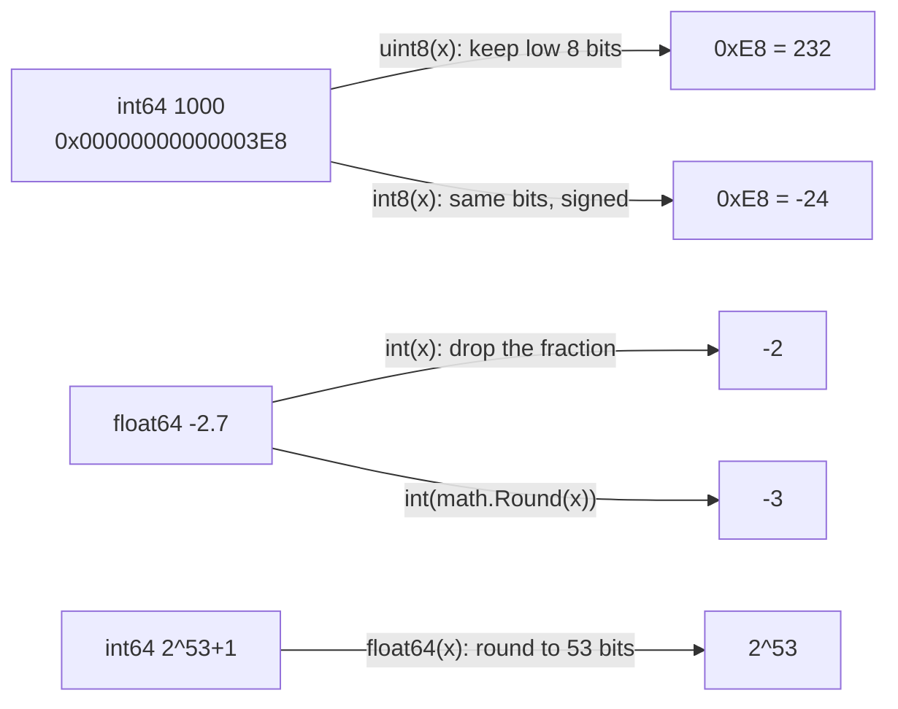
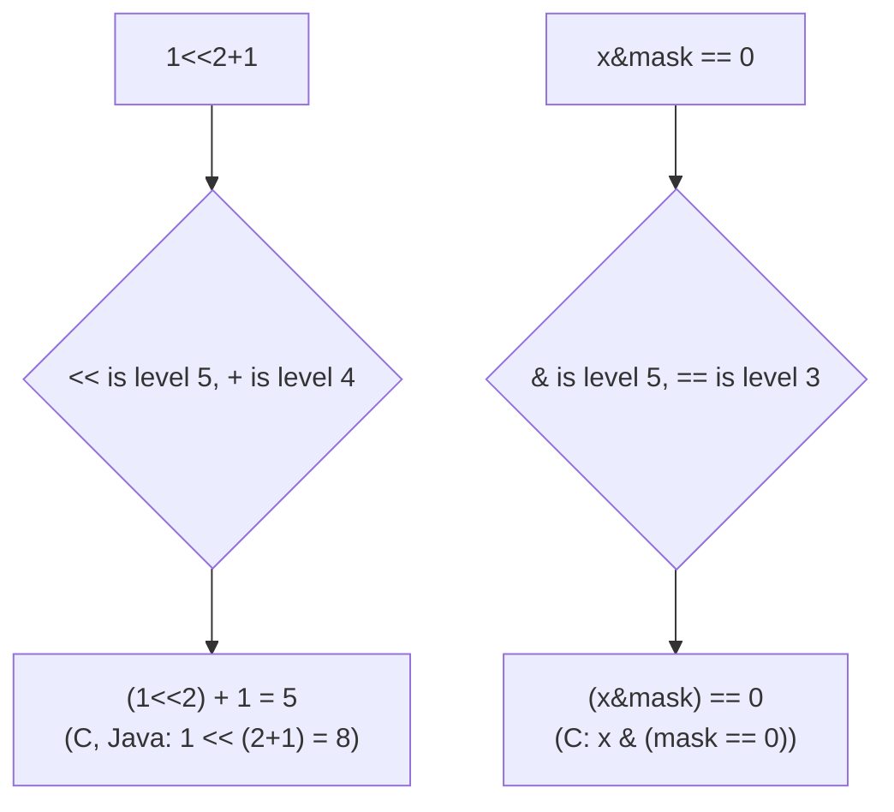

# 03 · Basic Types & Operators

> **Level:** Foundation
> **Prerequisites:** [02 Variables & constants](../../02-variables-and-constants/theory/README.md) (zero values, untyped constants and default types, §5.2–5.4)
> **Related:** 08 Strings, bytes & runes (strings in depth) · 09 Pointers (pointer types) · 13 The type system (defined types, aliases, assignability in depth) · 18 Errors (`strconv` errors) · 28 Memory management (sizes and layout) · 31 Standard library essentials (`strconv`, `math`)
> **Go version:** go1.27.1 (darwin/arm64) · everything here applies from Go 1.22 on; `min`/`max` need Go 1.21+
> **Targets stuck patterns:** none recorded yet (no diagnostic). Likely targets: "random" numeric bugs from wraparound, truncation and float rounding (hypothesis 3, missing mental models), and Python/Java number habits (hypothesis 4)
> **Started:** 2026-11-03 · **Status:** 📖 In progress
>
> **Syllabus items covered:** 3 (bool, integers, floats, complex, string, byte, rune, conversions, overflow, a first look at aliases vs defined types) and 4 (arithmetic, comparison, logical, bitwise, assignment, `++`/`--`, precedence). Strings get a first look here; their home is 08 (full treatment in 08). Defined types and aliases get a first look; their home is 13.
> **Run the code:** `cd topics/03-basic-types-and-operators && make examples` · exercises in [`exercises/`](../exercises/README.md)

---

## 1. TL;DR

- **Go's numbers are machine numbers with fixed sizes:** `int8`…`int64`, `uint8`…`uint64`, `float32`/`float64`, `complex64`/`complex128`, plus `int`/`uint`/`uintptr`, which are 64 bits on 64-bit platforms. `byte` is `uint8` and `rune` is `int32` (aliases, not new types).
- **Integer arithmetic wraps around silently** (two's complement), never panics and never grows: `int8(127) + 1 == -128`. Only **integer division by zero** and **negative shift counts** panic. Overflow detection is your job (E3).
- **`/` truncates toward zero and `%` takes the sign of the dividend:** `-7/2 == -3`, `-7%2 == -1`. `>>` on signed values floors instead (`-7>>1 == -4`). Floats follow IEEE 754: `1/0.0` is `+Inf`, `NaN != NaN`, and `0.1+0.2 != 0.3`.
- **No implicit conversions, ever, between typed values.** `int + int64` doesn't compile. `T(x)` conversions always succeed at runtime and **silently** truncate (`int(-2.7) == -2`), wrap (`uint8(300) == 44`) or lose precision.
- **Go's precedence differs from C and Java:** `<<`, `>>`, `&` and `&^` bind like `*`, so `1<<2+1 == 5` and `x&mask == 0` needs no parentheses. `^` is XOR (and bitwise NOT as a unary operator), never "power". `++`/`--` are statements, and there's no ternary `?:`.
- **Habits to drop:** money in `float64`, `uint` for "can't be negative", `math.Pow`/`math.Ceil` for integer math, `== true`, and expecting Python's arbitrary-precision ints or Java's implicit widening.

## 2. Why It Exists

### The problems Go's design solves here

**Predictable performance and memory layout.** Go is a systems language: a struct of three `int32` fields is exactly 12 bytes, and adding two `int64`s is one machine instruction. That rules out Python's design, where every `int` is a heap object with arbitrary precision. The trade-off: numbers can overflow, so you have to think about ranges.

**No hidden conversions.** C and Java convert silently between numeric types (Java widens `int` to `long` and `double`; C does "usual arithmetic conversions", including signed-to-unsigned surprises). The Go FAQ ("Why does Go not provide implicit numeric conversions?") says the convenience isn't worth the confusion it causes. So in Go, `int`, `int32` and `int64` are **different types** even on a machine where `int` is 64 bits, and mixing them is a compile error. The cost is a few explicit conversions. The benefit is that every conversion is visible in the code, so a reviewer can see where precision may be lost.

**Defined behaviour where C has undefined behaviour.** Signed overflow in C is *undefined behaviour*: the optimizer may assume it never happens. In Go it's defined: it wraps (spec, "Integer overflow"). Shifting by the width of the type or more is undefined in C; in Go it's defined as "all bits shifted out" (E5 relies on it). Integer division by zero is a defined **runtime panic** rather than a crash or garbage. Go chose "always the same answer on every platform" over "maximum optimizer freedom".

**A small set of operators with fewer precedence levels.** C has 15 precedence levels. Go has **5** for binary operators, and puts the bitwise operators at the same levels as arithmetic. That removes the most famous C precedence bug (`x & mask == 0` parses as `x & (mask == 0)` in C) at the cost of surprising people who memorized C's table. `++`/`--` are statements, not expressions, so `a[i++] = i` style puzzles can't be written. There's no ternary operator; the Go FAQ says `if`/`else` is clearer.

### What Python and Java do instead

| Concern | Python | Java | Go |
|---|---|---|---|
| Integers | One `int`, arbitrary precision, never overflows | `byte` (signed!), `short`, `int`, `long`; overflow wraps silently; `Math.addExact` throws | 10 sized integer types + `int`/`uint`; wraps silently; check it yourself |
| Division | `/` is float division; `//` floors; `%` takes the **divisor's** sign (`-7 % 2 == 1`) | Truncates toward zero; `%` takes the dividend's sign | Same as Java: `-7/2 == -3`, `-7%2 == -1` |
| Mixed arithmetic | `1 + 2.5` works | Implicit widening (`int` → `long` → `double`) | Compile error for typed values; untyped constants adapt (02 §5.4) |
| Booleans | `bool` is a subclass of `int` (`True + 1 == 2`) | `boolean`, not numeric | `bool`, not numeric; `if n {}` doesn't compile |
| Characters | 1-character `str` | `char` = UTF-16 code unit (16 bits) | `rune` = Unicode code point (`int32`); `byte` = `uint8` |
| Unsigned | — | Only `char`; `>>>` for logical shift | `uint8`…`uint64`; `>>` is logical on unsigned, arithmetic on signed |
| `++` | None | Expression (`a[i++]`) | Statement only |
| Ternary | `x if c else y` | `c ? x : y` | None: use `if`/`else` |
| Power | `**` | `Math.pow` | `math.Pow` for floats; shifts for powers of two; `^` is XOR |

## 3. Mental Model

**Every typed value is a fixed number of bits, and every operator works on exactly those bits.** Arithmetic is done in that width and wraps around at the ends. A conversion `T(x)` re-reads or re-cuts the bits for the new type and never asks whether the value fits.

```
int8 is a clock with 256 positions:
                 0
          -1  ·     ·  1
       -2 ·             · 2
         ·               ·
   -127 ·                 · 126
     -128 ·  ←── +1 ──  · 127      127 + 1 lands on -128: no error, no panic
```

```
conversion = keep the low bits, then reinterpret them
int64(1000)     ... 00000011 11101000
uint8(…)                     11101000  = 232
int8(…)                      11101000  = -24   (same bits, signed reading)
```

And for floats: **a float64 is a binary fraction with 53 significant bits**, so it represents `0.5`, `0.25` and `3.0` exactly, but `0.1` only approximately (just as 1/3 has no exact decimal form).

**Where it breaks:**
- **Untyped constants aren't bits yet.** `1 << 100` is fine as a constant, and constant overflow is a *compile* error, not a wraparound (02 §5.3, §7.5–7.6). The clock model applies to *typed* values.
- **Floats don't wrap: they saturate.** Overflow gives `±Inf`, and invalid operations give `NaN`, which isn't equal to anything, including itself.
- **Float → int conversion out of range isn't "keep the low bits".** The spec says the result is *implementation-dependent* (§5.5). Range-check first (E3).
- **`int` isn't "an int64".** It's a distinct type whose size depends on the platform (64 bits on every common server platform today, 32 on some embedded or WebAssembly targets).

## 4. Core Concepts & Terminology

| Term | Precise meaning (spec wording where possible) | Common confusion |
|---|---|---|
| **Boolean type** | `bool`, with the predeclared constants `true` and `false` | Not a number: no `int(true)`, no `if n` |
| **Integer types** | `int8`, `int16`, `int32`, `int64` (signed, two's complement); `uint8`…`uint64` (unsigned) | "Signed" means two's complement, so the range is asymmetric: `-128..127` |
| **`int`, `uint`** | "Either 32 or 64 bits", the same size as each other | Distinct from `int64`/`int32` even when the size matches |
| **`uintptr`** | "An unsigned integer large enough to store the uninterpreted bits of a pointer value" | Not a pointer: the GC doesn't track it (topic 30) |
| **Floating-point types** | `float32`, `float64`: IEEE 754 binary32/binary64 | `float64` is the default for float constants; prefer it |
| **Complex types** | `complex64` (two `float32`s), `complex128` (two `float64`s) | Rare outside numeric code |
| **String type** | An immutable sequence of bytes; `len` counts bytes | Not a sequence of characters (08) |
| **`byte`, `rune`** | Aliases: `byte` = `uint8`, `rune` = `int32` | `%T` prints `uint8`/`int32`, because they *are* those types |
| **Defined type** | `type Celsius float64` creates a **new, distinct** type with `float64` as its underlying type | Not interchangeable with `float64` without a conversion |
| **Alias** | `type Temperature = float64` is **another name** for the same type | Introduced for refactoring large codebases (Go 1.9); full treatment in 13 |
| **Conversion** | `T(x)`: changes the type of `x`; for numbers, may change the representation | Not a cast in the C sense of "trust me": it's always value-preserving *or* well-defined truncation |
| **Overflow** | Typed integer results wrap modulo 2ⁿ; "overflow does not cause a run-time panic" (spec) | Constant overflow is a compile error instead |
| **Comparable / ordered** | `==`/`!=` work on comparable types; `<` `<=` `>` `>=` only on ordered types (integers, floats, strings) | `bool` and `complex` are comparable but not ordered |
| **Precedence** | 5 levels: `* / % << >> & &^` > `+ - \| ^` > `== != < <= > >=` > `&&` > `\|\|`; unary operators bind tightest | Differs from C/Java for shifts and `&`, `\|` |
| **Short-circuit** | `&&` and `\|\|` evaluate the right operand only if needed | It's a guarantee you can rely on for guards |
| **IncDec statement** | `x++` and `x--` are **statements** | Not expressions; no `++x` |

## 5. How It Works Inside

### 5.1 Sizes, ranges and the machine

Every basic type has a fixed size on a given platform. On 64-bit platforms (amd64, arm64: every common server and laptop), `int`, `uint` and `uintptr` are 8 bytes.

**Predict the output** ([`internal/examples/types.go`](../internal/examples/types.go) · `make example N=type-sizes`): what is the size of a `string`?
<details><summary>Output</summary>

```
bool        1 bytes
int8        1 bytes
int16       2 bytes
int32       4 bytes
int64       8 bytes
int         8 bytes
uint        8 bytes
uintptr     8 bytes
float32     4 bytes
float64     8 bytes
complex64   8 bytes
complex128 16 bytes
byte        1 bytes
rune        4 bytes
string     16 bytes
int:   -9223372036854775808 to 9223372036854775807
int8:  -128 to 127 | uint8: 0 to 255
```
Why: a `string` value is a **two-word header** (a pointer to the bytes and a length), so it's 16 bytes no matter how long the text is. The bytes live elsewhere. The code uses `unsafe.Sizeof`, a compile-time constant that's harmless to call (the `unsafe` package itself is topic 30).
</details>

```
string "héllo" (16-byte header)          backing bytes (read-only)
┌───────────────┬─────────┐            ┌────┬────┬────┬────┬────┬────┐
│ ptr ──────────┼────────►│            │ 68 │ C3 │ A9 │ 6C │ 6C │ 6F │
├───────────────┼─────────┤            └────┴────┴────┴────┴────┴────┘
│ len = 6       │                         h    é (2 bytes)  l    l    o
└───────────────┘
```

Which type to use:
- **`int`** for counts, lengths, indexes and loop variables. `len`, `cap` and slice indexes are `int`, so using `int` avoids conversions.
- **Sized types** (`int32`, `uint16`, `int64`…) when the size is part of a contract: a file format, a network protocol, a database column, a hash, or memory-sensitive data in large slices.
- **`uint8`…`uint64`** for bit patterns, masks, hashes and binary protocols (E5). **Not** for "this can't be negative" (§7.2).
- **`float64`** for floating point unless memory or an API demands `float32` (`float32` has only about 7 significant decimal digits).
- **`int64` cents** (or a decimal type) for money, never floats (§7.5, E4).

### 5.2 Integers: two's complement and wraparound

Signed integers use **two's complement**: the top bit has negative weight. For `int8`, bit 7 is worth −128 and bits 0–6 are worth +1…+64, so `10000000` = −128 and `11111111` = −1. The same adder circuit then works for signed and unsigned numbers, and overflow simply drops the carry out of the top bit.

The spec makes this the language rule: "For unsigned integer values, the operations `+`, `-`, `*`, and `<<` are computed modulo 2ⁿ… For signed integers, the operations… may legally overflow and the resulting value exists and is deterministically defined… Overflow does not cause a run-time panic."

**Predict the output** ([`internal/examples/integers.go`](../internal/examples/integers.go) · `make example N=integer-overflow`):
```go
var i8 int8 = 127
i8++
fmt.Fprintln(w, "int8 127+1 =", i8)

var u8 uint8
u8--
fmt.Fprintln(w, "uint8 0-1 =", u8)

big := math.MaxInt64
big++
fmt.Fprintln(w, "MaxInt64+1 =", big)

low := int8(-128)
fmt.Fprintln(w, "-(-128) as int8 =", -low)
fmt.Fprintf(w, "bits: 127=%08b -128=%08b -1=%08b\n", uint8(127), uint8(low), uint8(low+127))
```
<details><summary>Output</summary>

```
int8 127+1 = -128
uint8 0-1 = 255
MaxInt64+1 = -9223372036854775808
-(-128) as int8 = -128
bits: 127=01111111 -128=10000000 -1=11111111
```
Why: each result is the true result modulo 2ⁿ, read back in the type's range. Negating −128 gives +128, which doesn't fit in `int8`, and wraps back to −128. That's the **asymmetry** of two's complement: there's one more negative value than positive ones, so `-x` and `abs(x)` can overflow (§7.11, E3).
</details>

### 5.3 Division, remainder and shifts

The spec defines integer division as **truncated** (rounded toward zero), and the remainder so that `x == (x/y)*y + x%y` always holds. So `%` takes the **sign of the dividend**. A right shift on a signed integer is an *arithmetic* shift (it copies the sign bit in), which rounds toward **minus infinity**. That's why `x >> 1` and `x / 2` differ for negative odd `x`.

**Predict the output** (`make example N=division-and-remainder`):
```go
a, b := -7, 2
fmt.Fprintln(w, "7/2 =", 7/b, " -7/2 =", a/b, " -7%2 =", a%b, " 7%-2 =", 7%-b)
fmt.Fprintln(w, "-7>>1 =", a>>1, "(a shift rounds toward minus infinity)")

n, idx := 5, -1
fmt.Fprintln(w, "-1%5 =", idx%n, " wrapped:", (idx%n+n)%n)
```
<details><summary>Output</summary>

```
7/2 = 3  -7/2 = -3  -7%2 = -1  7%-2 = 1
-7>>1 = -4 (a shift rounds toward minus infinity)
-1%5 = -1  wrapped: 4
```
Why: −7 / 2 = −3.5, truncated to −3, and −7 = (−3)(2) + (−1). Python gives `-7 // 2 == -4` and `-7 % 2 == 1` (it floors), so ported "wrap around an index" code breaks: in Go, use `(i%n + n) % n` to get a value in `[0, n)`.
</details>

**What the compiler does with it** (real `go build -gcflags=-S` output on arm64, trimmed):
```
func divU(x uint64) uint64 { return x / 8 }      func divS(x int64) int64 { return x / 8 }
	LSR	$3, R0, R0                           	ASR	$63, R0, R1        // R1 = all ones if x < 0
	RET                                          	ADD	R1>>61, R0, R1     // add 7 if x < 0
                                                	ASR	$3, R1, R0         // then shift
                                                	RET
func divVar(x, y int64) int64 { return x / y }
	CBZ	R1, 44                                  // y == 0?  → jump to the panic
	SDIV	R1, R0, R0
	...
	CALL	runtime.panicdivide(SB)
```
Dividing an **unsigned** value by a constant power of two is a single shift. A **signed** division needs a fix-up, because a plain shift would round toward −∞ instead of toward zero. Dividing by a **variable** costs a real divide instruction plus a zero check that calls `runtime.panicdivide` (§7.3). None of this changes how you write code, but it shows that the language rules map to concrete instructions.

### 5.4 Floating point: IEEE 754 binary fractions

A `float64` has 1 sign bit, 11 exponent bits and 52 stored fraction bits (53 significant bits with the implicit leading 1):

```
float64:  ┌─┬───────────┬────────────────────────────────────────────────────┐
          │s│ exponent  │ fraction (52 bits)                                 │
          └─┴───────────┴────────────────────────────────────────────────────┘
value = (-1)^s × 1.fraction × 2^(exponent - 1023)
0.1  = 0x3FB999999999999A → 0.1000000000000000055511151231257827…   (rounded)
0.5  = 0x3FE0000000000000 → exactly 0.5                               (2^-1)
```
Any value that is a short sum of powers of two (`0.5`, `0.75`, `3.0`, `1024.125`) is exact. Most decimals (`0.1`, `0.2`, `19.95`) are not. Each operation is correctly rounded, but the errors accumulate.

**Predict the output** ([`internal/examples/floats.go`](../internal/examples/floats.go) · `make example N=float-precision`):
```go
a, b := 0.1, 0.2
fmt.Fprintln(w, "0.1+0.2 =", a+b)
fmt.Fprintf(w, "0.1 is really %.25f\n", a)

var f32 float32 = 16_777_216 // 2^24: float32 has a 24-bit significand
fmt.Fprintln(w, "float32 2^24+1 == 2^24:", f32+1 == f32)
f64 := float64(1 << 53) // float64 has a 53-bit significand
fmt.Fprintln(w, "float64 2^53+1 == 2^53:", f64+1 == f64)

sum := 0.0
for range 10 {
	sum += 0.1
}
fmt.Fprintln(w, "ten 0.1s:", sum, "== 1:", sum == 1)

cents := 0
for range 10 {
	cents += 10
}
fmt.Fprintln(w, "ten 10-cent ints == 100:", cents == 100)
```
<details><summary>Output</summary>

```
0.1+0.2 = 0.30000000000000004
0.1 is really 0.1000000000000000055511151
float32 2^24+1 == 2^24: true
float64 2^53+1 == 2^53: true
ten 0.1s: 0.9999999999999999 == 1: false
ten 10-cent ints == 100: true
```
Why: above 2²⁴ a `float32` can't represent every integer, and above 2⁵³ a `float64` can't, so `+1` rounds back to the same value. This is also why JSON numbers (parsed as `float64` in JavaScript and by default in `encoding/json` into `any`) can't carry 64-bit IDs safely (§10). The integer version of the loop is exact.
</details>

The special values come from IEEE 754 too. Go's gc compiler follows IEEE 754 for floating-point division by zero; the spec says only that the result "is not specified beyond the IEEE 754 standard". Integer division by zero is different: it panics (§7.3).

**Predict the output** (`make example N=float-special-values`):
```go
var zero float64
fmt.Fprintln(w, "1/0 =", 1/zero, " -1/0 =", -1/zero, " 0/0 =", zero/zero)

nan := math.NaN()
fmt.Fprintln(w, "NaN == NaN:", nan == nan, " NaN != NaN:", nan != nan, " IsNaN:", math.IsNaN(nan))

negZero := math.Copysign(0, -1)
fmt.Fprintln(w, "-0:", negZero, " -0 == 0:", negZero == 0, " 1/-0 =", 1/negZero)

huge := math.MaxFloat64
fmt.Fprintln(w, "MaxFloat64*2 =", huge*2, " Inf-Inf =", math.Inf(1)-math.Inf(1))
```
<details><summary>Output</summary>

```
1/0 = +Inf  -1/0 = -Inf  0/0 = NaN
NaN == NaN: false  NaN != NaN: true  IsNaN: true
-0: -0  -0 == 0: true  1/-0 = -Inf
MaxFloat64*2 = +Inf  Inf-Inf = NaN
```
Why: NaN ("not a number") compares unequal to everything, itself included, so the only test is `math.IsNaN` (or `x != x`). Negative zero equals zero but keeps its sign through division. Float overflow saturates to `±Inf` instead of wrapping.
</details>

One more spec detail: an implementation **may fuse** operations such as `x*y + z` into a single fused multiply-add instruction with one rounding instead of two (arm64 has one). An explicit conversion, `float64(x*y) + z`, forces the intermediate rounding. This matters only for bit-exact numeric code, but it's why "the same float code gives a slightly different last digit on another CPU" is possible.

### 5.5 Conversions: always succeed, never check

The spec rules for non-constant numeric conversions:
- **Integer → integer:** the value is sign-extended (signed source) or zero-extended (unsigned source) to infinite precision, then **truncated** to the target size. Keep the low bits, then reinterpret them.
- **Float → integer:** "the fraction is discarded (truncation towards zero)". If the result doesn't fit, the value is **implementation-dependent**: no panic, just an unspecified number.
- **Integer → float:** rounded to the nearest representable value (precision loss above 2⁵³ for `float64`).
- **Constant conversions** are checked at compile time instead: `int8(300)` doesn't compile (§7.8).



**Predict the output** ([`internal/examples/conversions.go`](../internal/examples/conversions.go) · `make example N=conversions`):
```go
f := -2.7
fmt.Fprintln(w, "int(-2.7) =", int(f), " Round:", int(math.Round(f)), " Floor:", int(math.Floor(f)))

x := int64(300)
fmt.Fprintln(w, "int8(300) =", int8(x), " uint8(300) =", uint8(x))

y := int64(-1)
fmt.Fprintln(w, "uint8(-1) =", uint8(y), " uint64(-1) =", uint64(y))

big := int64(1<<53 + 1)
fmt.Fprintln(w, "float64(2^53+1) == float64(2^53):", float64(big) == float64(big-1))

v := int64(0x1234_5678)
fmt.Fprintf(w, "int16(%#x) = %#x\n", v, int16(v))
```
<details><summary>Output</summary>

```
int(-2.7) = -2  Round: -3  Floor: -3
int8(300) = 44  uint8(300) = 44
uint8(-1) = 255  uint64(-1) = 18446744073709551615
float64(2^53+1) == float64(2^53): true
int16(0x12345678) = 0x5678
```
Why: 300 = `0x12C`; the low byte `0x2C` = 44, which is positive in both readings. −1 is all ones in two's complement, so any unsigned conversion gives that type's maximum. Converting to a smaller type keeps the low bits (`0x5678`). **None of these is an error**: if a value might not fit, check the range before converting (E3's `ToInt32`).
</details>

### 5.6 Defined types vs aliases: a first look

*(Full treatment in 13: underlying types, type identity, assignability.)*

`type Celsius float64` is a **type definition**: it creates a new, distinct type. It has the same representation and operators as `float64`, but you can't mix the two without a conversion, which is the point: the compiler stops you from adding a `Celsius` to a `Fahrenheit` (or cents to a count, E4). `type Temperature = float64` is an **alias declaration**: just a second name for the same type, used mainly for gradual refactoring. `byte` and `rune` are aliases of this kind, which is why `%T` prints `uint8` and `int32`.

**Predict the output** ([`internal/examples/types.go`](../internal/examples/types.go) · `make example N=alias-vs-defined`):
```go
type Celsius float64        // defined type: a new, distinct type
type Temperature = float64  // alias: another name for float64

f := 21.5
var t Temperature = f // OK: Temperature IS float64
c := Celsius(f)       // a conversion is required: Celsius is a different type
fmt.Fprintf(w, "%T %T %T\n", f, t, c)
fmt.Fprintln(w, "c + 1.5 =", c+1.5) // untyped constants convert to Celsius

var b byte = 'A' // byte is an alias for uint8
var u uint8 = b
var r rune = 'é' // rune is an alias for int32
var i int32 = r
fmt.Fprintf(w, "%T %T %v %v\n", b, r, u, i)
```
<details><summary>Output</summary>

```
float64 float64 examples.Celsius
c + 1.5 = 23
uint8 int32 65 233
```
Why: `%T` of an alias prints the aliased type, because there's no separate type to print. `var c2 Celsius = f` wouldn't compile: `f` is a typed `float64`, and assigning it to `Celsius` needs `Celsius(f)`. Untyped constants (`1.5`) still convert implicitly (02 §5.4). `'é'` is code point U+00E9 = 233.
</details>

### 5.7 Operators and precedence

Go has five precedence levels for binary operators; within a level, operators associate **left to right**. Unary operators (`+ - ! ^ * & <-`) bind tighter than all of them.

| Level | Operators | Notes |
|---|---|---|
| 5 (highest) | `*` `/` `%` `<<` `>>` `&` `&^` | multiplicative: shifts and AND sit with `*` |
| 4 | `+` `-` `\|` `^` | additive: OR and XOR sit with `+` |
| 3 | `==` `!=` `<` `<=` `>` `>=` | comparison |
| 2 | `&&` | |
| 1 (lowest) | `\|\|` | |



**Predict the output** ([`internal/examples/operators.go`](../internal/examples/operators.go) · `make example N=operator-precedence`):
```go
fmt.Fprintln(w, "1+2*3 =", 1+2*3)
fmt.Fprintln(w, "1<<2+1 =", 1<<2+1) // << binds like *, so (1<<2)+1
fmt.Fprintln(w, "6&3 == 2:", 6&3 == 2)
fmt.Fprintln(w, "2^3 =", 2^3) // ^ is XOR, not a power
t, f, g := true, false, false
fmt.Fprintln(w, "t || f && g:", t || f && g)               // && binds tighter: t || (f && g)
fmt.Fprintln(w, "10-4-3 =", 10-4-3, " 2*3/4*4 =", 2*3/4*4) // left to right
fmt.Fprintln(w, "7/2*2.0 =", 7/2*2.0)                      // (7/2) is integer division first
```
<details><summary>Output</summary>

```
1+2*3 = 7
1<<2+1 = 5
6&3 == 2: true
2^3 = 1
t || f && g: true
10-4-3 = 3  2*3/4*4 = 4
7/2*2.0 = 6
```
Why: `1<<2+1` is `(1<<2)+1`. `6&3` = `0110 & 0011` = `0010` = 2. `2^3` = `010 XOR 011` = `001`. `2*3/4*4` = `((2*3)/4)*4` = `(6/4)*4` = `1*4`. In `7/2*2.0`, the subexpression `7/2` has two untyped *integer* operands, so it's integer division (3) before the float `2.0` joins in (02 §7.7).
</details>

**Rule:** when in doubt, add parentheses; `gofmt` keeps them, and a reader shouldn't need the table. Don't rely on spacing to show grouping: `1<<2+1` and `1 << 2+1` parse the same way.

## 6. Worked Examples

§5 has the core mechanism examples. These cover the remaining concepts. `make examples` lists all 21 examples (2 crash on purpose), and `make example N=all` runs the others.

### 6.1 Bitwise operators
[`internal/examples/operators.go`](../internal/examples/operators.go) · `make example N=bitwise-ops`

**Predict the output:**
```go
a, b := uint8(0b1100), uint8(0b1010)
fmt.Fprintf(w, "a&b=%04b a|b=%04b a^b=%04b a&^b=%04b\n", a&b, a|b, a^b, a&^b)
fmt.Fprintf(w, "^a=%08b a<<2=%08b a>>2=%04b\n", ^a, a<<2, a>>2)

shift := 8
var one uint8 = 1
fmt.Fprintln(w, "uint8 1<<7 =", one<<(shift-1), " 1<<8 =", one<<shift) // shifted-out bits are gone

var s int8 = -8
fmt.Fprintln(w, "int8 -8>>1 =", s>>1, " ^-8 =", ^s) // arithmetic shift; ^x == -x-1
fmt.Fprintln(w, "6 is even:", 6&1 == 0, " 7 is even:", 7&1 == 0)
```
<details><summary>Output</summary>

```
a&b=1000 a|b=1110 a^b=0110 a&^b=0100
^a=11110011 a<<2=00110000 a>>2=0011
uint8 1<<7 = 128  1<<8 = 0
int8 -8>>1 = -4  ^-8 = 7
6 is even: true  7 is even: false
```
</details>

| Operator | Name | Use |
|---|---|---|
| `a & b` | AND | test bits: `flags&Write != 0`; mask: `addr & mask` |
| `a \| b` | OR | set bits: `flags \| Exec` |
| `a ^ b` | XOR | toggle bits; checksums |
| `^a` | NOT (unary) | invert all bits: `^uint32(0)` is all ones |
| `a &^ b` | AND NOT ("bit clear") | clear bits: `flags &^ Write`. Go-only, = `a & (^b)` |
| `a << n` | left shift | multiply by 2ⁿ; build masks: `1 << iota` (02 §6.3) |
| `a >> n` | right shift | logical (fills 0s) on unsigned, arithmetic (copies the sign bit) on signed |

**Takeaway:** shifts are defined for any non-negative count: shifting by the width or more gives 0 (or −1 for negative signed values shifted right), unlike C, where it's undefined. Since Go 1.13 the count can be a signed integer; a negative count panics at runtime (§7.4). Use unsigned types for bit manipulation, so `>>` doesn't drag the sign bit in.

### 6.2 Short-circuit evaluation
`make example N=short-circuit`
```go
func trace(w io.Writer, name string, v bool) bool {
	fmt.Fprintf(w, "eval(%s) ", name)
	return v
}

r := trace(w, "a", false) && trace(w, "b", true)
fmt.Fprintln(w, "=> false && ... =", r)
r = trace(w, "a", true) || trace(w, "b", true)
fmt.Fprintln(w, "=> true || ... =", r)

var line string
if len(line) > 0 && line[0] == '#' { // safe: line[0] is never evaluated for ""
	fmt.Fprintln(w, "comment")
}
fmt.Fprintln(w, "empty line handled without a panic")
```
```
eval(a) => false && ... = false
eval(a) => true || ... = true
empty line handled without a panic
```
**Takeaway:** `b` is never evaluated: the spec guarantees that the right operand of `&&`/`||` is evaluated only when needed. That makes guards like `len(s) > 0 && s[0] == '#'` and `p != nil && p.ok` safe. Put the cheap or protective check on the left. Go's `&` and `|` are bitwise only, and don't apply to `bool`, so you can't accidentally use a non-short-circuit operator as in Java.

### 6.3 Assignment operators and `++`/`--`
`make example N=assignment-ops`
```go
x := 10
x += 5
x -= 3
x *= 2
x /= 4
x %= 4
fmt.Fprintln(w, "x =", x)

flags := uint8(0b0110)
flags |= 0b0001
flags &^= 0b0100
flags <<= 1
fmt.Fprintf(w, "flags = %04b\n", flags)

i := 0
i++
i++
i--
fmt.Fprintln(w, "i =", i)

s := "go"
s += "pher"
fmt.Fprintln(w, "s =", s)
```
```
x = 2
flags = 0110
i = 1
s = gopher
```
**Takeaway:** every binary arithmetic and bitwise operator has an `op=` form (`x op= y` is `x = x op y`, with `x` evaluated once). `+=` works on strings (and allocates a new string each time: use `strings.Builder` in loops, 08). `x++` is a **statement**, so it can't appear inside an expression (§7.9).

### 6.4 Comparison rules, `min` and `max`
`make example N=comparison-rules`
```go
fmt.Fprintln(w, `"apple" < "banana":`, "apple" < "banana", ` "Zebra" < "apple":`, "Zebra" < "apple", ` "é" > "z":`, "é" > "z")

var a int32 = 5
var b int64 = 5
fmt.Fprintln(w, "int64(a) == b:", int64(a) == b)

c := complex(1, 2)
fmt.Fprintln(w, "complex ==:", c == complex(1, 2))

nan := math.NaN()
fmt.Fprintln(w, "NaN < 1:", nan < 1, " NaN > 1:", nan > 1, " NaN == NaN:", nan == nan)
fmt.Fprintln(w, "min(3, 1, 2) =", min(3, 1, 2), " max(2.5, 1) =", max(2.5, 1), ` min("b", "a") =`, min("b", "a"))
```
```
"apple" < "banana": true  "Zebra" < "apple": true  "é" > "z": true
int64(a) == b: true
complex ==: true
NaN < 1: false  NaN > 1: false  NaN == NaN: false
min(3, 1, 2) = 1  max(2.5, 1) = 2.5  min("b", "a") = a
```
**Takeaway:** strings compare **byte by byte** (lexicographically on UTF-8 bytes), so uppercase sorts before lowercase and `é` (bytes `C3 A9`) after `z` (`7A`). That's not human alphabetical order: use `golang.org/x/text/collate` for locale-aware sorting, or `strings.EqualFold` for case-insensitive equality. Both operands of a comparison must have the same type (convert one). NaN makes every ordered comparison false, which silently breaks sorting. `min` and `max` (Go 1.21+) take any number of ordered arguments of one type.

### 6.5 Strings are bytes: a first look
*(Full treatment in 08.)* [`internal/examples/types.go`](../internal/examples/types.go) · `make example N=string-basics`

**Predict the output:**
```go
s := "héllo"
fmt.Fprintln(w, "len:", len(s), "runes:", utf8.RuneCountInString(s))
fmt.Fprintf(w, "s[1]=%d (%T) s[1:3]=%q\n", s[1], s[1], s[1:3])
for i, r := range "hé!" {
	fmt.Fprintf(w, " %d:%q(%T)", i, r, r)
}
fmt.Fprintln(w)

b := []byte(s) // a mutable copy
b[0] = 'H'
fmt.Fprintln(w, string(b), s)
fmt.Fprintln(w, "go"+"pher", "a" < "b", "Z" < "a")
```
<details><summary>Output</summary>

```
len: 6 runes: 5
s[1]=195 (uint8) s[1:3]="é"
 0:'h'(int32) 1:'é'(int32) 3:'!'(int32)
Héllo héllo
gopher true true
```
Why: `é` is 2 bytes in UTF-8, so `len` is 6. Indexing gives a **byte** (`uint8`), while `range` decodes **runes** (`int32`) and jumps by their byte width (index 1, then 3). Strings are immutable: converting to `[]byte` copies, and changing the copy leaves `s` alone.
</details>

### 6.6 Numbers ↔ text: `strconv`, not `string()`
*(`strconv` in depth: 31.)* [`internal/examples/conversions.go`](../internal/examples/conversions.go) · `make example N=string-conversions`
```go
n := 65
fmt.Fprintln(w, "string(rune(65)) =", string(rune(n)), " strconv.Itoa(65) =", strconv.Itoa(n))

v, err := strconv.Atoi("42")
fmt.Fprintln(w, "Atoi(\"42\")+1 =", v+1, "err:", err)
_, err = strconv.Atoi("4 2")
fmt.Fprintln(w, "Atoi(\"4 2\") err:", err)

fmt.Fprintln(w, "255 in base 2 and 16:", strconv.FormatInt(255, 2), strconv.FormatInt(255, 16))
_, err = strconv.ParseInt("300", 10, 8) // parse into an 8-bit range
fmt.Fprintln(w, "ParseInt(\"300\", 10, 8) err:", err)

r := []rune("héllo")
fmt.Fprintln(w, "[]byte(\"hi\") =", []byte("hi"), " []rune(\"héllo\") has", len(r), "runes")
```
```
string(rune(65)) = A  strconv.Itoa(65) = 65
Atoi("42")+1 = 43 err: <nil>
Atoi("4 2") err: strconv.Atoi: parsing "4 2": invalid syntax
255 in base 2 and 16: 11111111 ff
ParseInt("300", 10, 8) err: strconv.ParseInt: parsing "300": value out of range
[]byte("hi") = [104 105]  []rune("héllo") has 5 runes
```
**Takeaway:** a numeric conversion to `string` produces the **character** with that code point, not the digits (`go vet` flags `string(int)`, §7.7). Text ↔ number goes through `strconv`, which **returns an error** instead of guessing, and whose `bitSize` argument range-checks for you (`ParseInt(s, 10, 8)` rejects 300). That's the safe way to read numbers from users, files and env vars (02's E5).

### 6.7 Complex numbers
`make example N=complex-numbers`
```go
c := complex(3, 4)
fmt.Fprintf(w, "%v %T real=%v imag=%v abs=%v\n", c, c, real(c), imag(c), cmplx.Abs(c))
fmt.Fprintln(w, "cmplx.Sqrt(-1) =", cmplx.Sqrt(-1), "math.Sqrt(-1) =", math.Sqrt(-1))
fmt.Fprintln(w, "c*c =", c*c)
```
```
(3+4i) complex128 real=3 imag=4 abs=5
cmplx.Sqrt(-1) = (0+1i) math.Sqrt(-1) = NaN
c*c = (-7+24i)
```
**Takeaway:** complex numbers are built in (`complex`, `real`, `imag`, literals like `2i`), with functions in `math/cmplx`. You'll rarely need them in backend code (signal processing and scientific code use them). They support `==` but not `<`.

### 6.8 Detecting overflow with `math/bits`
`make example N=overflow-detection`
```go
sum, carry := bits.Add64(math.MaxUint64, 1, 0)
fmt.Fprintln(w, "MaxUint64+1: sum =", sum, "carry =", carry)

hi, lo := bits.Mul64(1<<40, 1<<40) // 2^80 doesn't fit in 64 bits
fmt.Fprintln(w, "2^40*2^40: hi =", hi, "lo =", lo)

var x uint64 = 0b1011_0000
fmt.Fprintln(w, "ones:", bits.OnesCount64(x), "len:", bits.Len64(x), "trailing zeros:", bits.TrailingZeros64(x))
```
```
MaxUint64+1: sum = 0 carry = 1
2^40*2^40: hi = 65536 lo = 0
ones: 3 len: 8 trailing zeros: 4
```
**Takeaway:** for **unsigned** arithmetic, `math/bits` exposes the carry and the full 128-bit product (and compiles to single instructions on most CPUs), so overflow detection is exact: a carry of 1 or a nonzero `hi` means it didn't fit. For **signed** `int64`, detect overflow from the signs of the operands and the result, which is E3. `math/big` gives arbitrary precision when you really need it, at the cost of allocations.

### 6.9 Comparing floats
[`internal/examples/floats.go`](../internal/examples/floats.go) · `make example N=float-comparison`
```go
func almostEqual(a, b, relTol float64) bool {
	return math.Abs(a-b) <= relTol*math.Max(math.Abs(a), math.Abs(b))
}

a, b := 0.1, 0.2
fmt.Fprintln(w, "a+b == 0.3:", a+b == 0.3)
fmt.Fprintln(w, "almostEqual(a+b, 0.3, 1e-9):", almostEqual(a+b, 0.3, 1e-9))
fmt.Fprintln(w, "almostEqual(1e-20, 2e-20, 1e-9):", almostEqual(1e-20, 2e-20, 1e-9))
```
```
a+b == 0.3: false
almostEqual(a+b, 0.3, 1e-9): true
almostEqual(1e-20, 2e-20, 1e-9): false
```
**Takeaway:** compare computed floats with a **relative** tolerance. An absolute tolerance like `1e-9` would call `1e-20` and `2e-20` equal, although one is twice the other. The standard library has no built-in "almost equal" because the right tolerance depends on the computation. In tests, compare with a tolerance or compare formatted output. Better still, avoid floats where exact answers matter.

### 6.10 Number literals
[`internal/examples/types.go`](../internal/examples/types.go) · `make example N=number-literals`

**Predict the output:**
```go
fmt.Fprintln(w, 1_000_000, 0b1010, 0o17, 0x1F, 0x1p-2, 1e3, 2.5e-3)
fmt.Fprintln(w, 'a', '\n', '\x41', '\u00e9', '\U0001F600')
fmt.Fprintf(w, "%T %T %T\n", 1e3, 0x1p-2, '\u00e9')
fmt.Fprintln(w, "0644 == 0o644 == 420:", 0644 == 0o644, 0o644 == 420) // a leading 0 alone means octal
```
<details><summary>Output</summary>

```
1000000 10 15 31 0.25 1000 0.0025
97 10 65 233 128512
float64 float64 int32
0644 == 0o644 == 420: true true
```
Why: `_` separates digits for readability (Go 1.13+). Prefixes `0b`, `0o` and `0x` give binary, octal and hex (Go 1.13+ for `0b`/`0o`). `0x1p-2` is a hex float: 1 × 2⁻² = 0.25. `1e3` is a *float* constant even though its value is whole, so its default type is `float64`. A rune literal is a number: `'a'` is 97, and escapes like `\x41`, `\u00e9` and `\U0001F600` give code points. The legacy form `0644` (a leading zero) is also octal, which is why `os.WriteFile(name, data, 0644)` means `rw-r--r--`.
</details>

**Takeaway:** write file modes as `0o644` (gofmt keeps both forms, but `0o` can't be misread as decimal), large constants with `_` (`10_000_000`), and bit masks in `0b`/`0x`. A number with a leading zero that you meant as decimal (`010` for "ten") is a real bug class (*100 Go Mistakes* #17, "Creating confusion with octal literals").

## 7. Gotchas

Compile errors and tool output below were produced with go1.27.1 (and golangci-lint 2.14 for staticcheck) in a scratch module (`example.com/gotchas`), copied from the terminal. Runtime gotchas are examples in this module.

| # | Gotcha | Symptom | Fix |
|---|---|---|---|
| 7.1 | Integer overflow wraps silently | Wrong, often negative, numbers | Choose a big enough type; check at boundaries (E3) |
| 7.2 | `uint` for "can't be negative" | `len-1` becomes 18446744073709551615; infinite loops | Use `int`; unsigned only for bit patterns |
| 7.3 | Integer division by zero | Runtime panic (variable) / compile error (constant) | Check the divisor |
| 7.4 | Negative shift count | Runtime panic | Validate the count |
| 7.5 | Money and exact decimals in floats | `0.30000000000000004`, cents lost | Integer cents (E4) or a decimal type |
| 7.6 | Integer division before multiplying | `done/total*100` is 0 | Multiply first (E2) |
| 7.7 | `string(n)` for digits | `"A"` instead of `"65"`; vet error | `strconv.Itoa(n)` |
| 7.8 | Mixing numeric types | `mismatched types int and int64`; `truncated to int` | Explicit conversion, deliberately |
| 7.9 | `++` as an expression, `++i`, `?:` | Syntax errors | Separate statement; `if`/`else` |
| 7.10 | `^` for power, C precedence habits | `2^3 == 1`; `1<<2+1 == 5` | `math.Pow` / shifts; parentheses |
| 7.11 | Asymmetric range: `-MinInt`, `MinInt / -1` | Still negative | Check for `MinInt` (E3) |
| 7.12 | Comparing with NaN; float `==` | Comparisons always false; sort breaks | `math.IsNaN`; tolerance |
| 7.13 | Using non-`bool` as a condition; ordering `bool`/`complex` | Compile errors | Explicit comparison |
| 7.14 | Modifying a string in place | `cannot assign to s[0]` | Convert to `[]byte`/`[]rune`, or build a new string |

### 7.1 Integer overflow wraps silently
See §5.2 (`make example N=integer-overflow`): `int8(127)+1 == -128`, `math.MaxInt64+1 == math.MinInt64`. **Why:** the spec defines wraparound and forbids a panic. Real-world shapes: a counter in an `int32` (2.1 billion) that wraps after a busy month; `width * height * 4` bytes for a large image in 32 bits; summing file sizes in an `int32`. **Fix:** use `int`/`int64` for anything that grows, validate inputs at the boundary (the size of a request, a quota), and use checked arithmetic where values come from outside (E3). Go has no `-ftrapv`-style overflow trap, and the race detector and vet don't catch overflow.

### 7.2 Unsigned "can't be negative" types underflow
`make example N=unsigned-underflow`
```go
var items []string
n := uint(len(items))
fmt.Fprintln(w, "uint len-1 =", n-1)
fmt.Fprintln(w, "int  len-1 =", len(items)-1)
```
```
uint len-1 = 18446744073709551615
int  len-1 = -1
```
The classic loop version compiles, passes `go vet`, and walks off the end of the slice:
```go
items := []string{"a", "b", "c"}
for i := uint(len(items)) - 1; i >= 0; i-- {
	fmt.Println(items[i])
}
```
```
c
b
a
panic: runtime error: index out of range [18446744073709551615] with length 3
```
staticcheck catches the condition (`go vet` doesn't):
```
unsignedloop/main.go:7:33: SA4003: every value of type uint is >= 0 (staticcheck)
```
**Why:** a `uint` can't hold −1, so `0 - 1` wraps to its maximum and `i >= 0` is always true. **Fix:** use `int` for counts, lengths and indexes (that's why `len` returns `int`). A negative `int` is an *obvious* bug you can check for; an underflowed `uint` looks like a valid huge number. Keep unsigned types for bit patterns, protocol fields and hashes.

### 7.3 Integer division by zero
With a constant divisor it doesn't compile:
```go
x := 10 / 0
```
```
constdiv/main.go:6:12: invalid operation: division by zero
```
With a variable it panics at runtime. `make example N=int-division-by-zero` (marked `Crashes: true`; the trace is trimmed):
```go
total, count := 10, 0
fmt.Fprintln(w, "average:", total/count)
```
```
panic: runtime error: integer divide by zero

goroutine 1 [running]:
github.com/Shreyash019/Golang/topics/03-basic-types-and-operators/internal/examples.IntDivisionByZero(...)
	.../internal/examples/integers.go:66 +0x1c
```
**Why:** there's no integer value that could represent the result, so Go stops instead of returning garbage. Remember the generated code from §5.3: the zero check is there on every division by a variable. Float division by zero gives `±Inf`/`NaN` instead (§5.4). **Fix:** handle the empty case explicitly: `if count == 0 { return 0, errNoSamples }`. Averages, percentages and rates are where this usually bites (E2's `total == 0`).

### 7.4 Negative shift counts panic
`make example N=negative-shift` (marked `Crashes: true`):
```go
n := -1
fmt.Fprintln(w, 1<<n)
```
```
panic: runtime error: negative shift amount
```
**Why:** since Go 1.13 shift counts may be signed integers, and a negative count is a runtime panic. A constant negative count is a compile error instead: `1 << -1` gives `invalid operation: negative shift count -1 (untyped int constant)`. **Fix:** validate counts that come from input (`if bits < 0 || bits > 32`, E5) or use an unsigned count.

### 7.5 Money in floating point
See §5.4: ten additions of `0.1` give `0.9999999999999999`, and `19.95` has no exact `float64` form. Each operation rounds, the errors accumulate, and `$x.yz` formatting hides them until a total is off by a cent, or a `== 0.3` check fails. **Fix:** represent money as an integer number of the smallest unit (`int64` cents), parse it from text exactly, and round once, explicitly, when applying percentages (E4's `percentOf`). For currencies with other minor units, many decimal places, or exchange rates, use a decimal type (`math/big.Rat` in the standard library, or a well-tested third-party decimal package). Floats are fine for measurements: latencies, temperatures, ratios.

### 7.6 Integer division before multiplication
```go
func Percent(done, total int) int {
	return done / total * 100 // 1/4 == 0, then 0*100
}
```
**Why:** integer division truncates, and operators of the same level evaluate left to right, so `done/total` is 0 for any `done < total`. **Fix:** multiply first, `done * 100 / total` (and check that `done*100` can't overflow), or compute in `float64` when you really want a fraction. The same thing happens with constants: `const ratio = 1 / 2` is 0 (02 §7.7). E2 is this bug.

### 7.7 `string(n)` produces a character, not digits
```go
id := 65
key := "user:" + string(id)
fmt.Println(key)
```
```
$ go run ./stringint
user:A
$ go vet ./stringint
stringint/main.go:7:19: conversion from int to string yields a string of one rune, not a string of digits
```
**Why:** converting an integer to `string` interprets it as a Unicode code point (65 = `A`). It's legal Go, which is why it slipped into real code often enough that `go vet` gained a check (`stringintconv`, also run by `go test`). **Fix:** `strconv.Itoa(id)` or `fmt.Sprint(id)`. If you really want the character, say so: `string(rune(id))`.

### 7.8 Mixing numeric types
```go
var a int = 1
var b int64 = 2
fmt.Println(a + b)
```
```
mixed/main.go:8:14: invalid operation: a + b (mismatched types int and int64)
```
```go
price := 5
total := price * 1.5
```
```
truncated/main.go:7:19: 1.5 (untyped float constant) truncated to int
```
```go
fmt.Println(int8(300))
```
```
constconv/main.go:6:19: constant 300 overflows int8
```
**Why:** no implicit conversions between typed values; untyped constants adapt but must be representable (02 §5.3). `price` is an `int`, so `1.5` must become an `int`, and it can't without losing `.5`. **Fix:** convert deliberately and think about what's lost: `float64(price) * 1.5`, or keep money in cents and use integer percentages. Each explicit conversion is a place a reviewer can check.

### 7.9 `++` is a statement; there's no `?:`
```go
j := i++
```
```
incexpr/main.go:7:8: syntax error: unexpected ++ at end of statement
```
```go
++i
```
```
preinc/main.go:7:2: syntax error: unexpected ++, expected }
```
```go
label := n > 1 ? "many" : "one"
```
```
ternary/main.go:7:17: invalid character U+003F '?'
ternary/main.go:7:19: syntax error: unexpected literal "many" at end of statement
```
**Why:** keeping `++` out of expressions removes a class of order-of-evaluation puzzles, and the Go FAQ explains that `?:` was left out because it's often used to build impenetrable expressions. **Fix:** `i++` on its own line, then use `i`. For a conditional value:
```go
label := "one"
if n > 1 {
	label = "many"
}
```

### 7.10 `^` isn't power, and precedence isn't C's
See §5.7: `2^3 == 1` (XOR) and `1<<2+1 == 5`. **Why:** Go reuses C's operator symbols with Go's own five-level table. **Fix:** `math.Pow(2, 3)` for float powers, `1 << n` for powers of two, a loop or a small helper for integer powers. Add parentheses whenever a reader might hesitate.

### 7.11 The asymmetric range: `-MinInt64` and `MinInt64 / -1`
See §5.2: `-int8(-128) == -128`. The same applies to `math.MinInt64`: its negation, its absolute value and `math.MinInt64 / -1` all overflow back to `math.MinInt64` (the spec calls out the division case explicitly: "the quotient q = x / -1 is equal to x (and r = 0) due to two's-complement integer overflow"). **Why:** two's complement has one more negative value than positive ones. **Fix:** special-case `MinInt64` in `Abs`, negation and division (E3's `Abs` and `Mul`).

### 7.12 NaN and float equality
See §5.4 and §6.4: every comparison with NaN is false, including `NaN == NaN`. So `if x == math.NaN()` never fires, and a hand-written ordering like `sort.Slice(xs, func(i, j int) bool { return xs[i] < xs[j] })` gives an unspecified order once a NaN is present. staticcheck reports the latter (real output from this module, before the line was marked deliberate):
```
internal/examples/floats.go:16:33: SA4012: no value is equal to NaN, not even NaN itself (staticcheck)
```
**Fix:** test with `math.IsNaN`; reject NaN and `±Inf` at input boundaries (`strconv.ParseFloat` accepts `"NaN"` and `"Inf"`). For floats that are results of computation, compare with a tolerance (§6.9). `slices.Sort` and `sort.Float64s` handle this for you: both document that NaNs are ordered before other values.

### 7.13 Non-`bool` conditions and unordered types
```go
n := 1
if n {
	fmt.Println(int(true))
}
```
```
boolint/main.go:7:5: non-boolean condition in if statement
boolint/main.go:8:19: cannot convert true (untyped bool constant) to type int
```
```go
c := complex(1, 2)
fmt.Println(c < c)
```
```
complexorder/main.go:7:14: invalid operation: c < c (operator < not defined on complex128)
```
**Why:** `bool` isn't a number in Go (unlike Python's `True == 1` or C's ints). **Fix:** write the comparison (`if n != 0`); to count trues, use an `if` (`if ok { count++ }`).

### 7.14 Strings are immutable
```go
s := "hello"
s[0] = 'H'
```
```
strassign/main.go:7:2: cannot assign to s[0] (neither addressable nor a map index expression)
```
**Why:** strings can be shared freely (substrings, map keys, between goroutines) precisely because nobody can change their bytes. **Fix:** build a new string: `"H" + s[1:]`, or convert to `[]byte`/`[]rune`, modify, and convert back (§6.5; each conversion copies). Full treatment in 08.

## 8. Idiomatic vs Non-Idiomatic

| ❌ Non-idiomatic | ✅ Idiomatic | Why (source) |
|---|---|---|
| `price float64` for money | `price int64 // cents`, or a defined `type Cents int64` | Floats can't represent most decimals (§5.4, §7.5); *100 Go Mistakes* #19 "Not understanding floating points" |
| `count uint` "because it can't be negative" | `count int` | Commonly recommended: `len` returns `int`, and unsigned underflow hides bugs (§7.2) |
| `int(math.Ceil(float64(a) / float64(b)))` | `(a + b - 1) / b` (for non-negative `a`, positive `b`) | Exact, no float rounding, no conversions (E4) |
| `int(math.Pow(2, float64(n)))` | `1 << n` | Exact and cheap; `math.Pow` works in float64 and loses precision above 2⁵³ |
| `if ok == true`, `if done == false` | `if ok`, `if !done` | A `bool` is already a condition; staticcheck flags comparisons to `true`/`false` (S1002) |
| `"id:" + string(id)` | `"id:" + strconv.Itoa(id)` | `string(int)` gives a rune; `go vet` (`stringintconv`) reports it (§7.7) |
| `x := float64(a) / float64(b)` everywhere "to be safe" | Decide per value: integer math for counts and money, float for measurements | Each conversion is a precision decision; make it visible (Go FAQ, implicit numeric conversions) |
| `0644` | `0o644` | Go 1.13 release notes introduced `0o`; it can't be mistaken for decimal (§6.10) |
| `1<<n + 1`, trusting readers to know the table | `(1 << n) + 1`: parenthesize what a reader might misread | Go's precedence differs from C/Java (§5.7) |
| A ternary emulation helper `iif(cond, a, b)` | `if`/`else` | Go FAQ, "Why does Go not have the ?: operator?"; a helper evaluates both arguments |

### 8.1 Money: floats patched with rounding vs integer cents

```go
// ❌ float money: every step needs a rounding patch, and it's still fragile
type LineItem struct {
	UnitPrice float64 // dollars
	Quantity  float64
}
func round2(x float64) float64 { return math.Round(x*100) / 100 }

tax := round2(taxable * 0.08)
boxes := int(math.Ceil(units / 4.0))
```
```go
// ✅ integer cents, explicit rounding exactly where a percentage applies
type cents int64

func percentOf(c cents, p int64) cents { return (c*cents(p) + 50) / 100 } // half up

tax := percentOf(taxable, taxPercent)
boxes := (units + unitsPerBox - 1) / unitsPerBox
```
Why: integers are exact, so sums of prices are exact. Rounding happens once, in one named function, with a stated rule (half up). A defined `cents` type keeps money from being added to a quantity by accident (13), and its `String` method formats it (`$129.70`). E4 is this refactor.

### 8.2 Integer powers and ceilings without floats

```go
// ❌
pages := int(math.Ceil(float64(total) / float64(perPage)))
size := int(math.Pow(2, float64(level)))
```
```go
// ✅
pages := (total + perPage - 1) / perPage // total >= 0, perPage > 0
size := 1 << level                       // level >= 0 and small enough not to overflow
```
Why: the float versions go through `float64`, which can't represent every `int64` (§5.4), allocates nothing but costs conversions, and hides the domain conditions. The integer versions are exact. Their preconditions (non-negative, no overflow) are visible, and you can validate them.

### 8.3 Booleans

```go
// ❌
isLarge := subtotal > threshold
if isLarge == true { ... }
valid := false
if len(name) > 0 { valid = true } else { valid = false }
```
```go
// ✅
if subtotal > threshold { ... }
valid := len(name) > 0
```
Why: a comparison already produces a `bool`. Assign it directly, and name it when the name adds meaning (`isLarge` is fine if it's used twice).

## 9. Coming from Python / Java

| Concept | Python (FastAPI) | Java (Spring Boot) | Go | What doesn't translate |
|---|---|---|---|---|
| Integer | `int`, unbounded | `int` 32-bit, `long` 64-bit | `int` (64-bit on servers), sized types | Overflow wraps silently in Go and Java; never in Python |
| Big integers | Built in | `BigInteger` | `math/big.Int` | Allocates; use only when needed |
| Division | `7 / 2 == 3.5`; `//` floors | Truncates | Truncates for ints; `/` on floats is float division | Python's `//` and `%` floor; Go's truncate (§5.3) |
| Byte | `bytes` element is an `int` 0–255 | `byte` is **signed** (−128..127) | `byte` = `uint8` (0..255) | Java's signed byte habits (`& 0xFF`) are unnecessary |
| Character | 1-char `str` | `char`: UTF-16 code unit | `rune`: Unicode code point (`int32`) | A Java `char` can be half of an emoji; a rune can't |
| Decimal money | `decimal.Decimal` | `BigDecimal` | `int64` cents or `math/big.Rat`/a decimal package | No built-in decimal type |
| Numeric widening | Automatic | `int` → `long` → `double` implicitly | None: `int64(x)` explicitly | Every conversion is written |
| Bool ↔ int | `True + True == 2` | Not allowed | Not allowed | `if n` doesn't compile |
| Unsigned shift | — | `>>>` | `>>` on an unsigned type | No `>>>` operator |
| Bit clear | `a & ~b` | `a & ~b` | `a &^ b` (or `a & ^b`) | `~` isn't a Go operator (it means "underlying type" in constraints, 14) |
| Increment | `x += 1` | `x++` / `++x` expressions | `x++` statement only | No `a[i++]`, no `++x` |
| Ternary | `a if c else b` | `c ? a : b` | `if`/`else` | — |
| Exceptions on overflow | — | `Math.addExact` throws `ArithmeticException` | None; check manually or with `math/bits` (E3) | — |

**Habits to unlearn in this topic** (AGENTS.md §1.1):
- **"Numbers just work" (Python)** → choose the type; know its range; check at boundaries (§7.1, E3).
- **Floats for money (Python/JS) or `BigDecimal` reflexes (Java)** → integer cents for most backends (§8.1, E4).
- **Implicit widening (Java)** → explicit conversions; treat each one as a decision (§7.8).
- **`unsigned` for non-negative values (C/C++)** → `int` (§7.2).
- **`== true`, ternary emulation, `++` inside expressions** → plain conditions and statements (§7.9, §8.3).
- **Python's flooring `//` and `%`** → Go truncates; use `(i%n + n) % n` to wrap indexes (§5.3).

## 10. Production Lens

- **Performance.** Arithmetic on any integer size costs about the same; smaller types pay off only in **memory** (large slices, struct layout and padding, 28). Division by a variable costs a hardware divide plus a zero check, while division by a constant power of two is a shift (§5.3, real assembly). Conversions between integer sizes are usually free or a single extend instruction. Don't micro-optimize types; choose them for correctness and the data's range.
- **JSON and 64-bit integers.** JavaScript numbers are float64, so integers above 2⁵³ − 1 (`Number.MAX_SAFE_INTEGER`) lose precision in browsers and in many JSON tools, and `encoding/json` decodes numbers into `float64` when the target is `any`. For 64-bit IDs (snowflake IDs, `bigint` primary keys), send them as JSON strings: `ID int64 \`json:"id,string"\``. Full treatment in 33.
- **Databases.** Map Postgres `bigint` to `int64` (not `int`, so the size is explicit), `integer` to `int32`, and money to `bigint` cents or `numeric` decoded into a decimal type, never `float8`. Scanning a `NULL` into an `int64` is an error: use `sql.NullInt64` or a pointer (39).
- **Metrics.** Prometheus sample values are `float64`, so counters lose integer precision past 2⁵³. That's fine for rates, but don't use a metric to carry exact IDs or money.
- **Testing.** Table-driven tests at the **boundaries**: 0, 1, −1, `MaxInt64`, `MinInt64`, `MinInt64 / -1`, `MaxUint`, NaN, `±Inf`, `-0` (E3's tests are a template). Fuzzing (19) is excellent at finding overflow and parsing bugs: `testing.F` explores inputs you didn't think of.
- **Security.** Go's bounds checks turn many overflow bugs into panics instead of memory corruption, but logic bugs remain: a negative quantity that makes a total smaller, a wrapped size that passes a limit check, a `uint32` conversion that turns −1 into 4294967295. Parse with `strconv` and a `bitSize`, reject negatives explicitly, and check sums for overflow (E3) before comparing them to limits.
- **Concurrency.** `x++` and `x += n` are **read-modify-write** sequences, not atomic operations: two goroutines incrementing the same counter is a data race and loses updates. Use `sync/atomic` (`atomic.Int64`) or a mutex (24, 25).
- **API design.** Use `time.Duration` instead of an `int` with a unit in its name (02 §8). Use `int` for counts in Go APIs, and sized types only at encoding boundaries. Return errors from parsing instead of clamping silently.

### Senior review: latency stats for an internal dashboard

```go
// Stats summarises request latencies for the /stats endpoint.
type Stats struct {
	Count   int32
	TotalMs int32
	MaxMs   uint16
}

func (s *Stats) Record(d time.Duration) {
	ms := int32(d / time.Millisecond)
	s.Count++
	s.TotalMs += ms
	if uint16(ms) > s.MaxMs {
		s.MaxMs = uint16(ms)
	}
}

func (s *Stats) AverageMs() float64 {
	return float64(s.TotalMs / s.Count)
}

func (s *Stats) ErrorRate(errors int32) int32 {
	return errors / s.Count * 100
}
```
*(Methods with pointer receivers: topic 10. Here they just mean "functions that update a `Stats`".)*

Review comments a senior Go engineer would leave:
1. **`TotalMs int32` overflows.** 2³¹ ms is about 24.8 days of *cumulative* latency: at 1,000 req/s with a 50 ms average, it wraps in about 12 hours and the average goes negative. Use `int64`, or better, `time.Duration` (an `int64` of nanoseconds, good for about 292 years).
2. **`uint16(ms)` truncates.** A 70-second request (70000 ms) becomes `70000 - 65536 = 4464` ms, so the max you most need to see disappears. Keep `time.Duration` for the max too.
3. **`AverageMs` divides in integers, then converts.** `float64(s.TotalMs / s.Count)` throws away the fraction before the conversion (§7.6). It also **panics** when `Count == 0` (§7.3), which is exactly the state of a freshly started server. Check for zero, then `float64(total) / float64(count)`, or return a `time.Duration`: `total / time.Duration(count)`.
4. **`ErrorRate` truncates to 0.** `errors / s.Count * 100` is 0 for any rate below 100% (E2's bug), and it panics on `Count == 0`. Multiply first, or return a `float64` ratio.
5. **The parameter `errors` shadows the `errors` package** in this file (01 §7.4, 02 §7.11). Call it `failed`.
6. **Units in names (`Ms`).** `time.Duration` carries the unit and formats itself (`1.5s`), which removes a class of ×1000 mistakes.
7. **Concurrency.** `Record` is called from many request goroutines, and `s.Count++`/`s.TotalMs += ms` are unsynchronized read-modify-writes: a data race that loses samples (25). Protect them with a mutex or use `atomic.Int64` (24). In production you'd export a histogram metric (43) instead of hand-rolled stats.

## 11. Interview Lens

| Question | What a strong answer shows | Red flags |
|---|---|---|
| What happens when an `int8` holding 127 is incremented? | Wraps to −128; two's complement; defined by the spec; no panic; how to detect overflow | "It panics" / "It becomes 128" |
| What's `-7 / 2` and `-7 % 2` in Go? In Python? | −3 and −1 (truncation; the remainder has the dividend's sign); Python −4 and 1 (floor) | Assumes all languages agree |
| Why can't you add an `int` and an `int64`? | No implicit conversions between typed values; distinct types even with the same size; explicit `int64(x)`; untyped constants are the exception | "Go is just strict" |
| What does `float64(0.1) + 0.2 == 0.3` return, and how do you handle money? | false; binary fractions; tolerance comparisons; integer cents or decimal types | Suggests rounding to 2 places after every step as the main fix |
| What does `int(-2.7)` return? `uint8(300)`? | −2 (truncation toward zero); 44 (low 8 bits); conversions never fail; range-check first | Expects rounding or a runtime error |
| What's the difference between `byte` and `rune`? `string(65)`? | Aliases of `uint8`/`int32`; bytes vs code points; `string(65)` is `"A"`, vet flags it; `strconv.Itoa` | Thinks a string is a sequence of characters |
| What's `1 << 2 + 1` in Go? `x & mask == 0`? | 5 (shifts bind like `*`); `(x & mask) == 0`; contrast with C | Applies C's precedence |
| When would you use `uint`? | Bit patterns, hashes, protocol fields; not for "non-negative"; the `len-1` underflow | "For anything that can't be negative" |
| What's `&^`? | AND NOT / bit clear, `a & ^b` | — |
| What panics in Go arithmetic? | Integer division by zero, negative shift counts (and conversions of out-of-range constants fail at compile time); overflow never panics; float division by zero gives Inf/NaN | Thinks overflow panics, or that float division by zero panics |

**What separates a senior answer:** connecting the rules to production failures, e.g. "a cumulative latency counter in `int32` wraps in hours; I keep durations as `time.Duration`, test the boundaries, and send 64-bit IDs to browsers as strings because JavaScript numbers are float64."

## 12. Exercises

[`exercises/`](../exercises/README.md) · run from this topic folder (`make` lists every command). Don't open `solutions/` until you've tried.

| # | Exercise | Trains | Command | Status | Score |
|---|---|---|---|---|---|
| E1 | [Predict: integer math](../exercises/01-predict-int-math/) | Wraparound, `/` `%` `>>` on negatives, exact vs inexact floats, conversions, precedence, `^`/`&^`, strings as bytes (§5, §6.1, §6.5) | `make ex E=01-predict-int-math` | ⬜ | – |
| E2 | [Fix the bug: percentage](../exercises/02-fix-percentage/) | Integer division before multiplication (§5.3, §7.6) | `make ex E=02-fix-percentage` | ⬜ | – |
| E3 | [Implement: checked arithmetic](../exercises/03-implement-checked/) | Overflow detection, range-checked conversions, NaN/Inf, the `MinInt64` asymmetry (§5.2, §5.4, §5.5, §7.11) | `make ex E=03-implement-checked` | ⬜ | – |
| E4 | [Refactor: float-money invoice](../exercises/04-refactor-invoice/) | Integer cents, exact parsing, integer ceiling division, no `== true`/getters (§8) | `make ex E=04-refactor-invoice` | ⬜ | – |
| E5 | [Mini-project: `ipcalc`](../exercises/05-project-ipcalc/) | `uint32` addresses, masks and shifts, `&` `\|` `^`, size conversions, the defined 32-bit shift; a CLI with `cmd/` + `internal/` | `make ex E=05-project-ipcalc` | ⬜ | – |

Before asking the tutor to `check En`: `make check E=<folder>` (gofmt + vet + race tests).

Exercise status: ⬜ not started · 🛠️ attempted · ✅ passed + reviewed · 🔁 redo (solved after seeing the full solution)

## 13. Cheat Sheet

1. **Use `int`** for counts/lengths/indexes, sized types at encoding boundaries, unsigned only for bits, `int64` cents for money, `float64` for measurements.
2. **`byte` = `uint8`, `rune` = `int32`** (aliases); a `string` is a 16-byte header over immutable bytes; `len` counts bytes.
3. **Integer overflow wraps silently**; `-MinInt64 == MinInt64`. Check at boundaries (`math/bits` for unsigned, sign checks for signed).
4. **Only integer `/0` and negative shifts panic.** Float `/0` → `±Inf`/`NaN`.
5. **`/` truncates toward zero; `%` has the dividend's sign; `>>` on signed floors.** Wrap an index: `(i%n + n) % n`.
6. **No implicit conversions.** `T(x)` never fails: it truncates (`int(-2.7) == -2`), wraps (`uint8(300) == 44`) or rounds (`float64(2⁵³+1)`).
7. **Floats:** 53 significant bits; `0.1` is inexact, `0.5` is exact; `NaN != NaN` → `math.IsNaN`; compare with a relative tolerance.
8. **Precedence:** `* / % << >> & &^` > `+ - | ^` > comparisons > `&&` > `||`. So `1<<2+1 == 5`. `^` is XOR / NOT, never power.
9. **`x++` is a statement; no `++x`, no `?:`, no `bool` ↔ `int`.**
10. **Text ↔ numbers via `strconv`** (with a `bitSize` to range-check), never `string(n)`. Literals: `1_000`, `0b1010`, `0o644`, `0xFF`, `'é'`.

## 14. References & Further Reading

- **The Go Programming Language Specification**: *Boolean types*, *Numeric types*, *String types*, *Integer literals*, *Floating-point literals*, *Rune literals*, *Type definitions*, *Alias declarations*, *Operators* (*Operator precedence*), *Arithmetic operators* (*Integer operators*, *Integer overflow*, *Floating-point operators*), *Comparison operators*, *Logical operators*, *Conversions*, *IncDec statements*, *Assignment statements*, *Min and max*: go.dev/ref/spec
- **Go FAQ**: *Why does Go not provide implicit numeric conversions?*, *Why does Go not have the ?: operator?*, *Why are ++ and -- statements and not expressions?*: go.dev/doc/faq
- **Go 1.13 release notes** (number literal prefixes, digit separators, signed shift counts): go.dev/doc/go1.13
- **Go 1.21 release notes** (`min`, `max`, `clear` builtins): go.dev/doc/go1.21
- **Effective Go**: *Printing* (`%v`, `%T`, `%x`), *Conversions*: go.dev/doc/effective_go
- Package docs: `go doc math`, `go doc math/bits`, `go doc math/big`, `go doc strconv`, `go doc unicode/utf8`
- Teiva Harsanyi, **100 Go Mistakes and How to Avoid Them** (Manning, 2022): #17 *Creating confusion with octal literals*, #18 *Neglecting integer overflows*, #19 *Not understanding floating points*
- David Goldberg, **What Every Computer Scientist Should Know About Floating-Point Arithmetic** (ACM Computing Surveys, 1991)
- `go vet` analyzers: `go doc cmd/vet` (`stringintconv`, `shift`, `bools`); staticcheck checks SA4003, SA4012, S1002: staticcheck.dev/docs/checks

---

## 🗣️ Q&A Discussion

Sessions, exercise reviews and stuck entries are logged in [`basic-types-and-operators-qa.md`](basic-types-and-operators-qa.md).
