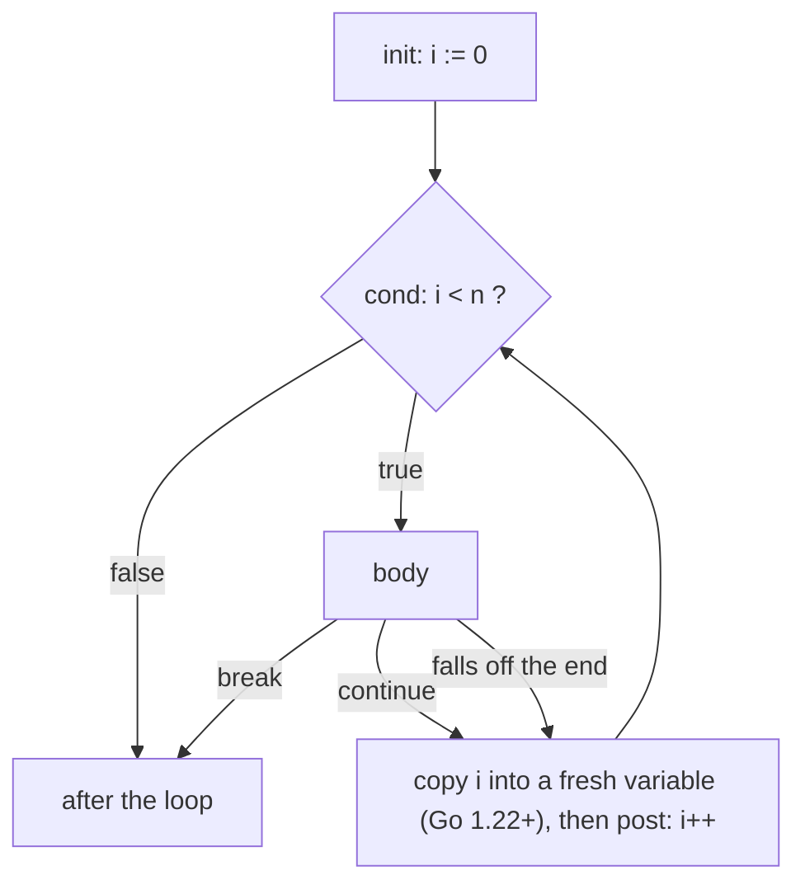
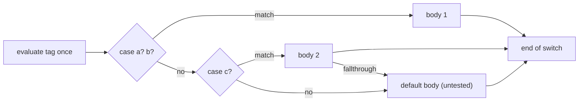

# 04 · Control Flow

> **Level:** Foundation
> **Prerequisites:** [02 Variables & constants](../../02-variables-and-constants/theory/README.md) (blocks, scope and shadowing, §5.6–5.7) · [03 Basic types & operators](../../03-basic-types-and-operators/theory/README.md) (`bool`, comparison and logical operators, short-circuit evaluation, §6.2)
> **Related:** 05 Functions, closures & defer (closures and `defer` in loops) · 06 Arrays & slices · 07 Maps · 08 Strings, bytes & runes (what `range` iterates) · 12 Interfaces (type switches in depth) · 15 Iterators (range-over-func in depth) · 18 Errors (the `if err != nil` flow) · 23 Channels & select (`range` over channels, `select`) · 26 Context (cancelling long loops)
> **Go version:** go1.27.1 (darwin/arm64) · per-iteration loop variables and range-over-int need a module with `go 1.22` or later; range-over-func needs `go 1.23`
> **Targets stuck patterns:** none recorded yet (no diagnostic). Likely targets: bugs that "feel random" from `break` inside `switch`/`select`, range copies and loop-variable capture (hypothesis 3, missing mental models), and Java/Python control-flow habits such as arrow code, flag variables and do-while emulation (hypothesis 4)
> **Started:** 2026-11-04 · **Status:** 📖 In progress
>
> **Syllabus items covered:** 5 (`if` with init, `for` in all its forms, `range` including range-over-int, `switch`, `fallthrough`, `break`/`continue`, labels, `goto`). Type switches get a first look here (home: 12). Range-over-func gets a recap (home: 15). `range` over channels and the `select` statement get a recap (home: 23). Scope and shadowing are recapped from 02.
> **Run the code:** `cd topics/04-control-flow && make examples` · exercises in [`exercises/`](../exercises/README.md)

---

## 1. TL;DR

- **Go has one loop keyword, `for`, with three shapes:** `for init; cond; post {}` (C-style), `for cond {}` ("while") and `for {}` (infinite). `for … range` iterates over integers (Go 1.22), slices, arrays, strings, maps, channels and iterator functions (Go 1.23). There's no `while`, no `do … while`, and no parentheses around conditions. The braces are mandatory.
- **`if`, `switch` and `for` take an optional init statement** (`if v, err := f(); err != nil {}`). Its variables are scoped to the statement, including every `else` branch. Idiomatic Go handles errors and edge cases first and **returns early**, so the happy path stays at the left margin.
- **`switch` is Go's workhorse:** no `break` needed (cases don't fall through), several values per case, any comparable type, and a tagless `switch {}` that replaces if/else-if ladders. Cases are tried top to bottom and the first match wins. `fallthrough` runs the next case's body **without testing its condition**.
- **Since Go 1.22 each loop iteration has its own variable**, so closures and `&v` taken in a loop behave as you'd expect. The `go` line in `go.mod` decides which semantics a module gets. `range` evaluates its expression **once**, gives you **copies** of the elements and **copies an array** before iterating.
- **`break` leaves the innermost `for`, `switch` or `select`.** Inside a `switch` or `select` in a loop, an unlabeled `break` doesn't leave the loop. That's the most common control-flow bug in Go code. Use a label (`break loop`) or `return`.
- **Habits to drop:** arrow-shaped nested ifs with `else` after `return`, flag variables to escape nested loops, `for true`/do-while emulation, `for i := 0; i < len(xs); i++` where `range` says it better, and expecting a ternary or exceptions to shape the flow.

## 2. Why It Exists

### The problems Go's design solves here

**One way to loop.** C, Java and JavaScript have `for`, `while` and `do … while`. Python has `for` and `while`, plus `else` clauses on both. Go folds them into one keyword with optional parts: drop the init and post and `for` is a while loop, drop the condition too and it's an infinite loop. There's less to learn, fewer ways to write the same loop, and reviewers only have to read one construct. The cost is small: a do-while becomes `for { …; if !cond { break } }`, which is rare in practice.

**Conditions must be honest booleans.** In C, `if (x = 0)` compiles and assigns. In Python, `if items:` tests emptiness. In Go a condition must be a `bool` expression (03 §7.13), the parentheses are gone and the braces are mandatory. That rules out C's dangling-else bug, Apple's 2014 "goto fail" style bug (an unbraced `if` followed by two statements), and assignments mistaken for comparisons.

**Scoped setup with init statements.** Most `if`s in Go check something you just computed: `if err := save(); err != nil`. The init statement keeps that variable inside the `if` (and its `else` branches), so it can't leak into the rest of the function and be misused later. Java has nothing like it for `if` (only `for` and try-with-resources). Python 3.8's walrus operator (`:=`) is similar, but its variable leaks into the enclosing scope.

**A `switch` without C's mistakes.** C's `switch` falls through by default, and forgetting a `break` is a classic bug. It also only works on integers. Go flips the default: each case ends the switch, and falling through has to be written explicitly with `fallthrough`. Cases can be any expression, can list several values, and the tag can be omitted entirely. That makes `switch` the idiomatic replacement for long if/else-if chains (Effective Go, *Switch*). Java fixed the same problems in Java 14 with arrow-form `switch` expressions, and Python got `match` in 3.10.

**Labels instead of flags; `goto` kept on a short leash.** Breaking out of nested loops is a real need. Go gives `break` and `continue` an optional label (as Java does), so you don't need a `found` flag checked at every level. `goto` exists, mainly for generated code and a few hand-written state machines, but the compiler forbids the dangerous jumps: over a variable declaration, or into a block.

**Fixing the loop variable (Go 1.22).** Before Go 1.22, a three-clause or `range` loop declared **one** variable for the whole loop. A closure or goroutine that captured it saw its *last* value, which was a famous source of production bugs. The Go team tested the change against Google's own codebase, where it surfaced real bugs, mostly in tests that had silently checked only the last case, and then changed the language so that each iteration gets a fresh variable (Go blog, *Fixing For Loops in Go 1.22*). To keep old code working, the change is gated on the `go` line in `go.mod`.

### What Python and Java do instead

| Concern | Python | Java | Go |
|---|---|---|---|
| Loop keywords | `for x in it`, `while cond` | `for(;;)`, enhanced `for (T x : xs)`, `while`, `do … while` | `for` only: three-clause, condition-only, infinite, `range` |
| Counting loop | `for i in range(n)` | `for (int i = 0; i < n; i++)` | `for i := range n` (Go 1.22) or the three-clause form |
| Condition type | Any object, by truthiness | `boolean` | `bool` only, no parentheses, braces required |
| Init in a condition | Walrus `if (n := f()) > 0:` (n leaks) | Only in `for` | `if`, `switch` and `for` all take an init statement, scoped to the statement |
| Multi-way branch | `if/elif`, `match` (3.10) | `switch` (falls through by default; arrow form since 14) | `switch` (no fallthrough by default), tagless `switch`, type `switch` |
| Leaving nested loops | Flag variable, exception or a function + `return` | Labeled `break`/`continue` | Labeled `break`/`continue`, or `return` |
| Loop `else` | `for … else` runs when no `break` happened | None | None: use a labeled break or a function that returns |
| `goto` | None | Reserved word, unusable | Exists, with compile-time restrictions |
| Errors in the flow | `try/except` | `try/catch` | `if err != nil { return … }`: errors are values (18) |
| Ternary | `a if c else b` | `c ? a : b` | None: `if`/`else` |
| Dict/map iteration order | Insertion order (guaranteed since 3.7) | `HashMap`: unspecified; `LinkedHashMap`: insertion | Unspecified, and **deliberately varied** from run to run |
| Loop variable in closures | Late binding: the last value (`lambda: i`) | Must be effectively final | A fresh variable per iteration (Go 1.22+) |

## 3. Mental Model

**Every control-flow statement is a block with a single entry at the top. `break` and `continue` are jumps to the end of a labelled block, and the compiler checks every jump.** A `for` loop is a block that may run many times, and since Go 1.22 each run gets fresh copies of the loop variables.

```
for i := 0; i < 3; i++ { body }        each iteration is its own little scope
┌──────────────────────────────────┐
│ iteration 0:  i₀ = 0   body(i₀)  │──┐ copy i₀ → i₁, then i₁++
├──────────────────────────────────┤  │
│ iteration 1:  i₁ = 1   body(i₁)  │◄─┘──┐ copy i₁ → i₂, then i₂++
├──────────────────────────────────┤     │
│ iteration 2:  i₂ = 2   body(i₂)  │◄────┘
└──────────────────────────────────┘
  break    → jump past the whole box
  continue → jump to "copy, post, test the condition"
```

```
switch tag {               tested top to bottom, left to right
case a, b:   ──► run body, then jump to END (no fallthrough)
case c:      ──► run body; "fallthrough" = jump into the NEXT body, untested
default:     ──► only when nothing else matched, wherever it is written
}  ◄── END: an unlabeled break inside any case lands here, NOT after the loop around it
```

**Where it breaks:**
- **Old modules see one shared loop variable.** If `go.mod` says `go 1.21` or lower, every iteration shares one `i`. The picture above is Go 1.22+ only (§5.3).
- **`range` doesn't re-read its source.** The source is evaluated once, before the first iteration. An array is copied whole and a slice's length is fixed, so changes made during the loop may or may not be seen (§5.4).
- **Maps and channels aren't sequences.** Map order is unspecified, and entries added during the loop may or may not show up. A channel range blocks until the channel is closed (§5.5).
- **Changing `i` inside the body behaves differently per form.** A three-clause loop carries the change into the next iteration. A `range` loop overwrites it (§5.3).

## 4. Core Concepts & Terminology

| Term | Precise meaning (spec wording where possible) | Common confusion |
|---|---|---|
| **Block** | A possibly empty sequence of statements in braces; also *implicit* blocks: each `if`, `for` and `switch` statement, and each `switch`/`select` clause | Thinking scope is per function (as in Python) |
| **Init statement** | A simple statement before the condition or tag of `if`, `switch`, `for`, executed once before it | Its variables vanish after the statement, `else` included |
| **For clause** | `InitStmt; Condition; PostStmt`; any part may be empty | `for ;;` is legal but gofmt writes `for {}` |
| **Range clause** | `for k, v := range x`; `x` is evaluated once; the iteration values are assigned per iteration | Thinking `v` aliases the element: it's a copy |
| **Per-iteration variable** | Since Go 1.22, "Each iteration has its own separate declared variable" (spec, *For statements with for clause*) | Behaviour depends on the module's `go` line |
| **Expression switch** | `switch x { case e1, e2: … }`: the tag is compared with each case expression using `==` | Cases needn't be constants (only duplicate *constant* cases are rejected) |
| **Tagless switch** | `switch { case cond: … }`: the tag defaults to `true` | Same as `switch true` |
| **Type switch** | `switch v := x.(type) { case T: … }` branches on the dynamic type of an interface value | `fallthrough` is not allowed in a type switch (home: 12) |
| **`fallthrough`** | Transfers control to the first statement of the next clause; must be the last statement of a non-final clause | It doesn't evaluate the next case's expression |
| **`break`** | Terminates the innermost `for`, `switch` or `select` in the same function, or the labeled one | Inside a `switch`/`select` in a loop, it doesn't leave the loop |
| **`continue`** | Begins the next iteration of the innermost `for`, or the labeled one; runs the post statement first | A `continue` label must name a `for`, never a `switch` |
| **Label** | An identifier followed by `:` that names a statement; scoped to the function body; must be used | An unused label is a compile error, like an unused variable |
| **`goto`** | Jumps to a label in the same function; may not jump over a variable declaration or into a block | Not a general "jump anywhere" |
| **Terminating statement** | A statement after which control can't fall off: `return`, `goto`, `panic`, an infinite `for` without `break`, an `if`/`else` or `switch` (with `default`) whose every branch terminates… | Why `for {}` at the end of a function needs no `return` after it |

## 5. How It Works Inside

Control flow compiles to **conditional and unconditional jumps between basic blocks** (straight-line runs of instructions). The front end checks the rules (labels used, no jumps over declarations, `fallthrough` placement, terminating statements). The SSA back end then builds a control-flow graph and optimises it: it removes bounds checks it can prove are safe, and turns dense `switch` statements into jump tables (§10).



### 5.1 `if`, `else` and the init statement

`if` takes an optional simple statement, then a `bool` condition. Each `if` is an **implicit block** that encloses the init statement, the condition, the `if` block and every `else` branch. So a variable declared in the init statement is visible in all branches, and nowhere after. Scope and shadowing rules are the ones from [02 §5.6](../../02-variables-and-constants/theory/README.md#56-scope-nested-blocks-resolved-inside-out). Here they're applied to control flow.

```
{                                  ← implicit block of the if statement
    n, err := strconv.Atoi(in)     ← init statement
    if err != nil { … }            ← n, err visible
    else if n < 0 { … }            ← n, err visible
    else { … }                     ← n, err visible
}                                  ← n, err gone
```

**Predict the output** ([`internal/examples/ifs.go`](../internal/examples/ifs.go) · `make example N=if-with-init`):
```go
for _, in := range []string{"42", "-7", "abc"} {
	if n, err := strconv.Atoi(in); err != nil {
		fmt.Fprintf(w, "%q: not a number (%v)\n", in, err)
	} else if n < 0 {
		fmt.Fprintf(w, "%q: negative %d\n", in, n)
	} else {
		fmt.Fprintf(w, "%q: ok, n*2 = %d\n", in, n*2)
	}
	// n and err don't exist here: the if statement is their scope.
}
```
<details><summary>Output</summary>

```
"42": ok, n*2 = 84
"-7": negative -7
"abc": not a number (strconv.Atoi: parsing "abc": invalid syntax)
```
Why: `n` and `err` exist in every branch. The `else` form is idiomatic **here** because no branch returns. When the `if` branch ends in `return`, drop the `else` (§8.1).
</details>

The condition is evaluated with the short-circuit rules from [03 §6.2](../../03-basic-types-and-operators/theory/README.md#62-short-circuit-evaluation), so `if p != nil && p.ok` is a safe guard.

### 5.2 `for`: one keyword, three shapes

```go
for i := 0; i < n; i++ { }   // for clause: init; condition; post
for cond { }                 // condition only: Go's while
for { }                      // no condition: loop until break/return
for k, v := range x { }      // range clause (§5.4, §5.5)
```

Rules: the init statement may be a short variable declaration, but the post statement may not (`i++`, `i, j = i+1, j-1`, or any simple statement that isn't `:=`). There's no comma operator, so two counters use **parallel assignment**. An empty condition means `true`.

**Predict the output** ([`internal/examples/loops.go`](../internal/examples/loops.go) · `make example N=for-forms`):
```go
for i := 0; i < 3; i++ {
	fmt.Fprint(w, i, " ")
}
// …
n, steps := 27, 0
for n != 1 { // while
	if n%2 == 0 { n /= 2 } else { n = 3*n + 1 }
	steps++
}
// …
attempt := 0
for { // infinite
	attempt++
	if attempt == 3 { break }
}
// …
s := []byte("stressed")
for i, j := 0, len(s)-1; i < j; i, j = i+1, j-1 {
	s[i], s[j] = s[j], s[i]
}
```
<details><summary>Output</summary>

```
0 1 2 | three-clause
111 | while: Collatz steps from 27
3 | infinite loop left on attempt 3
desserts | two indexes
```
Why: the same keyword covers all four. The last loop shows the post statement doing a parallel assignment, since `i++, j--` doesn't exist in Go (`++` is a statement, [03 §7.9](../../03-basic-types-and-operators/theory/README.md)).
</details>

### 5.3 Loop variables: one per iteration (Go 1.22+)

The spec (*For statements with for clause*) says: "Each iteration has its own separate declared variable (or variables) [Go 1.22]. The variable used by the first iteration is declared by the init statement. The variable used by each subsequent iteration is declared implicitly before executing the post statement and initialized to the value of the previous iteration's variable at that moment."

So for a three-clause loop the compiler effectively does this:

```go
// for i := 0; i < 3; i++ { body }   becomes, conceptually:
{
	i_outer := 0
	for ; i_outer < 3; {
		i := i_outer        // fresh variable for this iteration
		body                // closures and &i capture THIS i
		i_outer = i         // copy back what the body did to i…
		i_outer++           // …then run the post statement
	}
}
```

The compiler only allocates a separate variable per iteration when it has to, i.e. when something captures it (a closure, `&i`) and it escapes. Otherwise it stays a register, so the change costs nothing in ordinary loops.

**Predict the output** ([`internal/examples/loops.go`](../internal/examples/loops.go) · `make example N=loopvar-per-iteration`):
```go
var prints []func()
var ptrs []*int
for i := 0; i < 3; i++ {
	prints = append(prints, func() { fmt.Fprint(w, i, " ") })
	ptrs = append(ptrs, &i)
}
for _, p := range prints {
	p()
}
fmt.Fprintln(w, "| closures")
fmt.Fprintln(w, *ptrs[0], *ptrs[1], *ptrs[2], "| pointers")
fmt.Fprintln(w, ptrs[0] != ptrs[1], "| different variables")
```
<details><summary>Output</summary>

```
0 1 2 | closures
0 1 2 | pointers
true | different variables
```
Why: each iteration's `i` is a distinct variable, and the `i++` happens to the *next* iteration's copy, so the variable from iteration 0 keeps 0.
</details>

**The same code under Go 1.21 semantics.** In a module whose `go` line is 1.21 or later, a `//go:build go1.N` line sets that file's language version to go1.N (`go help buildconstraint`). [`internal/examples/loopvar_legacy.go`](../internal/examples/loopvar_legacy.go) uses it to show the old behaviour inside this go 1.27 module. A whole module whose `go.mod` says `go 1.21` or lower gets this in every file:

**Predict the output** (`make example N=loopvar-legacy`):
```go
//go:build go1.21
// …
var prints []func()
for i := 0; i < 3; i++ {
	prints = append(prints, func() { fmt.Fprint(w, i, " ") })
}
for _, p := range prints {
	p()
}
// …
var ptrs []*int
for _, v := range []int{10, 20, 30} {
	ptrs = append(ptrs, &v)
}
fmt.Fprintln(w, *ptrs[0], *ptrs[1], *ptrs[2], "| pointers (Go 1.21 semantics)")
```
<details><summary>Output</summary>

```
3 3 3 | closures (Go 1.21 semantics)
30 30 30 | pointers (Go 1.21 semantics)
```
Why: one `i` for the whole loop, and the last `i++` makes it 3 before the loop exits. Every closure reads that single variable after the loop. The same goes for `&v`. This is the bug Go 1.22 removed. You'll still meet it in old code, in modules that haven't raised their `go` line, and in interview questions.
</details>

**Changing the loop variable in the body.** The copy-back rule has a visible consequence. In a three-clause loop the next iteration starts from the body's modified value. A `range` loop assigns the next value from the range, so the body's change is lost:

**Predict the output** ([`internal/examples/loops.go`](../internal/examples/loops.go) · `make example N=loopvar-copy-back`):
```go
for i := 0; i < 10; i++ {
	fmt.Fprint(w, i, " ")
	i += 2 // carried into the next iteration, then i++ runs
}
fmt.Fprintln(w, "| three-clause: the body's change carries over")

for i := range 10 {
	fmt.Fprint(w, i, " ")
	i += 2 // overwritten: the next iteration gets the next value
	_ = i
}
fmt.Fprintln(w, "| range: the body's change is lost")
```
<details><summary>Output</summary>

```
0 3 6 9 | three-clause: the body's change carries over
0 1 2 3 4 5 6 7 8 9 | range: the body's change is lost
```
</details>

### 5.4 `range`: evaluated once, iterating over copies

The spec (*For statements with range clause*): "The range expression x is evaluated before beginning the loop, with one exception: if at most one iteration variable is present and x or len(x) is constant, the range expression is not evaluated." It is evaluated once, and on every iteration, the iteration values are **assigned** (copied) into the iteration variables.

What "evaluated once" means depends on the type, because evaluating `x` copies its **value**:

```
range over…    value copied before the loop           consequence
─────────────  ─────────────────────────────────────  ─────────────────────────────────────────
[N]T array     the whole array (N × sizeof(T) bytes)  writes to arr during the loop are not seen
*[N]T          the pointer                            writes are seen; no copy
[]T slice      the 24-byte header {ptr, len, cap}     len fixed at the start; elements shared,
                                                      so writes to existing elements ARE seen
string         the 16-byte header {ptr, len}          strings are immutable anyway
map            the map handle (a pointer)             live: deletions are seen, additions may be
chan           the channel handle                     receives until the channel is closed
```

```
s := []int{1, 2, 3}; for _, v := range s { s = append(s, v*10) }

range copies the header once:     header_copy {ptr ─┐, len 3, cap 3}
                                                    ▼
                                   [ 1 | 2 | 3 ]          ← iterated: 3 times, no more
append gives s a NEW array:        s {ptr ─┐, len 6, cap 6}
                                           ▼
                                   [ 1 | 2 | 3 | 10 | 20 | 30 ]
```
(Slice headers and `append` growth are topic 06. Here it's enough that `range` takes a snapshot of the length.)

**Predict the output** ([`internal/examples/ranges.go`](../internal/examples/ranges.go) · `make example N=range-evaluated-once`):
```go
s := []int{1, 2, 3}
for _, v := range s {
	s = append(s, v*10) // the loop still runs 3 times
}
fmt.Fprintln(w, s, "| append during range")

arr := [3]int{1, 2, 3}
for i, v := range arr { // ranges over a copy of arr
	if i == 0 { arr[2] = 100 }
	if i == 2 { fmt.Fprintln(w, v, "| array: the copy still has 3") }
}

sl := []int{1, 2, 3}
for i, v := range sl { // copies the slice header, shares the elements
	if i == 0 { sl[2] = 100 }
	if i == 2 { fmt.Fprintln(w, v, "| slice: the shared element is 100") }
}
```
<details><summary>Output</summary>

```
[1 2 3 10 20 30] | append during range
3 | array: the copy still has 3
100 | slice: the shared element is 100
```
Why: no infinite loop, because the length was fixed when the loop started. The array was copied, so the write isn't seen. The slice shares its elements, so the write is seen. To avoid copying a large array, range over `&arr` or `arr[:]`.
</details>

**The iteration value is a copy too.** `v` in `for _, v := range items` is a new variable holding a copy of the element. Modifying it (or its fields, for a struct) changes the copy only:

**Predict the output** ([`internal/examples/ranges.go`](../internal/examples/ranges.go) · `make example N=range-copies-values`):
```go
type item struct {
	name  string
	price int
}
items := []item{{"pen", 100}, {"book", 900}}

for _, it := range items {
	it.price *= 2 // changes the copy only
}
fmt.Fprintln(w, items, "| after doubling the copy")

for i := range items {
	items[i].price *= 2 // changes the element
}
fmt.Fprintln(w, items, "| after doubling through the index")
```
<details><summary>Output</summary>

```
[{pen 100} {book 900}] | after doubling the copy
[{pen 200} {book 1800}] | after doubling through the index
```
Why: assigning a struct copies all its fields (value semantics, topic 09). Write through the index, or keep a slice of pointers if you really need that. For large structs the copy also costs time, which is another reason to range over the index (§10).
</details>

### 5.5 What `range` iterates over

| Range expression | 1st value | 2nd value | Since | Notes |
|---|---|---|---|---|
| integer `n` | `0 … n-1`, typed like `n` | — | Go 1.22 | no iterations if `n <= 0`; untyped constant → `int` |
| array, `*array`, slice | index `int` | element (a copy) | 1.0 | |
| string | **byte offset** of each rune | `rune` | 1.0 | decodes UTF-8; invalid byte → `U+FFFD`, advance 1 byte |
| map | key | value | 1.0 | order unspecified; nil map → 0 iterations |
| channel | element | — | 1.0 | until closed; nil channel → blocks forever |
| `func(yield func() bool)` | — | — | Go 1.23 | iterator functions (topic 15) |
| `func(yield func(V) bool)` / `iter.Seq[V]` | `V` | — | Go 1.23 | |
| `func(yield func(K, V) bool)` / `iter.Seq2[K,V]` | `K` | `V` | Go 1.23 | |

**Integers (Go 1.22).** `for i := range n` replaces `for i := 0; i < n; i++` when you just need to count. `n` is evaluated once.

**Predict the output** ([`internal/examples/ranges.go`](../internal/examples/ranges.go) · `make example N=range-over-int`):
```go
for i := range 3 {
	fmt.Fprint(w, i, " ")
}
fmt.Fprintln(w, "| range 3")

var n uint8 = 2
for i := range n {
	fmt.Fprintf(w, "%d:%T ", i, i)
}
fmt.Fprintln(w, "| i has n's type")

count := 0
for range -5 {
	count++
}
fmt.Fprintln(w, count, "| range -5 runs zero times")

for range 2 {
	fmt.Fprint(w, "hi ")
}
fmt.Fprintln(w, "| no variable at all")
```
<details><summary>Output</summary>

```
0 1 2 | range 3
0:uint8 1:uint8 | i has n's type
0 | range -5 runs zero times
hi hi | no variable at all
```
</details>

**Slices and arrays** ([`make example N=range-over-slice`](../internal/examples/ranges.go)): `for i, v := range s`, `for i := range s` (index only, no copy of the element), `for _, v := range s` (value only).
<details><summary>Output</summary>

```
0=go 1=python 2=java | index and value
0 1 2 | index only
2 6 4 | value only
```
</details>

**Strings** decode UTF-8. The index is where each rune **starts** in bytes, so it skips numbers after multi-byte characters. Indexing `s[i]` gives a **byte**. (A first look at strings is [03 §6.5](../../03-basic-types-and-operators/theory/README.md#65-strings-are-bytes-a-first-look). Full treatment in 08.)

**Predict the output** ([`internal/examples/ranges.go`](../internal/examples/ranges.go) · `make example N=range-over-string`):
```go
s := "héllo"
fmt.Fprintln(w, "len:", len(s))
for i, r := range s {
	fmt.Fprintf(w, "%d:%c ", i, r)
}
fmt.Fprintln(w, "| byte offset : rune")

for i := 0; i < len(s); i++ {
	fmt.Fprintf(w, "%02x ", s[i])
}
fmt.Fprintln(w, "| indexing gives bytes")

bad := "a\xffb"
for i, r := range bad {
	fmt.Fprintf(w, "%d:%U ", i, r)
}
fmt.Fprintln(w, "| invalid UTF-8")
```
<details><summary>Output</summary>

```
len: 6
0:h 1:é 3:l 4:l 5:o | byte offset : rune
68 c3 a9 6c 6c 6f | indexing gives bytes
0:U+0061 1:U+FFFD 2:U+0062 | invalid UTF-8
```
Why: `é` is two bytes (`c3 a9`), so offset 2 never appears. E3's `Find` relies on this: the rune *column* has to be counted separately.
</details>

**Maps.** "The iteration order over maps is not specified and is not guaranteed to be the same from one iteration to the next" (spec). The runtime starts each `range` at a **random** position on purpose, so code can't come to depend on an order (§7.5). For a stable order, collect and sort the keys: `slices.Sorted(maps.Keys(m))` (Go 1.23) does it in one line. Deleting entries during the loop is safe. An entry added during the loop "may be produced during the iteration or may be skipped" (spec). Maps in depth, including the Swiss-table internals since Go 1.24, are topic 07.

**Predict the output** ([`internal/examples/ranges.go`](../internal/examples/ranges.go) · `make example N=range-over-map` and `N=map-delete-during-range`):
```go
stock := map[string]int{"pear": 3, "apple": 5, "fig": 0}
for _, k := range slices.Sorted(maps.Keys(stock)) {
	fmt.Fprintf(w, "%s=%d ", k, stock[k])
}
// …
m := map[int]bool{}
for i := range 10 { m[i] = true }
for k := range m {
	if k%2 == 1 { delete(m, k) }
}
fmt.Fprintln(w, len(m), slices.Sorted(maps.Keys(m)))
```
<details><summary>Output</summary>

```
apple=5 fig=0 pear=3 | sorted keys
```
```
5 [0 2 4 6 8]
```
</details>

**Channels (recap, home: 23).** `for v := range ch` receives until `ch` is **closed** and drained. If nobody closes it, the loop blocks forever: a goroutine leak, or a deadlock if it's the last goroutine. `make example N=range-over-channel` uses a buffered channel filled before the loop, so no goroutine is needed:
<details><summary>Output</summary>

```
a b c | received until closed
```
</details>

**Functions (recap, home: 15).** Since Go 1.23, `range` accepts a function that takes a `yield` callback. The loop body becomes `yield`. A `break` (or `return`) in the body makes `yield` return `false`, and a well-behaved iterator then stops:

**Predict the output** ([`internal/examples/ranges.go`](../internal/examples/ranges.go) · `make example N=range-over-func`):
```go
func countdown(from int) iter.Seq[int] {
	return func(yield func(int) bool) {
		for i := from; i > 0; i-- {
			if !yield(i) {
				return
			}
		}
	}
}

for n := range countdown(5) {
	if n == 2 {
		break
	}
	fmt.Fprint(w, n, " ")
}
```
<details><summary>Output</summary>

```
5 4 3 | break stops the iterator
```
Why: when `n == 2`, `break` makes `yield(2)` return `false`, so `countdown` returns. If an iterator ignores `false` and calls `yield` again, the runtime panics. Topic 15 covers writing iterators, `iter.Pull` and the rules.
</details>

### 5.6 `switch`

```go
switch init; tag {           // both optional
case e1, e2:                 // tag == e1 || tag == e2, tested left to right
	…                        // implicit break at the end of every clause
case e3:
	…
default:                     // at most one; may appear anywhere; runs only if nothing matched
	…
}
```

How it's evaluated (spec, *Expression switches*): the tag is evaluated once. Then "the switch expression … and the case expressions, which need not be constants, are evaluated left-to-right and top-to-bottom; the first one that equals the switch expression triggers execution of the statements of the associated case; the other cases are skipped." Case expressions are evaluated **lazily**, only up to the first match.



**Predict the output** ([`internal/examples/switches.go`](../internal/examples/switches.go) · `make example N=switch-eval-order`):
```go
check := func(name string, v int) int {
	fmt.Fprintf(w, "eval %s ", name)
	return v
}
switch check("tag", 2) {
case check("a", 1), check("b", 2), check("c", 3):
	fmt.Fprintln(w, "-> first case")
case check("d", 2):
	fmt.Fprintln(w, "-> second case")
}
```
<details><summary>Output</summary>

```
eval tag eval a eval b -> first case
```
Why: `c` and `d` are never evaluated. Matching stops at `b`, and the second case also matches but is never reached.
</details>

**Several values per case, `default` anywhere** ([`make example N=switch-basics`](../internal/examples/switches.go)):
```go
switch d {
default:
	fmt.Fprintln(w, d, "-> midweek")
case time.Saturday, time.Sunday:
	fmt.Fprintln(w, d, "-> weekend")
case time.Monday:
	fmt.Fprintln(w, d, "-> start of the week")
}
```
<details><summary>Output</summary>

```
Saturday -> weekend
Wednesday -> midweek
Monday -> start of the week
```
Why: `default` is chosen only after every other case fails, wherever it's written. Put it last anyway, because readers expect it there.
</details>

**Tagless switch: an if/else-if chain, but readable.** `switch { … }` means `switch true { … }`. Each case is a boolean condition, and the first true one wins, so **order matters**:

**Predict the output** ([`internal/examples/switches.go`](../internal/examples/switches.go) · `make example N=switch-tagless`):
```go
switch {
case code >= 500 && code <= 599:
	class = "server error"
case code >= 400:
	class = "client error"
case code >= 300:
	class = "redirect"
case code >= 200:
	class = "success"
default:
	class = "unknown"
}
```
<details><summary>Output</summary>

```
204 success
301 redirect
404 client error
503 server error
99 unknown
```
Why: each case only needs a lower bound because the higher ranges were already taken by earlier cases. Note the bug waiting here: `code` 700 would be "client error", because the first case caps at 599 but the second doesn't. E3's `StatusClass` makes you handle that.
</details>

**Switch with an init statement**, scoped like an `if`'s ([`make example N=switch-with-init`](../internal/examples/switches.go)): `switch n := len("gopher"); { case n > 5: … }` prints `6 letters: long`. Note the `;` before the empty tag.

Rules the compiler enforces: case values must be comparable to the tag (`case "3"` against an `int` tag is a compile error). **Duplicate constant** cases are rejected (`duplicate case 2`). Duplicate non-constant cases are not checked, since they're only known at run time.

### 5.7 `fallthrough` and type switches

`fallthrough` must be the **last statement** of a case. It transfers control into the **next case's body without evaluating that case's expression**. It's not allowed in the final case or in a type switch.

**Predict the output** ([`internal/examples/switches.go`](../internal/examples/switches.go) · `make example N=fallthrough`):
```go
for _, n := range []int{1, 2, 3} {
	fmt.Fprintf(w, "n=%d:", n)
	switch {
	case n == 1:
		fmt.Fprint(w, " one")
		fallthrough
	case n > 100: // not tested when we fall into it
		fmt.Fprint(w, " big?")
	case n == 2:
		fmt.Fprint(w, " two")
	default:
		fmt.Fprint(w, " other")
	}
	fmt.Fprintln(w)
}
```
<details><summary>Output</summary>

```
n=1: one big?
n=2: two
n=3: other
```
Why: `1 > 100` is false, but `fallthrough` never asks. That's why it's rarely the right tool. Several values in one case (`case 1, 2:`) covers most of what C programmers use fall-through for.
</details>

**Type switch (first look, home: 12).** `switch x := v.(type)` branches on the **dynamic type** stored in an interface value. In a case with a single type, `x` has that type. In a case with several types, or in `default`, `x` keeps the interface type. `case nil` matches a nil interface.

**Predict the output** ([`internal/examples/switches.go`](../internal/examples/switches.go) · `make example N=type-switch`):
```go
for _, v := range []any{42, "go", 3.5, nil, []int{1}} {
	switch x := v.(type) {
	case int:
		fmt.Fprintln(w, "int, doubled:", x*2)
	case string:
		fmt.Fprintln(w, "string of length", len(x))
	case float64, float32:
		fmt.Fprintf(w, "a float: %v (x is %T here)\n", x, x)
	case nil:
		fmt.Fprintln(w, "nil interface")
	default:
		fmt.Fprintf(w, "something else: %T\n", x)
	}
}
```
<details><summary>Output</summary>

```
int, doubled: 84
string of length 2
a float: 3.5 (x is float64 here)
nil interface
something else: []int
```
Why: in the `float64, float32` case `x` is still `any`. `%T` prints the dynamic type, but you couldn't do arithmetic on `x` there without a type assertion. Topic 12 explains interface values (a type word and a data word) and when a type switch is a design smell.
</details>

### 5.8 `break`, `continue`, labels and `goto`

- `break` ends the **innermost** `for`, `switch` or `select`. `break L` ends the statement labeled `L`, which must be an enclosing `for`, `switch` or `select`.
- `continue` starts the next iteration of the innermost `for` (running its post statement first). `continue L` does the same for the enclosing **`for`** labeled `L`.
- A label is scoped to the whole function body, doesn't conflict with variable names, and **must be used** (an unused label is a compile error).
- `goto L` jumps to `L` in the same function. It may not jump **over a variable declaration** into its scope, or **into a block** from outside. The compiler rejects both (§7.11).

```
rows:                                   ◄── label names the OUTER for
for r, row := range grid {
    for _, v := range row {
        if v < 0 { continue rows }  ────── next iteration of the outer loop
        if v > 5 { break rows }     ────── jump past the outer loop entirely
    }
}
◄── break rows lands here
```

**Predict the output** ([`internal/examples/jumps.go`](../internal/examples/jumps.go) · `make example N=labeled-break-continue`):
```go
grid := [][]int{
	{1, 2, 3},
	{4, -1, 6},
	{7, 8, 9},
}
rows:
for r, row := range grid {
	for _, v := range row {
		if v < 0 {
			fmt.Fprintf(w, "row %d has a negative, skipped\n", r)
			continue rows
		}
	}
	fmt.Fprintf(w, "row %d is clean\n", r)
}

foundR, foundC := -1, -1
search:
for r, row := range grid {
	for c, v := range row {
		if v > 5 {
			foundR, foundC = r, c
			break search
		}
	}
}
fmt.Fprintf(w, "first value > 5 at [%d][%d]\n", foundR, foundC)
```
<details><summary>Output</summary>

```
row 0 is clean
row 1 has a negative, skipped
row 2 is clean
first value > 5 at [1][2]
```
Why: `continue rows` skipped the "is clean" line for row 1. `break search` stopped at the first hit (6 at `[1][2]`), not at 7, 8 or 9. If the search were its own function, `return r, c, true` would be simpler still (§8.4).
</details>

**`goto`** ([`internal/examples/jumps.go`](../internal/examples/jumps.go) · `make example N=goto`):
```go
input := "ab1c"
i := 0
letters:
if i < len(input) && input[i] >= 'a' && input[i] <= 'z' {
	i++
	goto letters
}
fmt.Fprintf(w, "leading letters: %q, rest: %q\n", input[:i], input[i:])
```
<details><summary>Output</summary>

```
leading letters: "ab", rest: "1c"
```
Why: a backward `goto` plus an `if` is exactly what a `for` loop compiles to. `for i < len(input) && … { i++ }` says the same thing more clearly, so use that. You'll see `goto` in generated code (parsers, `go tool yacc` output) and in a few hand-tuned spots in the standard library and runtime.
</details>

## 6. Worked Examples

Every example in §5–7 lives in [`internal/examples/`](../internal/examples/) and is checked by an Example test, so the outputs above are real. `make examples` lists them all:

| Concept | Example | Section |
|---|---|---|
| `if` with init, scope of the init variable | `if-with-init` | 5.1 |
| The three `for` shapes, two indexes | `for-forms` | 5.2 |
| Per-iteration loop variables (1.22+) vs the old shared one | `loopvar-per-iteration`, `loopvar-legacy` | 5.3 |
| Changing the loop variable in the body | `loopvar-copy-back` | 5.3 |
| `range` evaluates once, copies arrays and elements | `range-evaluated-once`, `range-copies-values` | 5.4 |
| Range over int, slice, string, map, channel, func | `range-over-int`, `range-over-slice`, `range-over-string`, `range-over-map`, `map-delete-during-range`, `range-over-channel`, `range-over-func` | 5.5 |
| `switch`: values, tagless, init, evaluation order | `switch-basics`, `switch-tagless`, `switch-with-init`, `switch-eval-order` | 5.6 |
| `fallthrough`, type switch | `fallthrough`, `type-switch` | 5.7 |
| Labels, `goto` | `labeled-break-continue`, `goto` | 5.8 |
| Guard clauses | `guard-clauses` | 6.1 |
| The read loop | `read-loop` | 6.2 |
| `break` inside `switch` | `break-in-switch` | 7.1 |

### 6.1 Guard clauses: the shape of a Go function

Go code reads top to bottom: **check a failure case, handle it, return.** Repeat until only the happy path is left, and run it at the left margin. The error-handling form of this (`if err != nil { return …, err }`) is the most common `if` in Go. Errors in depth are topic 18.

**Predict the output** ([`internal/examples/ifs.go`](../internal/examples/ifs.go) · `make example N=guard-clauses`):
```go
func describeAge(s string) string {
	if s == "" {
		return "missing"
	}
	age, err := strconv.Atoi(s)
	if err != nil {
		return "not a number"
	}
	if age < 0 || age > 130 {
		return "out of range"
	}
	return "age " + strconv.Itoa(age)
}
```
<details><summary>Output</summary>

```
""     -> missing
"x"    -> not a number
"150"  -> out of range
"30"   -> age 30
```
Why: each guard removes one bad case, so by the last line every remaining input is valid. Note `age, err :=` is a plain statement here, not an `if` init, because `age` is needed after the check. That's the rule of thumb: use the init form only when the variables aren't needed after the `if`.
</details>

### 6.2 The read loop: `for sc.Scan()`

The most common while loop in real Go programs reads input until it runs out. `bufio.Scanner.Scan` returns `false` both at end of input **and** on error, so the error check comes after the loop (files and I/O in depth: topic 32). E5 is built on this loop.

**Predict the output** ([`internal/examples/loops.go`](../internal/examples/loops.go) · `make example N=read-loop`):
```go
input := "# config\nport=8080\n\nhost=localhost\nEND\nignored=true\n"
sc := bufio.NewScanner(strings.NewReader(input))
n := 0
for sc.Scan() {
	line := sc.Text()
	if line == "" || strings.HasPrefix(line, "#") {
		continue
	}
	if line == "END" {
		break
	}
	n++
	fmt.Fprintf(w, "setting %d: %s\n", n, line)
}
if err := sc.Err(); err != nil { // Scan returns false on EOF *and* on error
	fmt.Fprintln(w, "read error:", err)
}
```
<details><summary>Output</summary>

```
setting 1: port=8080
setting 2: host=localhost
```
Why: `continue` skips the comment and the blank line, and `break` stops at `END`, so `ignored=true` is never read. These `break`s sit in an `if`, not a `switch`, so they apply to the loop.
</details>

### 6.3 Choosing the loop form

| You need… | Write | Not |
|---|---|---|
| Every element of a slice/array/string/map | `for i, v := range xs` | `for i := 0; i < len(xs); i++ { v := xs[i] }` |
| To modify elements in place | `for i := range xs { xs[i].f = … }` | `for _, v := range xs { v.f = … }` (modifies a copy) |
| To count n times | `for i := range n` / `for range n` (Go 1.22) | `for i := 0; i < n; i++` (fine, but longer) |
| Unusual steps: backwards, by 2, two indexes | the three-clause form | contortions with `range` |
| Until a condition changes | `for cond { }` | `for true { if !cond { break } }` |
| At least once (do-while) | `for { …; if !cond { break } }` | duplicating the body before a `while` |
| Lines of input | `for sc.Scan() { }` + `sc.Err()` | reading byte by byte |
| Values from a channel until it's closed | `for v := range ch` (23) | `for { v, ok := <-ch; if !ok { break } }` |

## 7. Gotchas

Compile errors below were produced with go1.27.1 in a scratch module (`example.com/gotchas`) and copied from the terminal. Runtime gotchas are examples in this module, or real runs of a scratch program where it says so.

| # | Gotcha | Symptom | Fix |
|---|---|---|---|
| 7.1 | `break` inside `switch`/`select` in a loop | The loop keeps going; with `select`, a busy loop | `break label` or `return` (E2) |
| 7.2 | Loop variable captured before Go 1.22 | Every closure/pointer sees the last value | Raise the module's `go` line to ≥ 1.22 |
| 7.3 | Modifying the range value | The slice is unchanged | Write through the index |
| 7.4 | Range over a big array; changing the source during range | Copies; changes not seen; loop count fixed | Range over a slice or `&arr` |
| 7.5 | Depending on map order | Different output each run; flaky tests | Sort the keys |
| 7.6 | Adding to a map during range | Nondeterministic: new keys may or may not be visited | Collect changes, apply after the loop |
| 7.7 | Treating the string range index as a character count | Wrong columns with non-ASCII text | Count runes separately (E3) |
| 7.8 | Init-statement scope and `err` shadowing | `undefined: n`; or an outer variable that's never set | Declare before the `if` when needed after |
| 7.9 | `fallthrough` expectations | Runs the next body unconditionally; compile errors in final case / type switch | Several values per case |
| 7.10 | `defer` in a loop | Resources held until the function returns | Move the body into a function (05) |
| 7.11 | `goto` over declarations or into blocks | Compile errors | Use structured control flow |
| 7.12 | Label rules | `label … defined and not used`; `invalid continue label` | Label the `for` you mean |
| 7.13 | C/Java/Python syntax habits | `syntax error: unexpected …` | Go's syntax: no parens, braces on the same line |
| 7.14 | Changing the loop variable in the body | Works in a 3-clause loop, ignored in `range` | Don't; use a while loop if the step varies |
| 7.15 | Switch case types and duplicates | `cannot convert`; `duplicate case` | Match the tag's type |

### 7.1 `break` inside `switch` or `select` doesn't leave the loop

**Reproduction** ([`internal/examples/switches.go`](../internal/examples/switches.go) · `make example N=break-in-switch`):
```go
tokens := []string{"a", "b", "STOP", "c"}
for _, t := range tokens {
	switch t {
	case "STOP":
		break // leaves the switch only
	}
	fmt.Fprint(w, t, " ")
}
// …
loop:
for _, t := range tokens {
	switch t {
	case "STOP":
		break loop
	}
	fmt.Fprint(w, t, " ")
}
```
```
a b STOP c | unlabeled break: the loop kept going
a b | break loop: stopped at STOP
```
**Why:** `break` applies to the innermost `for`, `switch` **or `select`**, and here that's the `switch`. Java behaves the same way, but people coming from Java rarely meet it because they don't put `switch`es in loops as often. In Go, `switch` replaces if/else chains, so it happens all the time.

**With `select` it's worse.** The usual worker loop is `for { select { … } }`. A `break` meant to stop the worker just ends the `select`, and the loop goes around again. If the case that "broke" is a closed channel, it's ready immediately every time, so the goroutine spins at 100% CPU. A real run of a scratch program (`select` is topic 23):
```go
for {
	select {
	case <-done: // done was closed 10 ms in
		breaks++
		break // leaves the select, not the for
	case <-deadline: // 50 ms in
		fmt.Println("still looping 40ms after done was closed; break ran", breaks, "times")
		return
	}
}
```
```
still looping 40ms after done was closed; break ran 598242 times
```
**Fix:** `return` if the function is done, otherwise label the loop and `break loop`. **Tooling:** `go vet` says nothing, but staticcheck (also in golangci-lint's default set) reports `SA4011: ineffective break statement. Did you mean to break out of the outer loop?` when the `break` is the last statement of the case. Run `make lint` (01 covers the toolchain). E2 is this bug in a parser.

### 7.2 Loop variables captured before Go 1.22

See §5.3: under Go 1.21 semantics, `make example N=loopvar-legacy` prints `3 3 3` and `30 30 30`. The classic production versions are goroutines started in a loop (`go func() { use(v) }()`) all handling the last element, `&v` stored in a slice or map, and `t.Run` subtests with `t.Parallel()` all testing the last case. **What decides the semantics is the `go` line of the module that contains the code, not the toolchain.** An old library compiled with Go 1.27 still gets the old semantics if its `go.mod` says `go 1.20`. A real run of a scratch module with that closure loop: with `go 1.21` in `go.mod`, `go run .` prints `333`. After changing the line to `go 1.22`, it prints `012`, and building with `-gcflags=-d=loopvar=2` lists every loop the change affects:
```
$ go build -gcflags=-d=loopvar=2 .
./main.go:7:6: loop variable i now per-iteration, stack-allocated
```
**Fix:** raise the `go` line to 1.22 or later, review the loops that diagnostic lists, and run the tests. In code you can't upgrade, the old fix was to copy the variable: `v := v` inside the loop. You'll still see that line in older codebases. It's redundant (but harmless) from Go 1.22 on.

### 7.3 Modifying the range value modifies a copy

See §5.4 (`make example N=range-copies-values`): `it.price *= 2` leaves the slice unchanged. **Why:** `v` is a separate variable, assigned a copy of each element. Since Go 1.22 it's even a separate variable per iteration. **Fix:** `items[i].price *= 2`, using `for i := range items`. Neither `go vet` nor golangci-lint's default linters flag this (checked with golangci-lint 2.14 on a scratch copy of the example), so you have to know the rule.

### 7.4 What `range` evaluated before the loop

See §5.4 (`make example N=range-evaluated-once`). Three consequences:
- **Appending during the loop doesn't extend it.** The length was fixed at the start, so there's no infinite loop, but also no processing of the new elements. To process a growing work list (a BFS queue), use `for len(queue) > 0 { item := queue[0]; queue = queue[1:]; … }`.
- **Ranging over an array copies it**, and writes made during the loop aren't seen. For a large array (`[1 << 16]byte`), the copy also costs time and stack space. Range over `arr[:]` or `&arr`.
- **Slice elements are shared,** so writes to elements not yet reached *are* seen. Reasoning about that is fragile. Don't write to elements ahead of the loop.

### 7.5 Map iteration order is deliberately random

A real run of a scratch program, three times in a row:
```go
m := map[string]int{"a": 1, "b": 2, "c": 3, "d": 4}
for k := range m {
	fmt.Print(k, " ")
}
```
```
a b c d
c d a b
b c d a
```
**Why:** the spec leaves the order unspecified, and the runtime picks a random starting point for each `range`, so tests that accidentally depend on an order fail early instead of after a Go upgrade. **Fix:** `for _, k := range slices.Sorted(maps.Keys(m))` (Go 1.23) whenever order is visible in output: logs, JSON arrays, error messages, golden files, SQL built from a map. In tests, compare maps with `maps.Equal` or sort first. Example tests use `// Unordered output:` (01).

### 7.6 Adding to a map while ranging over it

Deleting during `range` is safe and well defined (§5.5). **Adding** is not deterministic: "that entry may be produced during the iteration or may be skipped. The choice may vary for each entry created and from one iteration to the next" (spec). A loop like `for k, v := range m { m[k+"_copy"] = v }` may visit some copies and copy them again, a different number each run. **Fix:** collect the additions in a second map and merge after the loop (`maps.Copy(m, additions)`).

### 7.7 The string range index is a byte offset

See §5.5 (`make example N=range-over-string`): in `"héllo"` the indexes are `0 1 3 4 5`. Using the index as a column, cursor position or character count is wrong for any non-ASCII text, including names, addresses and emoji. **Fix:** count runes yourself (`col++` per iteration, as in E3's `Find`), or use `utf8.RuneCountInString`. Full treatment in 08.

### 7.8 Init-statement scope and shadowing `err`

The variables of an `if` init statement don't exist after the `if`:
```go
if n, err := strconv.Atoi("42"); err != nil {
	println("bad")
}
println(n)
```
```
./main.go:6:5: declared and not used: n
./main.go:9:10: undefined: n
```
The opposite bug compiles fine. An init statement with `:=` declares **new** variables that shadow outer ones, so an outer variable you meant to set stays at its zero value:
```go
var cfg Config
if cfg, err := load(); err != nil { // NEW cfg and err, scoped to the if
	return err
}
use(cfg) // the outer cfg: still the zero Config
```
**Why:** `:=` always declares at least one new variable in the **current** scope, and the `if` is a new scope ([02 §5.7](../../02-variables-and-constants/theory/README.md#57--redeclaration-vs-shadowing), [02 §7.1](../../02-variables-and-constants/theory/README.md#71--in-an-inner-block-shadows-the-outer-variable)). The compiler rejects this exact snippet (`declared and not used: cfg`), but only because the inner `cfg` is never read. Add a log line that uses it and it compiles. **Fix:** when you need the value after the `if`, write `cfg, err := load()` as its own statement, then `if err != nil { … }`.

### 7.9 `fallthrough` doesn't test the next case

See §5.7: `n == 1` falls into `case n > 100` and prints `big?`. Two placements are compile errors:
```go
switch x := 1; x {
case 1:
	println("one")
case 2:
	println("two")
	fallthrough // in the final case
}
```
```
./main.go:9:3: cannot fallthrough final case in switch
```
```go
switch v.(type) {
case int:
	fallthrough
case string:
}
```
```
./main.go:7:3: cannot fallthrough in type switch
```
**Fix:** to run the same code for several values, list them in one case (`case 1, 2:`). To share *part* of a body, call a helper function.

### 7.10 `defer` in a loop runs at function end, not at iteration end

Recap (`defer` is topic 05). `defer` schedules a call for when the **function** returns. In a loop, every iteration adds one more pending call. A real run:
```go
for i := range 3 {
	defer fmt.Println("deferred", i)
	fmt.Println("iteration", i)
}
fmt.Println("loop done")
```
```
iteration 0
iteration 1
iteration 2
loop done
deferred 2
deferred 1
deferred 0
```
In production this shape is `for _, path := range paths { f, _ := os.Open(path); defer f.Close(); … }`, which keeps every file open until the function ends and runs out of file descriptors on a large directory. **Fix:** move the loop body into a function, so each `defer` runs when that call returns. Full treatment in 05.

### 7.11 `goto` can't jump over declarations or into blocks

```go
goto done
msg := "hello"
fmt.Println(msg)
done:
	fmt.Println("done")
```
```
./main.go:6:7: goto done jumps over declaration of msg at ./main.go:7:6
```
```go
goto inside
{
inside:
	println("in")
}
```
```
./main.go:4:7: goto inside jumps into block starting at ./main.go:5:2
```
**Why:** jumping over a declaration would leave `msg` in scope at `done` but never initialised, and jumping into a block skips its setup. Go guarantees that every variable in scope has been initialised (02 §5.1). **Fix:** use structured control flow (`if`, `for`, a function). If you really need `goto`, declare variables before the first `goto`.

### 7.12 Label rules

```go
outer:
	for i := 0; i < 3; i++ {
		_ = i
	}
```
```
./main.go:4:1: label outer defined and not used
```
```go
sw:
	switch x := 1; x {
	case 1:
		for i := 0; i < 3; i++ {
			continue sw
		}
	}
```
```
./main.go:8:13: invalid continue label sw
```
And `break` outside any `for`/`switch`/`select`: `break is not in a loop, switch, or select`. **Why:** labels follow the same "everything declared is used" rule as variables, and `continue` only makes sense for a loop. **Fix:** label the `for` itself, on the line right before it. By convention the label is lowercase (`outer`, `loop`, `rows`) and placed at the left margin; gofmt outdents it one level.

### 7.13 Syntax habits from C, Java and Python

```go
while i < 3 {        // ./main.go:5:8: syntax error: unexpected name i at end of statement
if (x > 0) println("pos")   // ./main.go:5:13: syntax error: unexpected name println, expected {
for i := 0, j := 10; i < j; i++, j-- {   // ./main.go:4:16: syntax error: unexpected :=, expected {
if x > 0             // ./main.go:5:10: syntax error: unexpected newline, expected { after if clause
{
```
**Why:** there's no `while` keyword, braces are mandatory (parentheses are optional, and gofmt removes them), there's no comma operator (use parallel assignment: `i, j := 0, 10` and `i, j = i+1, j-1`), and automatic semicolon insertion ends the line after `x > 0`, so the `{` must go on the same line (01).

### 7.14 Changing the loop variable in the body

See §5.3 (`make example N=loopvar-copy-back`): in a three-clause loop `i += 2` skips ahead (`0 3 6 9`). In a `range` loop it does nothing (`0 … 9`). Code that skips elements by bumping `i` (for example to skip a quoted section while parsing) silently stops working when someone "modernises" it to `range`. **Fix:** make the variable step explicit with a condition-only loop: `for i < len(s) { …; i += width }`.

### 7.15 Switch case types and duplicates

```go
x := 3
switch x {
case "3":
}
```
```
./main.go:6:7: cannot convert "3" (untyped string constant) to type int
```
```go
switch x := 1; x {
case 1, 2:
case 2:
}
```
```
./main.go:6:7: duplicate case 2 (constant of type int) in expression switch
	./main.go:5:10: previous case
```
**Why:** each case is compared with `==`, so it must be comparable with the tag, and a duplicated constant case would be dead code. Duplicates among **non-constant** cases aren't detected: the first one wins.

## 8. Idiomatic vs Non-Idiomatic

| ❌ Non-idiomatic | ✅ Idiomatic | Why (source) |
|---|---|---|
| `if ok { … return x } else { … }` | `if ok { … return x }` then the rest, outdented | Go Code Review Comments, *Indent Error Flow*; Effective Go, *If* |
| Arrow code: nested `if`s for each precondition | Guard clauses that return early | Effective Go, *If*: "the code reads well if the successful flow of control runs down the page" |
| `if x == a {} else if x == b {} else if …` | `switch x { case a: … case b: … }` | Effective Go, *Switch*: "It's therefore possible—and idiomatic—to write an if-else-if-else chain as a switch" |
| `for i := 0; i < len(xs); i++ { x := xs[i] }` | `for i, x := range xs` | Effective Go, *For* |
| `for i := 0; i < n; i++` just to count | `for i := range n` / `for range n` | Go 1.22 release notes (range over int) |
| `found := false` + `break` + `if found { break }` at every level | `return`, or a labeled `break`/`continue` | Effective Go, *For* (labeled break, continue); commonly recommended |
| `for true {}`, `for ;; {}` | `for {}` | gofmt simplifies `for ;; {}`; spec: an absent condition is `true` |
| `if done == true` | `if done` | Go Code Review Comments; staticcheck S1002 |
| `case 1: …; fallthrough; case 2: …` to share a body | `case 1, 2:` | Effective Go, *Switch* |
| `goto` for loops and retries | `for`, functions | Commonly recommended; the spec allows it, style guides discourage it |

### 8.1 Indent error flow: no `else` after `return`

```go
// ❌ the happy path is nested and the reader has to match up braces
func parsePort(s string) (int, error) {
	if s != "" {
		p, err := strconv.Atoi(s)
		if err == nil {
			if p > 0 && p < 65536 {
				return p, nil
			} else {
				return 0, fmt.Errorf("port %d out of range", p)
			}
		} else {
			return 0, fmt.Errorf("bad port %q: %w", s, err)
		}
	} else {
		return 0, errors.New("empty port")
	}
}

// ✅ each failure is handled where it's detected; the success is the last line
func parsePort(s string) (int, error) {
	if s == "" {
		return 0, errors.New("empty port")
	}
	p, err := strconv.Atoi(s)
	if err != nil {
		return 0, fmt.Errorf("bad port %q: %w", s, err)
	}
	if p <= 0 || p >= 65536 {
		return 0, fmt.Errorf("port %d out of range", p)
	}
	return p, nil
}
```
Go Code Review Comments (*Indent Error Flow*): "Try to keep the normal code path at a minimal indentation, and indent the error handling, dealing with it first." Effective Go's *If* section says the same: when an `if` body ends in `break`, `continue`, `goto` or `return`, the unnecessary `else` is omitted. Each guard pairs a condition with its error message, so a reviewer can check them one at a time. E4's `Quote` is the full exercise.

### 8.2 `switch` instead of if/else-if ladders

```go
// ❌
if p.Country == "IN" {
	base = 500
} else if p.Country == "US" || p.Country == "CA" {
	base = 1500
} else if p.Country == "DE" || p.Country == "FR" || p.Country == "NL" {
	base = 1200
} else {
	return 0, fmt.Errorf("unsupported country %q", p.Country)
}

// ✅ the subject is named once; each case is a row of a table
switch p.Country {
case "IN":
	base = 500
case "US", "CA":
	base = 1500
case "DE", "FR", "NL":
	base = 1200
default:
	return 0, fmt.Errorf("unsupported country %q", p.Country)
}
```
For conditions on different variables, use a tagless `switch { case …: }`. Keep plain `if/else` for one or two branches: a `switch` with one case is noise.

### 8.3 Leave nested loops with `return` or a label, not a flag

```go
// ❌ the Java/Python habit: a flag checked at every level
found := false
for i := 0; i < len(shipments); i++ {
	for j := 0; j < len(shipments[i]); j++ {
		if isRestricted(shipments[i][j]) {
			found = true
			break
		}
	}
	if found {
		break
	}
}
return found

// ✅ in a function, the answer is the return value
for _, items := range shipments {
	for _, item := range items {
		if isRestricted(item) {
			return true
		}
	}
}
return false
```
When code after the loops still has to run, use a labeled `break` (§5.8). Extracting the search into its own small function is often clearer than either.

### 8.4 Loop forms: say what you mean

```go
// ❌ C-style index loop where nothing needs the index arithmetic
for i := 0; i < len(users); i++ {
	u := users[i]
	notify(u)
}
// ❌ do-while emulation (from Java) with a constant condition
for true {
	delays = append(delays, d)
	if len(delays) == n {
		break
	}
	d *= 2
}

// ✅
for _, u := range users {
	notify(u)
}
for range n {
	delays = append(delays, d)
	d = min(d*2, limit)
}
```
`range` removes off-by-one mistakes and states the intent ("every user"). A known iteration count belongs in the loop header, not in a `break` buried in the body.

### 8.5 `goto`

The spec allows `goto` and the standard library uses it in a few hand-tuned places (some `math` functions, for example) and in generated code. In application code, a reviewer will ask you to replace it with a loop, a `switch` or a function. The one widely accepted use, jumping forward to shared cleanup (as in C), is covered by `defer` in Go (05).

## 9. Coming from Python / Java

| Concept | Python (FastAPI) | Java (Spring Boot) | Go | What doesn't translate |
|---|---|---|---|---|
| Counting loop | `for i in range(n):` | `for (int i = 0; i < n; i++)` | `for i := range n` / three-clause | Python's `range(start, stop, step)` → three-clause form |
| For-each | `for x in xs:` | `for (var x : xs)` | `for _, x := range xs` | `x` is a copy, as in Java for primitives, but also for structs |
| Index + value | `for i, x in enumerate(xs):` | index loop | `for i, x := range xs` | — |
| While | `while cond:` | `while (cond)` | `for cond {}` | No `while` keyword |
| Do-while | — | `do { } while (cond);` | `for { …; if !cond { break } }` | — |
| Loop `else` | `for … else:` (no `break` happened) | — | labeled break or `return` from a helper | No equivalent |
| Dict iteration | insertion order | `HashMap`: unspecified | unspecified, randomised | Sort keys for stable output |
| Multi-way branch | `if/elif`, `match` | `switch` / switch expressions | `switch`, tagless `switch` | `switch` is a statement, not an expression: assign in each case |
| Pattern matching | `match` with destructuring | `switch` patterns (21+) | type switch only (12) | No destructuring |
| Fall-through | — | default in classic `switch` | only with `fallthrough` | Don't need `break` in cases |
| Leaving nested loops | flag or exception | `break label` | `break label`, `continue label`, `return` | Same as Java |
| Generators | `yield` | `Iterator`, `Stream` | range-over-func iterators (15) | Push iterators; `break` stops them |
| Exceptions as control flow | `try/except StopIteration` | `try/catch` | `if err != nil { return … }` (18) | No exceptions; `panic` is not control flow |
| Ternary | `a if c else b` | `c ? a : b` | `if`/`else` | None |
| Closures in loops | late binding: `lambda: i` sees the last `i` | effectively-final copy | fresh variable per iteration (1.22+) | Python's classic late-binding bug doesn't happen in Go 1.22+ |

**Habits to unlearn here (AGENTS §1.1):**
- **Exceptions shaping the flow** → errors are values, handled where they occur with guard clauses (§6.1, §8.1). There's no `finally`; `defer` is the cleanup (05).
- **Arrow code from "single exit point" rules** (common in older Java style guides) → many early `return`s are idiomatic in Go.
- **Streams / comprehensions** (`[x*2 for x in xs if x > 0]`, `xs.stream().filter().map()`) → a plain `for` loop with an `if` is the idiomatic, allocation-transparent version. Use `slices`/`maps` helpers where they read better (06, 07).
- **Flag variables and `while True:` with `break`** → put the condition in the `for` header, and use labels or `return`.

## 10. Production Lens

- **Bounds checks and `range`.** Every `xs[i]` needs a bounds check unless the compiler proves `i` is in range. Both `range` and the textbook `i < len(xs)` loop are proven safe; an arbitrary bound isn't. Real output from a scratch package:
  ```go
  func SumRange(xs []int) int { total := 0; for _, x := range xs { total += x }; return total }
  func SumIndex(xs []int) int { total := 0; for i := 0; i < len(xs); i++ { total += xs[i] }; return total }
  func SumN(xs []int, n int) int { total := 0; for i := 0; i < n; i++ { total += xs[i] }; return total } // line 22
  ```
  ```
  $ go build -gcflags='-d=ssa/check_bce/debug=1' ./bce
  bce/bce.go:22:14: Found IsInBounds
  ```
  Only `SumN` keeps a check. So choose `range` for **clarity**, not speed: the compiler already handles the obvious index loop. Profiling and performance in depth: topic 29.
- **How `switch` compiles.** Real `GOARCH=amd64 go build -gcflags=-S` output from go1.27.1 shows three strategies: a dense switch whose cases only return constants became a **lookup table** (`CMPQ AX, $6; JHI …; LEAQ …stmp_0(SB), CX` then a load); a dense switch with real bodies became a **jump table** (`LEAQ …Do.jump3(SB), CX; JMP (CX)(AX*8)`, added in Go 1.19 for integer and string switches on amd64 and arm64); sparse cases (`1, 100, 1000, …`) became a **binary search** of compares (`CMPQ AX, $100` first). So a long `switch` isn't a linear scan you need to hand-optimise. Order cases for readability. Order matters for *correctness* only in tagless switches, where conditions can overlap.
- **Range value copies cost time.** `for _, v := range bigStructs` copies every element. For large elements in hot loops, use `for i := range xs` and `xs[i]`. Measure before changing (19 benchmarks, 29).
- **Loops in services must be stoppable.** Long-running loops (pollers, workers, retry loops) need an exit: check `ctx.Done()` in a `select` or `ctx.Err()` at the top of each iteration, and never `time.Sleep` in a loop you might need to cancel (26, 27). Retry loops need **backoff with jitter** and an attempt limit (42). A bare `continue` after an error is a hot loop that hammers the dependency that's already failing.
- **Bounded input loops.** `bufio.Scanner` refuses lines over 64 KiB (`bufio.ErrTooLong`) by default; raise it with `sc.Buffer` or switch to `bufio.Reader` for untrusted input (32). Always check `sc.Err()` after the loop (E5 tests it).
- **Testing.** Table-driven tests are themselves a `range` loop over cases. Since Go 1.22, `t.Run` + `t.Parallel()` inside the loop is safe without the old `tt := tt` line. Test the boundaries of every loop: zero iterations, one, the limit, and the early-exit path.
- **Observability.** In loops, log once per batch or with a count, not once per iteration ("processed 10 000 items, 3 failed"), or logs become the bottleneck and the bill (43).
- **Concurrency.** Goroutines started in a loop are only safe with per-iteration variables (Go 1.22+) **and** a bound on how many run at once (a semaphore or worker pool, 27). `break` in `select` is §7.1's trap.

### Senior review: a billing sync worker

```go
// syncOrders pushes pending orders to billing until it's told to stop.
func syncOrders(db *Store, billing *Client, done chan struct{}) {
	for true {
		select {
		case <-done:
			break
		default:
		}
		orders, err := db.Pending()
		if err != nil {
			log.Println("pending:", err)
			continue
		}
		if len(orders) == 0 {
			time.Sleep(5 * time.Second)
			continue
		}
		for i := 0; i < len(orders); i++ {
			o := orders[i]
			status, err := billing.Push(o)
			if err == nil {
				if status == "ok" {
					o.Synced = true
				} else if status == "duplicate" {
					o.Synced = true
				} else if status == "retry" {
					continue
				} else {
					log.Println("unexpected status", status)
				}
			} else {
				log.Println("push:", err)
				break
			}
			tx := db.Begin()
			defer tx.Rollback()
			tx.Save(o)
			tx.Commit()
		}
	}
}
```
*(`Store`, `Client` and the transaction type are illustrative. Transactions are topic 39.)*

Review comments a senior Go engineer would leave:
1. **The worker can never stop.** `break` inside `select` only leaves the `select` (§7.1), so `done` is ignored. Make it `return`. Better: take a `ctx context.Context` as the first parameter instead of a `done` channel (26), and `return` on `<-ctx.Done()`. staticcheck reports this one as SA4011.
2. **`for true`** → `for {}` (§8.4). In this case the loop should really be driven by a ticker or `ctx`.
3. **Hot loop on errors.** If `db.Pending()` fails (say the database is down), `continue` retries immediately, thousands of times a second, flooding logs and the database. Back off with jitter and cap the delay (42).
4. **`time.Sleep` isn't cancellable.** Shutdown waits up to 5 s. Use `select { case <-ctx.Done(): return; case <-time.After(5 * time.Second): }` or a `time.Ticker` (31).
5. **`defer tx.Rollback()` in a loop** (§7.10). The deferred calls run when `syncOrders` returns, which is never, so every transaction stays open and the connection pool is exhausted after a few batches. Move the body into `func syncOne(ctx, o) error` so each `defer` runs per order.
6. **`o := orders[i]` then `o.Synced = true`** changes a copy (§7.3). It's saved through `tx.Save(o)` here, so it works by accident, but anyone reading `orders[i].Synced` later sees `false`. Use `for _, o := range orders` and be explicit about what's saved.
7. **The status ladder** → `switch status { case "ok", "duplicate": …; case "retry": continue; default: … }` (§8.2). Better still, a typed status (02 enums).
8. **The inner `break` on a push error** silently abandons the rest of the batch with no metric, and the next pass retries immediately. Decide on purpose: skip the order and count failures, or stop the batch and back off. Then log once per batch.
9. **Ignored errors.** `tx.Save` and `tx.Commit` return errors that are dropped (18). An order can be pushed to billing but never marked synced, then pushed again forever. That's why idempotency keys matter (42).
10. **Arrow code.** With `if err != nil { … continue }` first, the happy path drops one level, and with `syncOne` extracted the loop body becomes about five lines.

## 11. Interview Lens

| Question | What a strong answer shows | Red flags |
|---|---|---|
| How do you write a while loop in Go? A do-while? | `for cond {}`; `for { …; if !cond { break } }`; one keyword by design | "Go has no while loops, so you can't" |
| What changed about loop variables in Go 1.22, and what decides which behaviour you get? | Per-iteration variables; closures/`&v`/goroutines capture distinct values; gated by the `go` line in `go.mod`; `v := v` no longer needed | Says it depends on the toolchain version, or is unaware of the change |
| What does `break` do inside a `switch` inside a `for`? Inside a `select`? | Leaves the `switch`/`select` only; labeled `break` or `return`; the busy-loop consequence with a closed channel; SA4011 | Thinks it leaves the loop |
| What does `for _, v := range s { v.X = 1 }` do? | Modifies a copy; use the index; why: assignment copies values | "It updates the slice" |
| Is it safe to delete from a map while ranging over it? To add? | Delete: yes, spec-defined; add: may or may not be visited | "It panics like Java's ConcurrentModificationException" |
| Why does iterating a map give different orders? How do you get a stable one? | Unspecified, randomised on purpose; `slices.Sorted(maps.Keys(m))` | Relies on insertion order |
| What does `for i, r := range "héllo"` produce? | Byte offsets 0 1 3 4 5 and runes; UTF-8 decoding; U+FFFD for bad bytes | Thinks `i` counts characters |
| How does `fallthrough` differ from C's fall-through? | Explicit, unconditional, doesn't test the next case; not in the last case or type switches | Thinks it re-checks the next case |
| When is `goto` acceptable in Go? | Rarely: generated code, tight state machines; compile-time restrictions; `defer` covers cleanup | "Never, it doesn't exist" or uses it for loops |
| Rewrite this nested-if function idiomatically | Guard clauses, early return, no `else` after `return`, a `switch` for multi-way branches | Adds more nesting or a flag variable |

**What separates a senior answer:** tying the language rules to failure modes and tooling, e.g. "a `break` in a `select` turns shutdown into a busy loop, so I return on `ctx.Done()`, and staticcheck's SA4011 runs in CI. Loops in services always have an exit, backoff, and a bound on concurrency."

## 12. Exercises

[`exercises/`](../exercises/README.md) · run from this topic folder (`make` lists every command). Don't open `solutions/` until you've tried.

| # | Exercise | Trains | Command | Status | Score |
|---|---|---|---|---|---|
| E1 | [Predict: loops](../exercises/01-predict-loops/) | Changing the loop variable (three-clause vs range), `break`/`continue` in a `switch`, `fallthrough`, labeled `continue`, array vs slice range, append during range, string offsets, per-iteration closures (§5.3–5.8, §7.1) | `make ex E=01-predict-loops` | ⬜ | – |
| E2 | [Fix the bug: header parser](../exercises/02-fix-header/) | `break` inside a `switch` leaves only the switch (§7.1, §5.8) | `make ex E=02-fix-header` | ⬜ | – |
| E3 | [Implement: loops](../exercises/03-implement-loops/) | Tagless `switch` over ranges, condition-only `for`, labeled `continue`, rune columns vs byte offsets, a loop carrying state (§5.2, §5.5, §5.6, §5.8) | `make ex E=03-implement-loops` | ⬜ | – |
| E4 | [Refactor: Java-style shipping quotes](../exercises/04-refactor-shipping/) | Guard clauses, no `else` after `return`, `switch` instead of a ladder, `range` instead of index loops, `return` instead of flags, no do-while emulation (§8) | `make ex E=04-refactor-shipping` | ⬜ | – |
| E5 | [Mini-project: `logstat`](../exercises/05-project-logstat/) | A log-filter CLI (`cmd/logstat` + `internal/logstat`): `for sc.Scan()`, `continue`, a multi-value `switch`, `break` on a limit, scanner and writer errors | `make ex E=05-project-logstat` | ⬜ | – |

Before asking the tutor to `check En`: `make check E=<folder>` (gofmt + vet + race tests).

Exercise status: ⬜ not started · 🛠️ attempted · ✅ passed + reviewed · 🔁 redo (solved after seeing the full solution)

## 13. Cheat Sheet

1. **One loop keyword:** `for i := 0; i < n; i++`, `for cond`, `for {}`, `for k, v := range x`. No parens, braces required, `{` on the same line.
2. **`range` over:** int (1.22, `0..n-1`), slice/array (index, copy of the element), string (byte offset, rune), map (random order), channel (until closed), func (1.23, iterators).
3. **`range` evaluates its expression once:** the length is fixed, arrays are copied, `v` is a copy, so write through `xs[i]`.
4. **Go 1.22+: a fresh loop variable per iteration** (gated by `go.mod`'s `go` line). Closures and `&v` are safe; `v := v` is obsolete.
5. **Changing `i` in the body:** carries over in a three-clause loop, is lost in `range`.
6. **`if`/`switch`/`for` init statements** scope their variables to the statement and all its branches. Use them only when the value isn't needed afterwards.
7. **Guard clauses + early `return`;** no `else` after `return`; happy path at the left margin.
8. **`switch`:** no `break` needed, `case a, b:`, any comparable type, tagless `switch {}` for if-chains; first match wins; lazy evaluation; `default` anywhere.
9. **`fallthrough` is unconditional** (doesn't test the next case); not in the last case or type switches.
10. **`break` leaves the innermost `for`/`switch`/`select`** → `break label` / `continue label` / `return`. Unused labels don't compile. `goto` can't skip declarations or enter blocks.

## 14. References & Further Reading

- **The Go Programming Language Specification**: *Blocks*, *Terminating statements*, *If statements*, *Switch statements* (*Expression switches*, *Type switches*), *For statements* (*with single condition*, *with for clause*, *with range clause*), *Break statements*, *Continue statements*, *Goto statements*, *Fallthrough statements*, *Labeled statements*: go.dev/ref/spec
- **Effective Go**: *Control structures* (*If*, *Redeclaration and reassignment*, *For*, *Switch*, *Type switch*): go.dev/doc/effective_go
- **Go Code Review Comments**: *Indent Error Flow*: go.dev/wiki/CodeReviewComments
- **Go blog**: David Chase and Russ Cox, *Fixing For Loops in Go 1.22* (2023): go.dev/blog/loopvar-preview · *Range Over Function Types* (2024): go.dev/blog/range-functions
- **Go wiki**: *LoopvarExperiment* (the loop variable change, `-d=loopvar=2`): go.dev/wiki/LoopvarExperiment
- **Release notes**: Go 1.19 (jump tables for large switches): go.dev/doc/go1.19 · Go 1.22 (per-iteration loop variables, range over integers): go.dev/doc/go1.22 · Go 1.23 (range over functions, `iter`, `slices.Sorted`/`maps.Keys`): go.dev/doc/go1.23
- `go help buildconstraint` (per-file language versions) · `go doc bufio.Scanner` · `go doc iter`
- Teiva Harsanyi, **100 Go Mistakes and How to Avoid Them** (Manning, 2022): #2 *Unnecessary nested code*, and chapter 4 *Control structures*: #30 *Ignoring the fact that elements are copied in range loops*, #31 *Ignoring how arguments are evaluated in range loops*, #32 *Ignoring the impact of using pointer elements in range loops*, #33 *Making wrong assumptions during map iterations*, #34 *Ignoring how the break statement works*, #35 *Using defer inside a loop*
- staticcheck checks SA4011 (ineffective break), S1002 (comparison with a boolean constant): staticcheck.dev/docs/checks

---

## 🗣️ Q&A Discussion

Sessions, exercise reviews and stuck entries are logged in [`control-flow-qa.md`](control-flow-qa.md).
